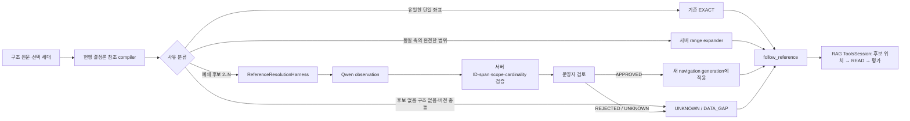

# 명시 참조 해소 하네스 구현 설계

- 문서 상태: 구현 기준 설계안; 2026-09-21 작업 코드 구현 완료, 모델 품질·MAIN·GENOS 미검증
- 기준일: 2026-09-21
- 범위: 구조화 이후 명시 참조 색인에서 범위·약칭·문맥상 애매한 참조를 제한적으로 해소
- 비범위: 실제 구현, 추가 모델 실험, 활성 MAIN 전환, GENOS 배포, 법률 적용 결론 생성

## 1. 의사결정 요약

현재 RAG의 더블하네스 실행 원칙을 재사용한 **`reference-resolution-harness-v1`**을 제안한다.
별도 질의 서버나 자유 생성형 참조 에이전트를 만들지 않는다. 구조화 원문과 선택된 문서 세대에서
서버가 후보·근거·버전을 먼저 고정하고, Qwen은 제공된 후보 ID의 선택 또는 기권만 수행한다.

설계의 핵심 결정은 다음과 같다.

1. 단순한 조·항·호 범위는 LLM을 쓰지 않고 구조 좌표로 펼친다.
2. 문서 약칭·직전 문맥·동일 제목 후보처럼 규칙만으로 하나를 확정하기 어려운 경우만 Qwen에 보낸다.
3. 모델은 `selected_candidate_ids`와 `evidence_ids`만 제안한다. `RESOLVED/MULTI_TARGET`은 서버가
   선택 개수로 계산한다.
4. 모델이 고른 대상은 `MODEL_OBSERVED`이며 곧바로 정본이 아니다. 서버 검증과 명시 검토를 통과한
   `APPROVED`만 새 navigation generation의 `reference.target_source_ids`에 반영한다.
5. 현재 `follow_reference(evidence)` 도구를 유지한다. 미해소 후보는 위치 카드로 보여 줄 수 있지만
   읽기 전에는 인용 근거가 아니며, 미승인 후보를 정본 참조로 따라가지 않는다.
6. 색인 구축의 기본 모드는 계속 `llm_calls=0`이다. 모델 해소는 명시적 reference-review 단계와
   모델 프로필이 있을 때만 실행하며 자동 fallback은 없다.

이 구조는 작업 코드에 구현했다. 다만 ADR-0483의 Qwen 합성 probe는 엄격 기준 8/12로 실패했으므로,
현재 결과만으로 자동 승인이나 MAIN 연결을 설계하지 않는다. 최초 도입 범위는 결정론적 범위 확장과
검토 가능한 Qwen observation 생성까지다.

## 2. 확인한 현재 상태

### 2.1 실행 경로와 배선 상태

작업 코드의 기본 RAG는 다음 경로다.

```text
service.py
  → semantic_runtime.app.create_app
  → POST /v1/rag/ask
  → Pipeline.run
  → 요청별 ToolsSession
  → Coordinator / StageRunner
  → retrieve → select → assemble → answer
  → outbox / run JSON / feedback
```

`legal-agent-tools-v2`에는 이미 다음 보호 장치가 있다.

- 요청·세대·문서 범위에 결속된 불투명 handle
- 읽은 정확 원문만 `E` evidence로 발급
- 모델 view에 실제 전달된 evidence만 평가·초안·검토에 사용
- 물리 모델 시도·repair·retry를 하나의 예산으로 기록
- 단일 전송, 모델 ID 대조, deadline, raw 응답과 usage 보존
- 같은 action ID의 멱등 재사용과 인자 충돌 거부
- `follow_reference(evidence, direction, cursor)` 도구
- 결과 확인 뒤 `RESEARCH/RECOMPOSE/REVIEW/FINAL` 재진입
- source generation·index·glossary·domain·profile 해시 결속

현재 참조는 `term_generation.build_generation` 안에서
`term_index.compile_index → term_references.compile_references`로 생성된다. 이 경로는 명시적으로
모델을 호출하지 않으며, `navigation.sqlite`의 `reference`와 `reference_end`가 RAG와
`/v1/rag/links`의 입력이다.

작업 코드와 실제 선택 릴리스는 다르다. 작업 `PIPELINE.json`의 기본은 `legal-agent-tools-v2`지만,
로컬 활성 포인터는 `document-navigation-rag-20260921-v1`, generation 17이고
`quality_certified=false`다. 이 설계는 어느 쪽도 변경하지 않는다.

### 2.2 현재 색인 관측값

관측 대상은 로컬 선택 데이터
`01_DATA/TERM/relation-subtree-main-serving-20260920-v1/generation/navigation`이다.

| ID | 지표·종류 | 단위/분모 | 값 | 근거·한계 |
|---|---|---:|---:|---|
| O-01 | 전체 명시 참조 행·관측 | reference 행 | 146,994 | navigation manifest와 SQLite 집계 |
| O-02 | `resolution=UNRESOLVED`·관측 | O-01 | 33,636 (22.88%) | 정확도 평가가 아니라 처리 상태 |
| O-03 | provision 대상·관측 | O-01 | 72,352 | target level 집계 |
| O-04 | article 대상·관측 | O-01 | 41,006 | target level 집계 |
| O-05 | navigation SQLite 크기·관측 | 파일 | 14,933,344,256 bytes | 전체 파일 크기이며 reference만의 크기가 아님 |
| O-06 | 문서 수·관측 | 선택 세대 | 159 | navigation manifest |

미해소 사유의 행 수는 다음과 같다.

| 사유 | 완전 미해소 | article까지만 연결 | 제안 처리 |
|---|---:|---:|---|
| `DOCUMENT_MISSING` | 9,853 | 0 | 선택 세대에 대상 문서가 없으므로 `DATA_GAP` |
| `ANNEX_BODY_NOT_IN_SELECTION` | 5,594 | 0 | 별표·서식 원문 보강 전 `DATA_GAP` |
| `PROVISION_NOT_IN_STRUCTURE` | 2,499 | 4,360 | LLM 연결 금지, 구조 수정 후보 |
| `RANGE_OR_SUBARTICLE_UNRESOLVED` | 5,423 | 0 | 범위 mention 재구성 후 결정론 확장 우선 |
| `DOCUMENT_NAME_UNRESOLVED` | 3,472 | 0 | 폐쇄 후보가 생기는 경우만 Qwen 검토 |
| `ARTICLE_MISSING_SELF_OR_AMBIGUOUS` | 6,795 | 0 | 자기 머리·삭제 조문 오탐 분리 후 제한 검토 |

행 수는 독립 사례 수가 아니다. 현재 범위 문구는 양 끝 조문이 별도 reference 행으로 남을 수 있으므로,
모델 작업 단위는 기존 행이 아니라 원문 전체 범위 span을 다시 묶은 `reference_case_id`여야 한다.

### 2.3 기존 계약과 문서 차이

현행 코드에는 항·호·목 해소가 구현되어 있고 provision 계약 테스트가 존재한다. 그러나
`DATA_MODEL.md`에는 아직 “범위·항/호·모호한 참조는 미확인”이라고 적혀 있다. 구현 시 이 문구를
“항/호는 구조가 유일할 때 해소, 범위는 결정론 확장 또는 검토 상태”로 고쳐야 한다.
문서 수정만으로 실제 색인을 바꾸지는 않는다.

## 3. 목표 구조



### 3.1 책임 분리

| 구성요소 | 소유 책임 | 하지 않는 일 |
|---|---|---|
| deterministic scanner | mention span, locator AST, 문서·구조 좌표, 현재 해소 결과 | 문맥상 법률 의미 추정 |
| candidate builder | 같은 선택 세대·요청 범위 안의 폐쇄 후보와 근거 ID 생성 | 없는 문서·조문 생성 |
| range expander | 같은 문서·같은 부모·같은 역할 축의 포함 범위 계산 | 버전 선택, 불연속 의미 추정 |
| reference harness | view·호출 예산·journal·모델 관찰 저장 | 정본 DB 직접 수정 |
| Qwen | 후보 ID 선택 또는 빈 선택과 이유 제안 | ID 생성, 상태 결정, 판본 적용 판단 |
| validator | candidate subset, evidence 가시성, span/hash, scope, 개수 상태 계산 | 의미 정확도 보증 |
| operator review | observation 승인·거절·UNKNOWN 확정 | 원문이나 과거 세대 덮어쓰기 |
| overlay applier | 승인 receipt를 새 index에 transaction 적용 | 활성 pointer 변경 |
| RAG ToolsSession | 정본 참조 또는 미해소 후보 위치를 표시하고 원문 READ | 미승인 후보를 인용 근거로 승격 |

### 3.2 처리 라우팅

| 입력 유형 | 1차 처리 | Qwen 사용 | 최종 상태 |
|---|---|---:|---|
| `제3조부터 제5조까지` | 같은 문서의 조 좌표를 포함 범위로 확장 | 아니오 | 3개면 서버가 `MULTI_TARGET` |
| `제3조제1항부터 제3항까지` | 같은 조·같은 항 역할 축 확인 후 확장 | 아니오 | 구조가 완전할 때만 승인 가능 |
| `제2호부터 제4호까지` | 현재 항과 호 역할 축 확인 | 아니오 | 부모가 유일하지 않으면 UNKNOWN |
| `관련 규정 제8조` | 약칭·직전 명명 문맥으로 후보 생성 | 후보 2개 이상일 때 가능 | 검토 전 MODEL_OBSERVED |
| `동 기준 제4조` | 직전 명시 문서명과 alias 후보 생성 | 필요 시 가능 | 검토 후 APPROVED/UNKNOWN |
| `전항`, `위 조항의 단서` | 현재 unit의 parent/sibling/proviso 구조 사용 | 구조만으로 불충분할 때 가능 | 존재하지 않으면 DATA_GAP |
| 같은 제목의 복수 판본 | `as_of`와 source selection 확인 | 근거 날짜가 없으면 금지 | VERSION_AMBIGUOUS |
| 선택 세대에 문서/별표 없음 | 후보 생성 안 함 | 금지 | DATA_GAP |
| 구조에 없는 제9항 | article fallback을 정답으로 쓰지 않음 | 금지 | STRUCTURE_MISMATCH |

범위는 자연어가 들어간다고 무조건 LLM 문제로 분류하지 않는다. 구조 좌표로 완전하게 계산되는 부분은
코드가 소유해야 모델 변동성과 검토량을 줄일 수 있다.

## 4. 제안 데이터 계약

### 4.1 `reference-case-v1`

```json
{
  "case_id": "refcase:<digest>",
  "binding": {
    "generation_id": "...",
    "source_store_sha256": "...",
    "draft_index_sha256": "...",
    "compiler_sha256": "..."
  },
  "source": {
    "source_id": "article:...",
    "document_id": "...",
    "block_id": "...",
    "start_cp": 10,
    "end_cp": 27,
    "text": "제3조부터 제5조까지",
    "text_sha256": "..."
  },
  "parse": {
    "kind": "RANGE",
    "locator_ast": {},
    "current_reason": "RANGE_OR_SUBARTICLE_UNRESOLVED"
  },
  "evidence": [
    {"id": "E1", "kind": "source_witness", "text": "...", "text_sha256": "..."}
  ],
  "candidates": [
    {
      "id": "T1",
      "target_source_id": "article:...",
      "target_unit_id": "...",
      "target_block_ids": ["..."],
      "basis": "same_document_coordinate"
    }
  ],
  "candidate_set_sha256": "..."
}
```

`case_id`는 generation·source/block·전체 mention span·text hash·compiler hash로 만든다. 현재 reference
행 두 개가 한 범위를 표현하더라도 하나의 case가 된다. 모델에는 실제 DB ID나 경로 대신 case에 결속된
짧은 `E/T` handle만 제공한다.

### 4.2 모델 출력

```json
{
  "cases": [
    {
      "case_id": "refcase:...",
      "selected_candidate_ids": ["T1", "T2"],
      "evidence_ids": ["E1"],
      "abstain_reason": null,
      "explanation": "원문 범위와 동일한 구조 축"
    }
  ]
}
```

모델 출력에는 `RESOLVED`, `MULTI_TARGET`, document ID, source ID, unit ID를 넣지 않는다.
서버는 선택 개수로 상태를 계산한다.

```text
0개 → UNKNOWN
1개 → RESOLVED
2개 이상 → MULTI_TARGET
```

ADR-0483에서 범위 대상 ID 집합은 12/12 맞았지만 복수 상태 라벨을 4건 모두 잘못 냈다. 따라서
cardinality 상태는 모델이 아니라 서버 책임으로 이동한다.

### 4.3 journal과 상태 전이

별도 `reference-review.sqlite`를 사용하되 기존 하네스와 같은 감사 원칙을 적용한다.

```text
DETECTED
  → CANDIDATES_READY | NO_CANDIDATES | DATA_GAP
  → MODEL_PENDING
  → MODEL_OBSERVED | MODEL_FAILED | MODEL_UNKNOWN
  → VALIDATED | INVALID
  → REVIEW_PENDING
  → APPROVED | REJECTED | UNKNOWN
  → APPLIED (새 generation에서만)
```

필수 테이블은 다음과 같다.

| 테이블 | 핵심 필드 |
|---|---|
| `case_record` | case ID, binding hash, source span/hash, parse kind, state |
| `candidate_record` | case ID, T ID, 실제 target 좌표, basis, candidate-set hash |
| `model_view` | exact input JSON, prompt/schema hash, 제시 E/T 목록 |
| `model_attempt` | logical/physical attempt, SENT/UNKNOWN/FAILED/SUCCEEDED, raw response, usage, model |
| `observation` | 선택 T/E, 설명, validator 결과, output hash |
| `review` | observation hash, APPROVE/REJECT/UNKNOWN, reviewer, 이유, 시각 |
| `apply_receipt` | parent index hash, 승인 집합 hash, output index/manifest hash |

모델 호출 중 DB write transaction을 유지하지 않는다. 호출 전에 view·attempt를 저장하고, 응답 후
expected state와 candidate-set hash를 CAS 검사한다. timeout이나 연결 오류는 원격 실행·과금 여부가
불명확하므로 `UNKNOWN`으로 보존한다.

### 4.4 정본 reference 호환성

기존 `reference` JSON 필드는 유지하고 다음 필드를 추가한다. 실제 v4 구현은 복수 target별 extent 유실을
막기 위해 아래 호환 필드와 함께 `reference_target(reference_id, ordinal, source_id, unit_id, unit_path,
block_ids, target_level)`을 정본 조회 표로 사용한다.

```json
{
  "resolution": "EXACT_... | REVIEWED_MODEL_SELECTION | UNRESOLVED",
  "resolution_state": "RESOLVED | MULTI_TARGET | UNKNOWN | DATA_GAP",
  "target_source_ids": [],
  "target_unit_ids": [],
  "resolution_basis": "deterministic | reviewed_model_observation",
  "review_receipt_sha256": null,
  "case_id": "refcase:..."
}
```

`reference_end`에는 source endpoint와 **승인된 target만** 넣는다. 후보 endpoint는 별도
`reference_candidate_end`에 두어 역참조 정본과 섞지 않는다. 기존 소비자는 `target_source_ids`와
`reference_end`를 그대로 읽을 수 있다.

## 5. RAG 하네스 연결

### 5.1 재사용할 것

- `GenosTransport`: 내부 Qwen 모델 결속, `/models` 확인, single-send, 총 deadline
- `ModelGateway`의 호출 예산·raw receipt·schema repair 패턴
- view/presentation 이후 성공 응답에서만 evidence 가시성을 인정하는 규칙
- `ToolsSession`의 handle·cursor·binding·멱등 action 영수증
- `follow_reference`의 outgoing/incoming 방향과 대상 location card
- `READ` 후에만 evidence를 만들고 assessment/claim에 사용할 수 있는 경계

`ModelGateway`는 현재 request `WorkRepository`에 결합되어 있다. 처음부터 코드를 복제하지 말고,
`ReferenceResolutionRepository`가 필요한 attempt/event 인터페이스를 구현하여 같은 gateway와
`GenosTransport`를 쓰는 방식을 우선한다. 공통화를 위해 기존 MAIN gateway를 크게 리팩터링하는 것은
첫 후보 범위에서 제외한다.

### 5.2 `follow_reference` 변경

현재 함수는 `reference`와 `reference_end`를 읽고 target card를 반환한다. 다음만 확장한다.

- 승인된 단일/복수 target: 기존 `targets`로 반환
- 미승인 폐쇄 후보: `candidates`로 반환하며 `content_read=false`, `citation_eligible=false`
- DATA_GAP: candidate 없이 gap kind와 reason 반환
- version ambiguity: 적용일이 없으면 후보를 보여 줄 수 있어도 auto-follow 금지
- witness는 현재처럼 실제 읽은 E span에 포함됐는지 검사
- candidate를 모델이 선택해도 해당 요청에서 정본 reference DB는 수정하지 않음

요청 시 Investigator는 candidate 위치를 `read`하고 일반 evidence assessment로 채택하거나 기각할 수 있다.
이는 답변 한 건의 근거 선택이며 색인 정본 승인과는 별개다.

### 5.3 모델과 반출 경계

실제 내부 문서의 reference review는 GENOS 내부 Qwen만 사용한다.

- `provider=genos`
- `trust_zone=internal`
- `adapter_version=genos-single-send-v1`
- 정확한 model·endpoint identity·max input bytes를 profile에 결속
- 다른 provider/model 자동 fallback 금지
- 키는 profile·journal·보고서에 기록하지 않음

ADR-0483의 OpenRouter Qwen은 합성 입력의 개발 probe일 뿐이며 내부 자료 전송 승인으로 재사용하지 않는다.

## 6. 변경 지도

| 파일·진입점 | 현재 책임 | 제안 변경 | 소비자·호환성 |
|---|---|---|---|
| `semantic_runtime/term_references.py` | 결정론 참조 compile | mention scanner와 resolver 분리, range AST·case ID 생성 | 기존 exact 결과 유지 회귀 필요 |
| `semantic_runtime/term_index.py` | reference 테이블 생성·manifest | 승인 overlay 입력, 새 표·counts·receipt hash | v2/v3 reader 호환 또는 v4 명시 |
| `lawrag/pipeline/term_generation.py` | source+glossary→불변 generation | 명시 reviewed overlay를 identity에 포함 | overlay 없으면 계속 llm_calls=0 |
| 신규 `lawrag/pipeline/reference_resolution.py` | 없음 | prepare/run/inspect/review/apply 계약 | document-release가 명시 호출 |
| 신규 `semantic_runtime/reference_resolution_protocol.py` | 없음 | case/view/output JSON schema와 validator | Qwen 자유 ID 생성 차단 |
| 신규 `semantic_runtime/reference_resolution_repository.py` | 없음 | SQLite journal·CAS·attempt·review receipt | 중단 재개·감사 |
| `legal_agent/exploration_tools.py::follow_reference` | 정본 참조 target 반환 | 후보·gap 상태를 구분해 반환 | 기존 `targets` 유지 |
| `lawrag/pipeline/document_release.py` | glossary 검토 후 serving DRAFT | reference review pending/receipt 결속 | 활성화는 기존 CAS 별도 |
| `06_TOOLS/pipeline.py` | 공통 CLI dispatch | `reference-resolution` 하위 명령 | 새 단독 실행기 증식 방지 |
| `00_SYSTEM/PIPELINE.json` | 단계·엔진 정본 | `authorities.reference_resolution`와 build substage 선언 | 서빙 4노드 외부 계약 불변 |
| 신규 `00_SYSTEM/SCHEMAS/reference-resolution-v1.schema.json` | 없음 | case/output/review/apply receipt 계약 | prompt와 validator 동일 정본 |
| `00_SYSTEM/DATA_MODEL.md` | 데이터 계약 | provision/range/review 상태 현실화 | 과거 generation은 읽기 전용 |
| release/serving bundle 검증 | 파일·해시 결속 | review DB/receipt 또는 적용 receipt 포함 | 과거 release 변경 없음 |

엔진 manifest에 들어간 파일을 수정한 뒤에는 기존 절차로 engine hash를 다시 생성한다. 작업 코드 해시 갱신,
후보 release 생성, 활성 pointer 변경, GENOS 배포는 각각 별도 상태다.

## 7. 구축 실행 시나리오

### 7.1 정상 흐름

| 단계 | 입력·상태 | 호출·판단 | 출력·저장 | 실패 시 |
|---|---|---|---|---|
| 1 구조화 | 선택된 source store | 기존 structure 완료 receipt 검증 | 원문·unit·block | 다음 단계 차단 |
| 2 baseline index | source+reviewed glossary | 현행 deterministic compile | `serving-baseline/generation` | 기존 방식으로 실패 |
| 3 prepare | baseline index+store hash | mention regroup, 후보 생성, ineligible 분류 | case snapshot+journal | 빈 후보는 UNKNOWN/DATA_GAP |
| 4 deterministic range | range AST+structure | 같은 축·부모·연속성 검사 | VALIDATED deterministic observation | 불완전하면 UNKNOWN |
| 5 Qwen run | CANDIDATES_READY case | 고정 batch, schema, budget, no fallback | MODEL_OBSERVED+raw receipts | resume 가능, 자동 승인 안 함 |
| 6 validate | observation+case hash | ID subset·E visibility·scope·cardinality | VALIDATED/INVALID | INVALID는 review 불가 |
| 7 review | validated observation | 운영자 승인·거절·UNKNOWN | completion receipt | 미완료면 release pending |
| 8 final build | source+glossary+review receipt | deterministic 재compile 후 overlay transaction | 새 serving generation | binding drift면 전체 중단 |
| 9 verify | manifest·index·review hash | TermIndex/release 계약 검사 | release receipt | 활성화 불가 |
| 10 activate | 검증 release+expected CURRENT | 기존 명시 CAS/rollback | 새 CURRENT receipt | pointer 충돌 시 중단 |

`document-release build`는 glossary review처럼 reference review가 끝나지 않았으면
`REFERENCE_REVIEW_PENDING`을 반환하고 `release.json`을 만들지 않는다. 새 모델 호출 없이 같은 run ID로
재개할 때는 완료 case를 건너뛰고 hash가 같은 UNKNOWN/실패 상태를 그대로 보여 준다.

### 7.2 중요 반례

**후보 목록이 빠진 경우**  
Qwen이 자유 target을 생성할 수 없으므로 UNKNOWN으로 남는다. candidate recall 문제를 모델 정확도 문제와
분리해 집계한다.

**범위 중간 조문이 구조에 없는 경우**  
양 끝만 연결하지 않는다. 전체 범위를 UNKNOWN 또는 DATA_GAP으로 남기고 누락 좌표를 기록한다.

**동일 문서명의 두 판본이 있는 경우**  
source selection의 적용일·판본 근거가 없으면 Qwen 호출 대상에서 제외한다. 모델의 상식으로 최신 판본을
고르지 않는다.

**모델이 복수 ID를 `RESOLVED`라고 설명하는 경우**  
설명과 무관하게 서버가 ID 개수로 `MULTI_TARGET`을 계산한다. ADR-0483의 실제 실패를 이 경계로 차단한다.

**timeout/연결 단절 후 응답 여부가 불명확한 경우**  
attempt를 UNKNOWN으로 기록한다. 동일 logical call의 제한된 재시도도 새 physical attempt로 계산하며,
완료 receipt 전에는 적용하지 않는다.

**검토 중 source/index가 바뀐 경우**  
binding hash가 달라져 review/apply를 거부한다. 새 run ID로 후보를 다시 만든다.

**일부 batch만 성공한 경우**  
성공 observation은 보존하지만 generation은 게시하지 않는다. 미완료 case가 정책상 제외 또는 검토 완료될
때까지 pending이다.

**RAG 요청에서 미승인 후보를 따라간 경우**  
후보 location은 READ 시작점만 된다. 실제 E를 읽고 assessment를 거쳐야 답변 근거가 될 수 있으며,
정본 reference와 구별된 route provenance를 결과 journal에 남긴다.

## 8. 위험과 실패 경계

| 위험 | 발생 조건 | 영향·전파 | 탐지 | 대응·복구 |
|---|---|---|---|---|
| 잘못된 후보 생성 | alias/범위 parser 오류 | Qwen이 정답을 선택할 수 없음 | gold candidate recall | UNKNOWN 보존, 후보 builder 수정은 새 세대 |
| 잘못된 모델 선택 | 후보 중 오답 선택 | 승인 시 잘못된 탐색 연결 | holdout·운영자 review | observation 자동 승인 금지 |
| 구조 오류를 의미로 은폐 | 없는 항을 article에 연결 | 부정확한 인용 범위 | STRUCTURE_MISMATCH gate | 구조 재구축 후보로 분리 |
| 버전 혼합 | 동명 판본·적용일 누락 | 다른 판본 근거 사용 | binding/as_of 검사 | VERSION_AMBIGUOUS 유지 |
| 범위 부분 적용 | 중간 target 누락 | 일부 조문만 읽음 | contiguous-set invariant | 전체 범위 기권 |
| 역참조 오염 | 후보를 reference_end에 삽입 | incoming 탐색이 미승인 관계를 정본 취급 | DB invariant | candidate_end 분리 |
| prompt injection | 원문이 명령처럼 보임 | 모델 판단 오염 | system/data 분리·closed IDs | 설명은 비권위, ID·E만 검증 |
| 비용 폭증 | 모든 unresolved를 모델 호출 | 빌드 지연·검토 적체 | reason/candidate 수와 물리 호출 원장 | eligible filter·batch·상한 |
| stale 결과 적용 | 원문/alias/index 변경 | 과거 후보가 새 세대에 적용 | 모든 입력 hash 결속 | apply 거부, 새 run |
| GENOS 장애 | 모델/endpoint 불가 | reference review pending | attempt state·health | deterministic generation 유지, fallback 금지 |

## 9. 기대치·비용·일정

### 9.1 수치 원장

| ID | 지표·종류 | 단위/분모 | 입력·식 | 결과 | 불확실성·검증 |
|---|---|---:|---|---:|---|
| C-01 | Qwen 검토 전 triage 상한·계산 | unresolved 행 | 5,423+3,472+6,795 | 15,690행 (46.65%) | case regroup·오탐 제거 전 상한 |
| C-02 | LLM 금지/data-gap 행·계산 | unresolved 행 | 9,853+5,594+2,499 | 17,946행 (53.35%) | 구조 보강 시 변동 |
| O-07 | Qwen probe 비용·관측 | 12 합성 case/1 call | provider receipt | $0.0032172 | 실데이터·GENOS 비용 아님 |
| O-08 | Qwen probe 지연·관측 | 12 합성 case/1 call | wall time | 10.799초 | 단회라 p50/p95 아님 |
| O-09 | Qwen probe target set·관측 | 12 합성 case | exact candidate ID set | 12/12 | in-sample 소표본 |
| O-10 | Qwen probe 엄격 결과·관측 | 12 합성 case | decision+ID exact | 8/12 | 사전 기준 10/12 미달 |
| G-01 | build 호출비 계산 예시·가정 | 12행 batch | C-01×적용률/12×$0.0032172 | 적용률 25/50/100%에서 $1.05/$2.10/$4.21 | 합성 prompt 단가 대입, 실제 예측 아님 |
| G-02 | 직렬 모델시간 계산 예시·가정 | 12행 batch | C-01×적용률/12×10.799초 | 0.98/1.96/3.92시간 | rate limit·병렬·실제 입력 길이 미반영 |
| T-01 | canonical 오연결 gate·목표 | 독립 holdout case | 잘못 승인된 target | 0건 | 0건이 실제 오류율 0을 증명하지 않음 |
| T-02 | 후보 recall gate·목표 | gold target이 있는 eligible case | gold가 후보 안에 있는 비율 | ≥98% | 문서·참조 유형별 별도 집계 |
| T-03 | reviewed target-set gate·목표 | 독립 holdout case | 승인 target set exact | ≥95% 및 baseline-only 회귀 0 | 최종 기준은 실험 전에 동결 |

G-01/G-02는 비용 구조를 보기 위한 계산 예시다. 실제 case는 후보·문맥이 더 길고 행을 case로 합치므로
방향이 서로 반대일 수 있다. 실제 운영비는 GENOS usage receipt와 case/batch 분포를 얻기 전에는 미확인이다.

### 9.2 손익분기 조건

요청 시 참조 탐색 호출 절감은 아직 측정하지 않았다. 손익분기 요청 수는 다음 식으로만 정의한다.

```text
build 물리 호출 수
──────────────────────────────────────────────
참조 포함 요청 비율 × 승인 참조 적중률 × 요청당 절감 호출 수
```

분모의 세 값이 현재 로그에 없으므로 절감률이나 손익분기 요청 수를 수치로 제시하지 않는다. 또한 build의
batch 호출과 RAG의 장문 조사 호출은 토큰·단가가 다르므로 호출 수만으로 비용 절감을 주장하지 않는다.

build-time 해소는 요청마다 별도 resolver 호출을 추가하지 않으므로 정상 서빙의 모델 지연은 원칙적으로
증가하지 않는다. 다만 SQLite와 tool 결과가 커지는 영향은 실제 benchmark가 필요하다.

### 9.3 구현 일정 가정

프로젝트 속도 실측이 없는 계획 입력이다.

| 작업 묶음 | 가정 인일 |
|---|---:|
| mention regroup·range expander·candidate builder | 3~5 |
| schema·journal·Qwen harness·resume | 4~6 |
| review/apply·generation/release 결속 | 3~5 |
| `follow_reference` 확장·호환 | 2~3 |
| 계약/회귀/실패 테스트·문서·인계 | 3~5 |
| 합계 | 15~24 인일 |

GENOS 모델 접근, 법률 검토자 대기, 독립 holdout 작성과 승격 대기는 위 인일에 포함하지 않는다.

## 10. 검증 계획

### 10.1 구현 전 동결할 평가 단위

- 동일 source block의 한 mention/range를 한 독립 case로 사용
- 같은 원문에서 파생한 의역을 독립 표본처럼 중복 계산하지 않음
- 문서·판본·조/항/호/목·별표·약칭·전항·단서별 층화
- 제품 입력에는 gold target·review 결과를 넣지 않음
- candidate recall과 candidate 안에서의 Qwen 선택 정확도를 분리
- 기존 exact reference 전량 회귀와 신규 eligible holdout을 분리

오류 0건의 상한을 평가할 때 독립성을 가정한 단순 rule-of-three를 쓰면, 300건에서 0건이어도
95% 수준의 오류율 상한은 약 1%다. 따라서 소수 synthetic 성공만으로 자동 승격하지 않는다.

### 10.2 계약 검사

추가할 최소 검사는 다음과 같다.

- 범위 양 끝 포함, 같은 부모·역할 축, 중간 누락 시 전체 기권
- current range 두 reference 행을 한 case로 regroup
- 후보 밖 ID, 중복 ID, 다른 case의 T/E, 다른 generation handle 거부
- 0/1/2+ 선택의 서버 상태 정규화
- 모델 설명과 선택 개수가 충돌해도 서버 상태 우선
- document missing, annex missing, provision missing은 모델 호출 안 함
- version ambiguity에 적용일 없으면 UNKNOWN
- timeout/late response/partial batch/resume/idempotency
- review receipt와 parent index hash drift 거부
- reference_end에는 APPROVED target만 존재
- incoming/outgoing `follow_reference`와 READ extent 회귀
- 기존 `/v1/rag/links`, Request/Result, feedback 소비자 호환
- release verify, explicit activation CAS, rollback

기존 관련 검사는 최소한 다음 묶음을 유지한다.

```text
05_TESTS/CONTRACTS/test_provision_references.py
05_TESTS/CONTRACTS/test_cross_law_references.py
05_TESTS/CONTRACTS/test_document_release.py
05_TESTS/CONTRACTS/test_tool_exploration_v2.py
05_TESTS/CONTRACTS/test_legal_agent_double_harness.py
05_TESTS/CONTRACTS/test_navigation_main_wiring.py
05_TESTS/CONTRACTS/test_rehash_engines.py
```

계약 테스트 통과는 모델의 의미 정확도를 증명하지 않는다. 실제 Qwen 비교는 별도 ADR에서 기준·질문·모델·
프롬프트·후보·성공 기준을 첫 호출 전에 동결하고, 독립 holdout과 기존 exact 회귀를 함께 평가한다.

## 11. 도입 단계

### P0 — 관측·계약 정리

- 기존 reference 행을 mention case로 regroup한 통계만 생성
- `DATA_MODEL.md`의 항/호 현행 차이 수정
- 새 schema와 상태·reason taxonomy 확정
- 모델 호출과 generation 변경 없음

종료 조건: 모든 146,994행이 case 또는 명시적인 legacy 상태로 설명되고 중복 범위 수가 측정됨.

### P1 — 결정론적 범위 확장

- 같은 문서·부모·역할 축의 완전한 범위만 새 candidate index에서 해소
- 기존 exact reference 회귀 0, 누락 중간 좌표 부분 연결 0
- Qwen 없음

종료 조건: 별도 후보 generation과 계약 검증. MAIN 미변경.

### P2 — Qwen observation 하네스

- 폐쇄 후보가 있는 문서명/문맥 사례만 internal Qwen 호출
- journal·resume·usage·UNKNOWN·review queue 구현
- observation은 index 정본에 미반영

종료 조건: 합성 계약, 실제 GENOS 연결 기록, 독립 품질 실험 ADR 완료.

### P3 — 검토 overlay generation

- APPROVED만 새 navigation generation에 적용
- release receipt에 parent index와 review completion hash 결속
- `follow_reference`에서 승인 target과 미승인 candidate 구분

종료 조건: 전체 회귀, holdout gate, 운영자 승인. 여전히 활성화 별도.

### P4 — 제한 활성화와 롤백

- 명시적 promotion plan과 `--confirm-main`/CURRENT CAS
- 초기에는 선택 문서군 또는 reason 유형 하나로 제한
- 오류 시 이전 release pointer로 롤백, 새 journal과 실패 generation은 보존
- 실제 내부 데이터·내부 모델 평가는 GENOS에서 수행

## 12. 권고 구현 순서

가장 작은 안전한 첫 구현은 **P0+P1**이다. 범위 참조는 먼저 LLM 없이 해결하고, Qwen 하네스는
문서명·문맥 후보 선택에만 도입한다. 이 순서가 ADR-0483에서 드러난 “대상 집합은 맞지만 상태 계약은
틀리는” 문제를 제거하고, 모델 검토량과 운영 위험을 동시에 줄인다.

구현에 착수할 때 첫 코드 변경 전 새 ADR을 선점하고 다음을 고정해야 한다.

- baseline generation/index hash
- eligible reason과 제외 reason
- case regroup 알고리즘과 fixture
- 후보 생성 상한·batch 크기·물리 호출 상한
- Qwen model binding·no fallback·internal trust zone
- strict target-set, UNKNOWN, candidate recall, 회귀, 비용·지연 기준
- 적용하지 않은 단계와 rollback release

## 13. 확인 근거

- [MAIN 아키텍처](../../../00_SYSTEM/ARCHITECTURE.md)
- [PIPELINE 선언](../../../00_SYSTEM/PIPELINE.json)
- [현행 데이터 계약](../../../00_SYSTEM/DATA_MODEL.md)
- [도구 선택형 탐색 v2](../OPERATIONS/TOOL_EXPLORATION_V2.md)
- [더블하네스 구현·실행 안내](../OPERATIONS/LEGAL_AGENT_DOUBLE_HARNESS.md)
- [현재 Pipeline](../../../02_BACKEND/semantic_runtime/pipeline.py)
- [StageRunner](../../../02_BACKEND/semantic_runtime/stage_runner.py)
- [모델 gateway](../../../02_BACKEND/semantic_runtime/legal_agent/gateway.py)
- [GENOS single-send transport](../../../02_BACKEND/semantic_runtime/legal_agent/transport.py)
- [v2 도구 계약](../../../02_BACKEND/semantic_runtime/legal_agent/tools_protocol.py)
- [`follow_reference` 구현](../../../02_BACKEND/semantic_runtime/legal_agent/exploration_tools.py)
- [현행 참조 compiler](../../../02_BACKEND/semantic_runtime/term_references.py)
- [navigation index compiler](../../../02_BACKEND/semantic_runtime/term_index.py)
- [generation builder](../../../02_BACKEND/lawrag/pipeline/term_generation.py)
- [document release](../../../02_BACKEND/lawrag/pipeline/document_release.py)
- [Qwen 제한 후보 probe ADR-0483](../../../04_EXPERIMENTS/ADR/ADR-0483-qwen-ambiguous-reference-probe/README.md)
- [provision reference 계약 검사](../../../05_TESTS/CONTRACTS/test_provision_references.py)
- [tool exploration v2 계약 검사](../../../05_TESTS/CONTRACTS/test_tool_exploration_v2.py)

## 14. 검토 상태

이 문서는 현재 코드·선택 세대·완료된 ADR을 작성자가 직접 대조한 구현 설계다. 2026-09-21 작업 코드에
결정론 범위, v4 target/candidate 계약, reference review journal·CLI, 승인 overlay와 선택형 document-release
결속을 구현했다. 합성 계약 검사는 수행했지만 독립 감독 검토, 실제 Qwen 품질 실험, 현장 GENOS 검증,
MAIN 활성화는 수행하지 않았다. 수치 O-01~O-10은 각 근거의 관측값이고, G-01/G-02와 인일은 명시한
가정에 따른 계획 예시다.

같은 날 선택 로컬 세대 `term-source-1acfbe06921527e74a0b`의 기존 navigation index를 입력으로
`reference-resolution prepare`를 임시 경로에서 실행했다. 146,994행을 37.88초, 최대 RSS 294,988KiB,
journal 130MiB로 처리했으며 물리 모델 호출은 0건이었다. 분류는 `DETERMINISTIC=113,358`,
`DATA_GAP=17,946`, `CANDIDATES_READY=7,076`, `NO_CANDIDATES=8,614`였다. 이는 새 compiler로
navigation을 재구축한 결과나 모델 정확도 측정이 아니라, 기존 선택 세대에 대한 prepare 하네스의
실규모 실행 관측이다. 임시 journal은 확인 후 삭제했다.
