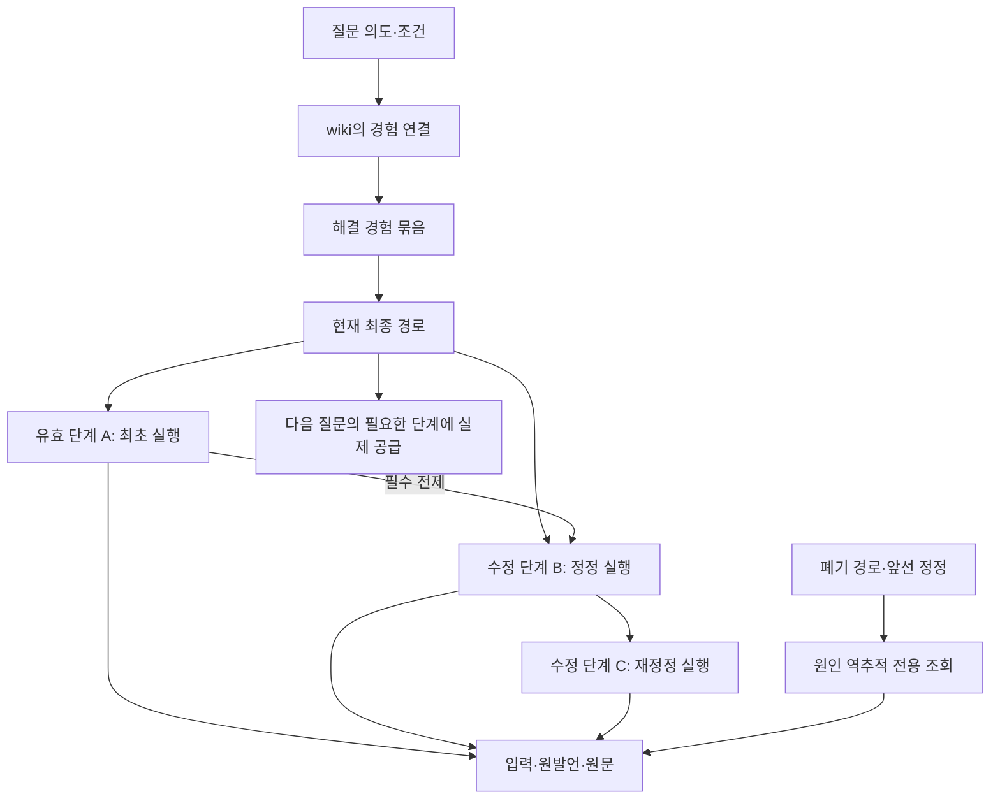

# 최종 해결 경험의 온톨로지·shortcut 계약 — 적재부터 실제 활용까지

설계 개정: **r3 / 2026-10-01**. 상태: **논리 계약 수정, 구현·DB 이행 전**.
전체 실행은 [RAG 전 단계·멀티턴 설계](LEGAL_AGENT_MEMORY_MULTITURN_DESIGN_20261001.md)를 따른다.
이전 물리 표·필드·검사 설명은
[r2 보관본](SHORTCUT_EXPERIENCE_SCHEMA_DESIGN_20261001_R2_ARCHIVE.md)에 그대로 보존했다.

## 1. 이번에 바로잡은 축적 단위

**지식 DB에 등록하는 대상은 모든 질문의 목록이 아니라, 의도·조건·출처와 최종 해결 경로를
연결한 온톨로지다.** 질문·답변·추가 조건·정정·재정정이 같은 문제를 풀면 하나의 경험 묶음이다.
로그·원발언은 경로의 출처와 원인 역추적을 위해 보관한다. 발언마다 독립 정답 지식을 만들지 않는다.

한 묶음의 최종 경로는 여러 실행에서 살아남은 단계 결과로 구성될 수 있다.
마지막 답변이나 마지막 run 전체를 최종 경로로 저장하는 방식은 사용하지 않는다.
검색·판단뿐 아니라 최초 의도, 검색 계획, 읽기, 선별, 종합, 최종 표현까지 필요한 단계의
실제 입력·결과를 찾아 현재 RAG 단계에서 사용할 수 있어야 한다.

“이번 답변을 표로”는 현재 유효 답변을 기존 작성 LLM에 전달해 재작성한다.
새 공통 지식이나 별도 업무 실행기로 등록하지 않는다.

DB 직접 편집·관리·법률 정확성 승인 기능은 사용자 요청대로 별도 작업이다.
본 문서는 멀티턴 실행과 저장소 사이에 필요한 조회·현재 경로·폐기·소비 인터페이스를 정의한다.
새 migration이나 승인 화면을 구현한 문서가 아니다.

## 2. 묶음·경로·단계의 관계

| 논리 객체 | 의미·필수 계약 | 정본의 책임 |
|---|---|---|
| 의도·조건 연결 | intent_ref, 조건·범위, bundle_ref, link_revision, 사용 가능 상태 | wiki/ontology의 탐색 연결 |
| 해결 경험 묶음 | bundle_id, 원래 문제·목표·분기, 최초 출처, 관련 run 참조 | 같은 문제의 경험을 한 단위로 관리 |
| 경로 버전 | route_id/revision, branch/goal, 구성 단계와 부모, state binding, 대체 관계 | 여러 run에서 조립한 불변 해결 그래프 |
| 현재 경로 포인터 | 해당 묶음·분기·조건의 현재 revision, 수정 중 상태 | 다음 턴·다음 질문이 읽는 현재 선택 |
| 단계 결과 | node_id/version, stage/operation, 입력·결과·이유 ref/hash, native binding | 실제 실행과 원본 산출물의 연결 |
| 전제 의존 | 현재 단계의 필수 부모·원문 버전·조건 참조 | 재계산·재사용의 입력 결속 |
| 정정·대체·출처 | 원발언, 해석 결과, 고친 대상, 전후 관계, 적용 receipt | 최초 원인까지 역추적 |
| 폐기 이력 | 대상·범위·원인·revision, 이후 일반 사용 차단 | 옛 원본 보존과 현재 사용의 구분 |
| 전달·소비 receipt | 무엇을 현재 실행에 넣었고 어떤 결과가 사용했는지 | 실제 활용 확인 |

이 이름은 r3 논리 계약이다. 기존 DB에 같은 이름의 테이블이 생겼다는 의미가 아니다.
기존 wiki/DB 담당과 정본 소유권·API·물리 스키마를 맞춘다.
중앙 저장소에서 native journal의 전체 요청·모델 시도 원장을 중복 구현하지 않는다.

현재 경로의 유일성은 하나의 전역 최신 시각으로 정하지 않는다.
같은 묶음 안에서도 서로 다른 실제/가정·목표·조건 분기의 유효 경로가 있을 수 있다.
소비자는 현재 질문에 대응하는 분기·조건과 정확한 revision을 선택한다.

## 3. 적재 절차

### 3.1 실행 중 기록

기존 journal에 실제 발언·도구 결과·판단·필수 부모·원문·출력 참조를 남긴다.
중간 질문과 잘못된 정정도 원인 진단을 위해 연결하지만, 독립 지식으로 자동 수입하지 않는다.
한 모델 응답의 여러 판단은 실제 항목·ID에 근거해 분리한다.
기록하지 않은 판단·검색 순위·읽기 범위를 임의로 만들어 적재하지 않는다.

### 3.2 최종 경로 구성

멀티턴 런타임이 현재 의도·조건·분기에 따라 유효 단계들을 선택하고
필수 부모가 닫힌 경로 manifest를 만든다.
수정하지 않은 최초 단계와 이번 정정·재정정의 새 단계가 함께 포함될 수 있다.
대체된 오류 단계와 그에 의존해 폐기된 결과는 현재 경로에서 제외한다.

이때 최종화는 현재 문제의 해결 경로 선택이다.
새 법률 정확성 승인 절차를 뜻하지 않으며 기존 데이터의 승인 상태를 조작하지 않는다.

### 3.3 ontology 반영

기존 action-memory intake를 확장해 개별 완료 run 대신 **묶음의 최종 경로 manifest**를
지식 축적의 입구로 사용한다. 원래 완료 journal은 원본 참조·진단 자료로 보존한다.
의도·조건→묶음→현재 경로→단계·전제·출처를 연결한다.

정정 접수 뒤 영향을 받은 옛 경로는 이미 일반 사용이 중단된 상태여야 한다.
경험 반영이 지연돼도 다음 턴이 옛 경로를 현재로 채택하지 못하게 한다.
같은 사건의 다음 턴은 온라인 현재 상태를 읽고 후처리 완료를 기다리지 않는다.

### 3.4 중복·재수집

동일 manifest/hash/revision의 재수입은 idempotent 처리한다.
완료된 옛 run을 다시 읽었을 때 해당 bundle/route의 폐기 이력을 먼저 확인한다.
옛 답변을 새 capsule·새 concept으로 바꿔 폐기 경로를 부활시키지 않는다.
과거 원본을 읽을 수 있다는 것과 현재 지식으로 쓸 수 있다는 것을 구분한다.

## 4. 정정의 두 경로

| 사용자 의도 | 변경 대상 | 유지할 것 |
|---|---|---|
| “이 질문에 가져온 과거 사례가 아니야” | 해당 wiki 의도/조건→bundle 연결과 현재 채택 부분 | 다른 의도에서 유효한 경험 자체 |
| “사례는 맞는데 이 처리 과정이 틀렸어” | 같은 묶음의 오류 시작점·의존 결과·최종 경로 | 무관한 유효 단계·분기 |
| “앞의 정정을 잘못 이해했어” | 앞선 정정의 해석과 그 전제까지 추적해 필요한 시작점 수정 | 실제로 영향 없는 결과 |
| “표로 바꿔줘” | 최종 답변 표현 | 현재 의도·조건·조사·판단 경로 |

과거 경로를 폐기한다고 모든 구성 node를 전역 폐기하지 않는다.
공유된 유효 단계는 다른 경로에서도 계속 쓸 수 있다.
오류 node 자체가 잘못됐으면 그것을 사용한 살아 있는 경로의 영향을 조사한다.
단지 다른 의도에서 잘못 선택된 경험이라면 그 선택 연결의 범위에서 중단한다.

폐기된 node·경로는 원인 역추적 모드에서만 관련 원본으로 읽을 수 있다.
현재 결과를 공급하는 일반 조회에서 진단 원본을 유효 단계로 전달하지 않는다.

## 5. 조회부터 실제 활용까지

1. 현재 질문의 목표·조건·허용 문서 범위와 state revision을 확보한다.
2. 같은 사건이면 현재 경로를, 다른 경험이 필요하면 wiki/ontology의 관련 연결을 찾는다.
   매번 사용자에게 과거 질문 선택을 요구하지 않는다.
3. bundle과 조건·분기·현재 route revision을 명시 결속한다.
   단일 과거 run을 “최신”으로 골라 최종 경로를 대신하지 않는다.
4. 현재 실행 단계에 필요한 과거 stage/operation, 결과, 필수 부모·출처를 가져온다.
5. 변경된 조건·범위·세대와 부모 대응을 확인한다.
   입력이 달라졌다면 과거의 경로·이유를 참고해 필요한 단계부터 다시 실행한다.
6. LLM에게 필요한 실제 내용과 참조를 전달한다. 그 단계에서 참고·유지·수정·재실행을 결정한다.
7. 실행 직전 경로 revision과 폐기·접근 상태를 다시 확인하고 현재 port로 결과를 공급한다.
8. 실제 공급된 입력과 후속 단계가 사용한 결과를 receipt로 남긴다.
   DB 조회·prompt 삽입만으로 작업이 완료됐다고 판정하지 않는다.
9. 현재 결과와 부모를 새 run에 명시 연결하고 다음 단계·다음 턴이 이를 소비하게 한다.

초기 도입에서는 과거 답변을 무조건 반환하거나 모든 단계를 자동 생략하지 않는다.
조건이 같은지 확인할 수 없는 단계는 경로·탐색 이유를 참고하고 실제 조사로 진행한다.
이미 존재하는 원문·버전·접근·인용 검증을 유지한다.
사용자가 수정했으므로 새 승인 화면을 거쳐야 한다는 별도 흐름을 추가하지 않는다.

## 6. 단계별 전달

| 현재 작업 | 필요한 과거 자료 | 소비 방식 |
|---|---|---|
| 최초 의도·이전 정정 해석 | 원발언, 앞선 해석, 목표·조건, 관련 부모 | 뜻을 다시 해석하고 영향 시작점 결정 |
| 검색 계획 | 유효 범위·질의·탐색 이유·세대 | 현재 조건에 맞는 계획 유지 또는 수정 |
| 후보 탐색 | 실제 후보와 탐색 경로·범위·미확인 | 필요한 문서·용어·좌표로 진입 |
| 원문 읽기 | 정확 문서·버전·span·coverage | 현재 읽기·전달 영수증으로 결속 |
| 근거 선별 | 채택/제외 이유와 실제 확보 근거 | 필요한 선택만 재평가 |
| 해석·판단 | 현재 대응 부모·근거·조건·이유 | 전제를 확인하고 유지 또는 재판단 |
| 종합·작성 | 현재 유효 판단과 요구 대응·원문 참조 | 현재 답변 생성 |
| 표·요약 재작성 | 지정한 현재 최종 답변·참조·조건 | 기존 작성 LLM에 표현 지시 전달 |
| 원인 역추적 | 관련 대체 이력·폐기 결과·원발언 | 진단만 수행, 폐기 결과 일반 사용 차단 |

과거 저장량과 현재 모델 전달량을 구분한다.
최종 답변 재작성에는 그 답변 자체가 필요한 자료이므로 가져올 수 있다.
모든 단계에서 전체 대화·위키·journal을 일괄 주입하는 방식은 사용하지 않는다.

원문 인용 namespace와 과거 경험 namespace를 분리한다.
서버의 원본 ref/hash, 모델의 짧은 로컬 참조, 현재 결과 ID의 대응을 남긴다.
전달 내용이 실제 wire에서 빠졌는지도 최종 request hash와 참조 대응으로 확인한다.

긴 체인은 정확한 원본 참조를 따라 나눠 가져온다.
필수 전제·조건·예외를 생략해서 capsule 크기만 맞추지 않는다.
모델·배포의 실제 token/byte 한도는 구현 때 결속하고 측정한다.
r2의 후보 개수·capsule 길이 목표를 필수 체인 깊이 제한으로 사용하지 않는다.

## 7. 현재 SQL과 필요한 인터페이스

[shortcut-experience-v1.draft.sql](../../../00_SYSTEM/SCHEMAS/shortcut-experience-v1.draft.sql)은
r2의 question/run/step·부모 대응·packet·reuse·작업 기록을 확인하는 초안이다.
[사건 SQL 초안](../../../00_SYSTEM/SCHEMAS/legal-agent-case-memory-v1.draft.sql)은
온라인 상태·정정·판단 소속 등을 위한 r2 초안이다.
이번 r3에서 이 파일을 수정하거나 실제 DB에 적용하지 않았다.

| r2 계약 | r3에서 보완할 계약 |
|---|---|
| question별 단일 run 선택 | bundle의 현재 경로와 그 안의 여러 run·단계 선택 |
| step의 상태 이벤트 | 경로·연결·공유 node의 서로 다른 폐기 범위 |
| run-local 의존과 parent reuse 대응 | 최초 발언·정정 해석·cross-run 전제 조회 |
| 완료 journal별 intake | 최종 경로 manifest와 폐기 이력 확인 |
| packet/reuse/work receipt | 모든 단계의 실제 재실행·공급·후속 소비 대응 |
| 개별 selection 고정 | 현재 state/route/link revision의 일관성 검사 |

별도 DB 작업과 맞출 최소 인터페이스는 현재 경로 조회, 정확한 단계 원본 조회,
필수 부모·대체 이력·발언 출처 조회, 정정 적용 상태 기록, 경로의 현재 선택 전환,
폐기 상태 확인, 최종 manifest 수입, 실제 소비 receipt다.
이 이름들은 제안이며 현재 callable API로 보고하지 않는다.

물리 저장소가 둘 이상이면 온라인 정본의 commit+outbox와 경험 소비자의
idempotent 반영·사용 직전 revision 확인을 사용한다.
하나의 트랜잭션이 두 DB와 파일·모델 출력을 모두 원자적으로 바꾼다고 가정하지 않는다.

## 8. 코드 연결과 이행 범위

| 현재 위치 | 연결할 변경 | 소비자 |
|---|---|---|
| service / app / Pipeline | 현재 상태와 경험 선택을 공통 execution context로 연결 | agent session·응답·publication |
| legal_agent repository / views | cross-run 원본 대응·전제·정정·단계별 입력 | 역추적·모델 전달·재실행 계획 |
| bounded_source_session / SourceRecall / source_selection | 단계별 현재 경험 조회와 재진입 | 기존 retrieve/select/assemble/answer port |
| Coordinator / StageRunner | 필요한 operation 재실행·유효 입력 공급·receipt | 같은 기존 RAG 실행 경로 |
| composer / answer_and_review | 현재 답변 표현 재작성 | 기존 최종 응답과 문단·판단 대응 |
| lawrag.pipeline.action_memory | 최종 경로 manifest intake | ontology·wiki projection |
| action_memory_store / legal_llm_wiki | 현재 연결·경로 조회와 폐기 전파 | 다음 유사 질문의 단계별 경험 활용 |
| publication / outbox | current revision과 뒤늦은 게시 대조 | 현재 답변만 게시·복구 |

구현 후보의 계약·schema·engine manifest·hash·실제 코드 소비자를 함께 변경한다.
현재 PIPELINE나 활성 registry가 연구 후보를 자동 선택하지 않게 한다.
전체 RAG를 중복 구현하거나 별도 scheduler를 새로 만들지 않는다.

기존 원본 journal·완료 경험·원문 세대는 보존한다.
확인 가능한 과거 기록만 묶음·단계로 연결하고, 최초 전제를 확인할 수 없는 기록은
체인을 완성했다고 표시하지 않는다. 새 물리 DB 이행과 운영 활성화는 별도 작업의 receipt로 확인한다.

## 9. 구현 검증과 남은 미확인

상위 설계의 C-INTENT부터 C-BUILD까지 시나리오를 따른다.
특히 **정정 → 새 최종 경로 → 다음 턴 → 새 유사 질문 → 옛 run 재수집**을 같은 저장소에서
연속 실행한다. 각각의 최신 결과·실제 단계 사용을 trace로 확인한다.

완료 기준:

- 현재 질문이 적절한 의도·조건의 묶음과 현재 경로에 연결된다.
- 현재 경로에는 필요한 유효 부모가 있고 폐기된 오류 결과가 섞이지 않는다.
- 사용자가 앞선 정정의 오해를 다시 고치면 최초 전제까지 찾아 필요한 단계부터 다시 푼다.
- 가져온 단계 결과가 실제 입력·후속 판단에 사용된다.
- 표현 변경은 기존 작성 LLM으로 처리되며 조건·근거·의미 경로를 유지한다.
- 다음 턴과 새 유사 질문에서 수정된 경로를 사용한다.
- 캐시·재개념화·중복 intake·늦은 게시로 폐기 경로가 되살아나지 않는다.

새 실험은 ADR reservation·snapshot/register/freeze와 사전 기준을 따른다.
ADR-0591에서 분기할 경우 정확한 완료 부모는 ADR-0591-experiment-v1/GUARDED다.
기존 독립 발언 실험의 원응답·점수·후보를 고쳐 r3 검증 결과로 만들지 않는다.

현재 적중률, 오류 회복률, 실제 호출 생략, 비용·속도 변화는 미확인이다.
개별 단계만 다시 실행하면 작업을 줄일 수 있지만 조회·추가 전달·역추적 호출로 늘 수도 있다.
순 호출 절감과 지연 이득은 상위 설계 E-CALLS/E-LATENCY의 산식으로 실제 측정한다.
구현·통합·복구 확인 전 일정은 산정하지 않는다.

r2의 SQL 계약 검사 18개 및 사건 SQL 22개 통과는 당시 기계적 연결 검사다.
r3의 cross-run 최종 경로, 전체 단계 수정, 온라인 소비 기능이 완료됐다는 근거가 아니다.

확인 근거:
[현재 활성 포인터](../../../01_DATA/ACTIVE/local/ACTIVE_RELEASE.json),
[기존 경험 intake](../../../02_BACKEND/lawrag/pipeline/action_memory.py),
[wiki 구현](../../../02_BACKEND/lawrag/pipeline/legal_llm_wiki.py),
[경험 저장소](../../../02_BACKEND/semantic_runtime/action_memory_store.py),
[기존 모의 보고서](CASE_MEMORY_FUNCTIONAL_MOCK_20261001/README.md),
[보존·문서 검사 영수증](../../../09_ARTIFACTS/AUDITS/20261001-rag-multiturn-design-r3/receipt.json).

본 문서는 작업 코드에 근거한 자체 설계 검토다.
현재 로컬 활성 릴리스는 legal-agent-source-prefix-20260930-r3 / generation 37이며,
r3 구현·품질 실험·MAIN 전환·GENOS 현장 실행을 이번에 수행한 것은 아니다.
