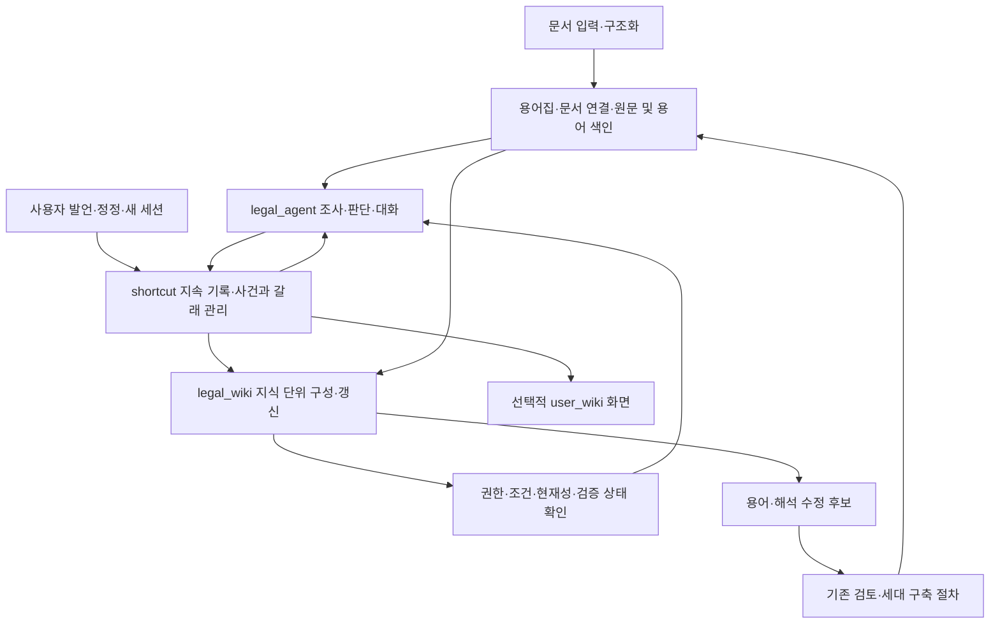

# shortcut·legal_wiki·legal_agent 전체 구현 설계

2026-10-05 · 설계 제안 · 작업 코드 조사 및 자체 검토 · 구현·실험·활성화 전

## 1. 이번 설계의 출발점

**shortcut은 대화와 조사 과정 전체를 지속적으로 저장하고 연결하는 시스템이다. legal_wiki는 그 기록에서 의미 있는 지식 단위를 구성한다. legal_agent는 두 시스템을 이용해 대화를 이어가고 조사·판단한다.**

사용자의 최신 설명을 설계 기준으로 삼는다. 이전 문서의 “최종 확인된 해결 경험이 shortcut”이라는 좁은 정의는 이번 목표 구조에 적용하지 않는다. 기존 보고서와 완료 기록은 당시 기록으로 보존한다.

| 구성 요소 | 책임 | 대표 산출물 |
|---|---|---|
| legal_agent | 질문 이해, 대화 진행, 도구 실행, 근거 확인, 판단, 답변, 정정 반영 | 발언·실행·판단·답변 이벤트 |
| shortcut 시스템 | 여러 턴·세션의 기록 수집, 사건·갈래 관리, 중복 방지, 정정·의존·연결 관리, 현재 상태 제공 | 불변 기록, 사건 상태, 실행 참조, 연결·변경 이력 |
| legal_wiki | shortcut 기록을 읽어 쟁점·개념·조건별로 분절·결합·검증하고 재사용 가능한 단위를 구성 | 버전 있는 지식 단위, 조건, 근거, 도구 절차, 미해결 사항 |
| user_wiki | 필요할 때 개인의 사건·질문·수정 내역을 보여 주는 선택적 화면 | 같은 저장소를 읽는 개인 조회 화면 |

user_wiki는 필수 구축 대상에서 제외한다. 개인 정보와 권한은 shortcut에서 관리한다. 별도 user_wiki가 없어도 사건을 이어가고 사용자별 기록을 찾을 수 있어야 한다.

설계는 다음 문서로 나눈다.

- [데이터·처리 계약](CONTRACTS.md): 저장소, 식별자, 상태, 정정, 지식 구성, 도구 절차, API.
- [구현·이행·검증 계획](IMPLEMENTATION.md): 실제 코드 변경 지점, 작업 순서, 복구, 성능·비용 판단.
- [법률 시나리오와 실패 사례](SCENARIOS.md): 여러 세션과 갈래가 실제로 어떻게 저장·구성·재사용되는지.
- [조사 근거 목록](evidence.json): 조사한 코드와 문서의 경로·해시, 선택된 로컬 릴리스.

## 2. 현재 v6와 목표의 차이

아래는 작업 트리의 연결 상태다. 선택된 로컬 릴리스 또는 GENOS 현장에서 모두 실행 중이라는 뜻은 아니다.

| 영역 | 확인한 현재 동작 | 이번에 필요한 확장 |
|---|---|---|
| 대화 저장 | CaseRepository에 세션·goal·이벤트·단계 노드·현재 경로 저장 | 분류 전 발언부터 수신 기록, 여러 세션을 포괄하는 사건·갈래 식별자 |
| 실행 저장 | native journal에 도구 입력·출력, 근거, 모델 호출, 단계 판단 기록 | 기록을 사건·쟁점·해석 지점까지 연결하는 공통 참조 |
| shortcut에 해당하는 경험 | 사용자 FINALIZE로 현재 경로를 knowledge에 저장 | 확정 전후 전체 기록을 관리하는 시스템으로 역할 확대; 확정 경험은 하위 산출물로 유지 |
| 두 위키 | 같은 경험을 조회하고 Markdown으로 투영; user_wiki는 질문 이력 추가 | legal_wiki에 독립적인 지식 단위 구성·갱신 책임 부여 |
| 개념 단위 | INTENT 개념과 경험을 연결 | 한 대화의 여러 쟁점 분리, 여러 대화에서 같은 쟁점 결합, 조건별 변형 보존 |
| 정정 | 현재 goal 상태·경로 갱신, 사용한 경험의 의존 관계 무효화 | 사건·갈래·사실·판단·지식 단위 수준의 영향 계산 |
| 재사용 | 조건·binding 검사 후 이전 단계 결속, COMPOSE 재실행 | 탐색 힌트·조사 절차·검증 판단을 구분하고 필요한 부분만 재사용 |
| 야간 처리 | action-memory가 완료 실행을 수집하고 별도 위키 생성 | 같은 shortcut 원장의 변경 큐를 소비하는 지식 구성 작업으로 통합 |
| 법률 정확성 | 인용·형식·참조 검사와 사용자 확인 존재 | 주장별 원문·문서명·조건·예외·상충 검증 영수증과 사용 정책 필요 |

현재 `KnowledgeRepository.wiki()`는 두 위키에 같은 experience 페이지를 반환한다. 여러 경험을 분절·조합하는 legal_wiki compiler는 이 경로에 없다. `goal.session`과 세션별 잠금도 여러 세션을 같은 사건으로 이어가는 데 한계가 있다.

과거 ADR-0619에서는 사용자 가이드로 판단 일부를 수정하고 새 세션에서 경험 재사용까지 성공했지만, 잘못된 법령명도 다시 나타났다. 이는 저장·재사용 성공이 정확성 검증을 대신할 수 없다는 실제 근거다. 해당 사례는 소수의 공개 외부 실험이며 현행 v6 전체 성능이나 GENOS 성능을 대표하지 않는다.

## 3. 전체 MAIN 안의 구조

문서·용어 MAIN을 지식 위키로 대체하지 않는다. 법률 원문과 용어 정의는 기존 세대가 정본이다. legal_wiki는 해석·적용·조사 경험을 축적하는 계층이다. 새로운 용어·관계 발견은 기존 검토 계약으로 보내고, 발견 즉시 승인된 온톨로지로 넣지 않는다.

## 4. 저장은 즉시, 지식 구성은 점진적으로

하나의 발언이 들어오면 원문과 신뢰된 주체를 먼저 기록한다. 그다음 기존 사건의 계속인지, 사실 정정인지, 새 갈래인지 판단한다. 분류가 불확실해도 원발언은 저장된다. 영향을 받지 않는 질문은 계속 처리하고, 중요한 정정 대상이 모호할 때만 대화에서 확인한다.

조사 중에는 도구의 계획·실행·결과와 채택·제외 이유를 차례로 기록한다. 답변 실패·중단·잘못된 가설도 이력에 남는다. 기록의 존재와 현재 유효한 판단을 구분한다.

legal_wiki는 변경 이벤트를 보고 지식 후보를 구성한다. 같은 대화에 자격·보유기간·처분제한이 섞여 있으면 쟁점별로 나눈다. 다른 세션에 나온 예외 검토는 같은 지식의 관련 부분으로 연결할 수 있다. 이때 원기록을 이동하거나 덮어쓰지 않고 정확한 기록 범위와 버전을 참조한다.

다음 턴의 정정 반영은 야간 처리를 기다리지 않는다. shortcut의 현재 사건 상태가 즉시 바뀌고 관련 지식은 사용 제한된다. 야간 작업은 묶기·중복 후보 검토·원문 재검증·색인 재구축을 처리한다.

## 5. “하나의 완결된 서사”의 정의

완결성은 대화 전체에 한 번 부여하는 상태가 아니다. **명시한 질문·조건·범위 안에서 하나의 쟁점을 설명할 수 있는가**로 판단한다. 한 대화에서 어떤 쟁점은 닫히고 다른 쟁점은 계속 열려 있을 수 있다.

지식 후보마다 다음 항목을 남긴다.

1. 다루는 질문과 적용 대상·시점·문서 범위.
2. 판단을 바꾸는 사실과 아직 확인되지 않은 사실.
3. 적용 규정, 정의·위임·예외 및 상충 관계의 확인 결과.
4. 주장별 근거와 채택 이유, 배제한 해석과 배제 이유.
5. 필요한 도구와 실제 실행 결과, 재현에 필요한 입력.
6. 결론 또는 조건별 결론, 적용 한계와 열린 질문.
7. 정정·반대 근거가 현재 결론에 반영됐는지.

필수 입력이 없으면 `OPEN`이다. 조건을 분명히 한 답변이 완성되면 `BOUNDED`가 될 수 있다. 관련 범위가 검토되고 중요한 미해결점이 없으면 `CLOSED_CANDIDATE`다. 이는 저장된 법률 정답을 뜻하지 않는다. 원문·해석 검증과 재사용 정책은 별도 검사한다.

사용자의 “맞아”, 대화 종료, 일정 시간 무응답, 야간 실행은 법률 검증을 자동 통과시키지 않는다. 반복 대화 횟수도 통과 기준이 아니다. 사용자가 제공한 사실 확인과 규정 적용 검증의 책임을 분리한다.

## 6. 정확성과 속도를 함께 만드는 방법

다음 질문에서 모든 과거 대화를 모델에 넣으면 기록이 쌓일수록 느려지고 맥락이 섞인다. 먼저 접근 가능한 사건·쟁점·용어·조건으로 작은 후보 목록을 찾고, 선택한 단위의 필요한 근거만 읽는다.

재사용에는 세 가지 수준을 둔다.

| 수준 | 활용 | 반드시 다시 확인할 것 |
|---|---|---|
| 탐색 힌트 | 관련 문서·조항·추가 질문을 찾는 단서 | 현재 권한·문서 존재, 실제 원문 |
| 조사 절차 | 어떤 도구를 어떤 순서·분기로 사용할지 | 도구 계약, 입력 조건, 현재 실행 결과 |
| 검증된 판단 | 조건이 맞는 주장·근거·해석을 이어받기 | 조건 충족, 예외, 원문 버전, 검증·의존 상태 |

과거 판단 재사용이 불가능해도 조사 절차는 유용할 수 있다. 반대로 같은 결론처럼 보여도 조건이 달라지면 필요한 판단을 다시 한다. 관련 조건을 확인할 수 없는 요청은 전체 조사 경로로 돌아간다.

현재 v6는 재사용 시 단계별 `domain.select()`를 다시 호출한다. 저장만 잘하면 자동으로 빠르게 되는 구조가 아니다. 새 설계에서는 이미 검사한 절차의 계약을 코드로 확인하고, 모델은 새로운 의미 판단에 사용하도록 변경한다. 어떤 단계 호출을 실제로 줄일지는 검증한 호환성 정책과 측정 결과로 결정한다.

## 7. 저장소 결정과 user_wiki

**shortcut 기록과 legal_wiki의 구조화된 지식은 DB가 정본이고, Markdown은 사람이 읽는 파생본으로 둔다.** 원발언·도구 결과·근거 원문은 원위치를 유지하고 해시와 참조로 연결한다. 큰 자료는 불변 artifact로 분리하고 DB에 manifest를 둔다.

첫 구현은 기존 CaseRepository를 확장한 단일 쓰기 주체의 저장소로 시작한다. 기존 v3 DB를 제자리에서 바꾸지 않고 새 스키마 세대로 이행한다. SQLite는 로컬 디스크·한 쓰기 서비스 조건에서 사용한다. GENOS의 공유 NFS에 여러 인스턴스가 직접 쓰는 형태는 검증되지 않았으므로 이 설계의 완료 기준으로 삼지 않는다. 다중 인스턴스가 필요하면 동일 repository 계약을 가진 트랜잭션 DB 서비스가 선행 조건이다.

user_wiki를 생략해도 `사용자 → 여러 세션 → 여러 사건`의 탐색과 권한 관리는 필수다. 사용자가 바뀐 직장·역할 등을 알려 주면 그 발언의 적용 시점과 범위를 저장한다. 사건에서 말한 사실을 사용자 전체의 영구 특성으로 자동 확대하지 않는다.

## 8. 설계 결정과 남은 확인

| 항목 | 결정/확인 상태 |
|---|---|
| 기록 시점 | 수신 즉시, 사건·개념 분류 전에도 저장 |
| 지식 구성 담당 | legal_wiki compiler; LLM이 후보 제안, 코드가 계약·권한·참조 검사 |
| 원기록 관리 담당 | shortcut repository; legal_agent·도구 adapter·compiler가 정해진 이벤트 제출 |
| 중복 처리 | 동일 기록은 한 번 저장, 여러 지식 단위의 참조는 허용; 의미 유사성만으로 사건 합치지 않음 |
| user_wiki | 선택 화면으로 유보; 별도 개인 지식 DB는 만들지 않음 |
| 공유 범위 | 원기록 권한 유지; 법률 주제라는 이유로 개인 사례를 공통 공개하지 않음 |
| 야간 처리 | 기존 action-memory 작업 진입점 확장; 배포 환경 스케줄러가 호출 |
| 활성화 | 저장, 지식 구성, 조회 힌트, 절차, 판단 재사용을 분리해 도입 |
| 미확인 | 실제 GENOS 디스크·단일 writer 제공 방식, 내부 모델 품질, 운영량, 지연·비용·개발 인일 |

관측한 로컬 활성 포인터는 `legal-agent-source-prefix-20260930-r3`, generation 37이며 `quality_certified=false`다. 작업 v6 선언은 `WORKING_CODE_ONLY`이고 통합 경로 활성화·법률 품질은 별도 상태다. GENOS는 제공된 기록과 코드만 확인했으며 현장 접속·배포·실행 검증은 수행하지 않았다.

이번 산출물은 새 목표의 구현 설계다. 동작 코드를 변경하거나 MAIN·데이터 CURRENT·GENOS 리비전을 전환하지 않았다.

## 9. 주요 확인 근거

- [MAIN 아키텍처](../../../../00_SYSTEM/ARCHITECTURE.md), [PIPELINE 선언](../../../../00_SYSTEM/PIPELINE.json), [workspace 경로 계약](../../../../00_SYSTEM/WORKSPACE.json).
- [현재 사건 저장소](../../../../02_BACKEND/semantic_runtime/legal_agent/case_repository.py), [현재 두 위키 조회·투영](../../../../02_BACKEND/semantic_runtime/legal_agent/knowledge_repository.py), [통합 실행](../../../../02_BACKEND/semantic_runtime/legal_agent/unified_runtime.py).
- [현재 경험 확정·재사용](../../../../02_BACKEND/semantic_runtime/legal_agent/corrected_memory.py), [단계 재결속](../../../../02_BACKEND/semantic_runtime/legal_agent/unified_rag.py), [실행 journal 계약](../../../../02_BACKEND/semantic_runtime/legal_agent/journal-v6.sql).
- [야간 action-memory](../../../../02_BACKEND/lawrag/pipeline/action_memory.py), [기존 Markdown 위키](../../../../02_BACKEND/lawrag/pipeline/legal_llm_wiki.py), [현재 이행 CLI](../../../../02_BACKEND/lawrag/pipeline/unified_memory.py).
- [이전 통합 설계](../LEGAL_AGENT_UNIFIED_SYSTEM_IMPLEMENTATION_PLAN_20261002.md): 당시 shortcut 정의와 이번 확장 범위 비교.
- [ADR-0619 결과](../../../../04_EXPERIMENTS/ADR/ADR-0619-unified-cm-guidance-interrupted-continuation/RESULT.md), [ADR-0575 기록](../../../../04_EXPERIMENTS/ADR/ADR-0575-native-schema-nightly-integration/README.md): 오류 전파·속도 실패의 관측 범위.
- [로컬 활성 포인터](../../../../01_DATA/ACTIVE/local/ACTIVE_RELEASE.json), [GENOS 진입 안내](../../../../GENOS.md): 작업 코드·선택 릴리스·현장 상태 구분.
