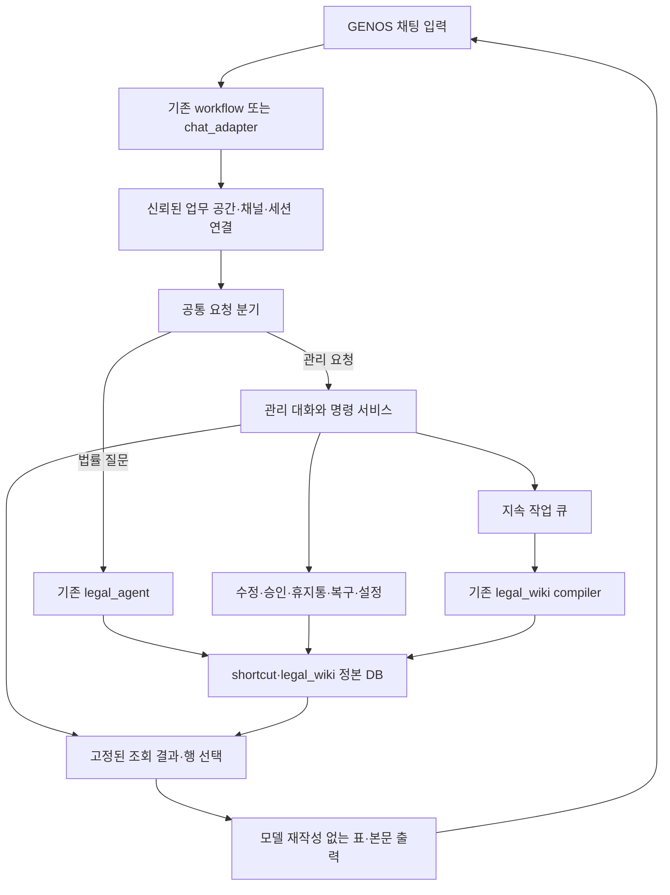

# shortcut·legal_wiki 대화형 관리 설계

2026-10-06 · 설계 제안 · 작업 코드와 승호님 고정 리비전 조사 · 구현·모델 실험·현장 배포 미실행

## 1. 결정

**GENOS 채팅 입력창 하나에서 shortcut과 legal_wiki를 조회·승인·수정·휴지통 이동·복구·켜기·끄기하고, 같은 대화에서 표와 작업을 이어간다. 별도 user_wiki나 회원가입·로그인 시스템은 만들지 않는다.**

기존 GENOS가 허용한 업무 공간과 대화 식별자를 사용한다. 사용자 정보가 제공되면 작업자로 기록하지만, 개인별 위키를 사용해야 관리 기능을 쓸 수 있는 구조로 만들지 않는다. 다만 대화 ID는 접근 허가를 대신하지 않는다. 업무 공간은 신뢰된 GENOS 연결에서 정하고, 입력 문장에 적은 사용자·팀 이름으로 바꾸지 않는다. GENOS의 실제 로그인·역할 전달 여부는 현장 확인 대상이다.

현재 코드의 `authenticated user_id` 요구는 저장소의 개인 소유 범위 계약에서 나온다. user_wiki를 안 쓴다고 설정 하나를 지워 해결되지는 않는다. **새 공통 업무 공간 범위와 기존 개인 범위의 호환 처리를 구현**한다. 모든 사람을 임의의 anonymous 사용자로 합치지 않는다. 기존 기록을 공통 범위로 옮기는 일은 별도 이행 명세로 정한다.

이 문서는 [10월 5일 전체 설계](../SHORTCUT_LEGAL_WIKI_SYSTEM_DESIGN_20261005/README.md)의 관리·GENOS 연결 부분을 확장한다. 그 문서의 당시 구현 상태는 역사적 기록이다. 이번 기준은 실제 shortcut v4 작업 코드와 로컬 활성 r2다.

| 문서 | 읽을 내용 |
|---|---|
| [데이터·처리 계약](CONTRACTS.md) | 세션, 표와 행 식별자, 전체 조회, 수정·승인, 휴지통, 작업 큐, 기능 상태 |
| [대화 시나리오](SCENARIOS.md) | 다음 페이지, 앞 표 선택, 여러 항목 수정·복구, 장시간 작업, 장애 |
| [구현·이행·검증](IMPLEMENTATION.md) | 실제 변경 파일, 연결 순서, 저장 조건, 테스트, 복구, 예상치 |
| [조사 근거](evidence.json) | 조사 파일 해시, 승호님 원본 Git 객체, 로컬 활성 포인터 |

## 2. 승호님 멀티턴과 우리 코드의 실제 차이

승호님 코드 `infocz/fde/seungho/cicd`, commit `5fca5fa353f2f6b1463e38a020bddd64b1f3018e`의 `02-els-qa/workflow/chat.py`, `core/query/session.py`, `core/query/carryover.py`를 저장소 Git 객체에서 직접 확인했다. 현장 최신 배포를 확인한 것은 아니다.

| 기점 | 확인한 동작 | 이번 설계에서 할 일 |
|---|---|---|
| 승호님 채팅 입구 | 플랫폼·스튜디오 채널 구분, chatId 전달, 스튜디오 중첩 사용자 정보 처리 | 같은 식별 규칙을 우리 두 입구에 적용; 채널을 턴마다 바꾸지 않음 |
| 승호님 Redis 세션 | 최근 질문·답변 상태·상품을 저장; 되묻기와 일부 지시어 승계 | 연결 방식을 재사용하되 표·선택 항목·작업 상태를 위한 별도 스키마 추가 |
| 승호님 장애 처리 | Redis 실패 시 단일 턴 답변으로 후퇴, 동시 저장은 마지막 쓰기 우선 | 관리 변경은 문맥을 잃은 채 실행하지 않음; 버전 충돌 검사를 추가 |
| 우리 `/chat` | `main.py → chat_adapter → service.service → /v1/rag/ask` | 동일 입구에서 관리 요청을 기존 법률 질의보다 먼저 분기 |
| 우리 워크플로우 Python | chatId 추출 및 선택적 서명된 기억 요청 | 스튜디오 사용자 경로·채널, 관리 세션, 사건 ID·revision 왕복 보강 |
| `service._normalize` | 일반 요청에서 session_id/user_id/request_id 제거; 기억 요청만 보존 | 신뢰된 관리·세션 계약을 별도로 보존; 클라이언트 임의 ID 허용으로 우회하지 않음 |
| 관리 API | memory/query·command 존재, issue/fact/relate/publish/retire 등 제한된 명령 | 게이트웨이 노출, 전체 조회, 관리 대화, 승인 상태, 수정, 휴지통·복구·켜기·끄기 추가 |
| 표 출력 | `_for_markdown`이 단일 줄바꿈을 빈 줄로 변경 | 관리 표 전용 렌더러로 표 행 사이 줄바꿈 보존 |

**멀티턴의 기반은 있다. 그러나 우리 shortcut 관리가 GENOS에서 끝까지 동작한다고 확인한 상태는 아니다.** 최근 질문을 이어받는 것과, 이전 표의 정확한 기록·버전에 변경을 적용하는 것은 저장 계약이 다르다. 채팅 화면이 보낸 전체 history를 LLM에 다시 넣는 방식으로 해결하지 않는다.

로컬 활성 포인터는 `shortcut-integrated-v6-20261005-r2`, generation 40, `quality_certified=false`다. GENOS 인계 기록의 현장 상태는 `NOT_VERIFIED`다. 로컬 MAIN 활성화, Git main 병합, GENOS 리비전 배포를 구분한다.

이번에 대조한 service·chat adapter·관리 API·identity·shortcut repository/commands·ingress/store·unified runtime·action-memory/compiler의 작업 파일은 선택된 r2 패키지 내 같은 파일과 해시가 일치했다. 이는 코드 동일성 확인이며 GENOS 현장 실행 확인은 아니다. 개별 비교 결과는 evidence.json에 남겼다.

## 3. 사용자가 보는 기능

아래 명령은 모두 **제안 문법**이다. 자연어와 명령어는 같은 구조화된 작업을 호출한다.

| 자연어 예시 | 명령어 예시 | 결과 |
|---|---|---|
| shortcut 전체 보여줘 | `/shortcut list --all` | 전체 목록의 첫 표, 전체 건수, 다음 페이지 |
| 안에 내용까지 빠짐없이 보여줘 | `/shortcut inspect --all` | 목록·본문·이력·실행·근거를 순서대로 분할 조회 |
| 위키 초안이랑 폐기된 것도 보여줘 | `/wiki list --states all` | 게시본 외 초안·과거 상태·휴지통 포함 |
| 다음, 앞 표로, 7번 자세히 | `/next`, `/view V12`, `/show V12:7` | 서버에 저장된 조회 상태로 이동 |
| 2번과 5번 승인해 | `/approve V12:2,V12:5` | 해당 버전 사용자 승인; 법률 검증 상태는 별도 |
| 3번 조건을 이렇게 바꿔 | `/edit V12:3 …` | 새 버전, 전후 차이, 관련 지식의 재검토 상태 |
| 그 둘 버려 | `/trash selection` | 선택 항목을 휴지통으로 이동, 사용 중단 |
| 방금 버린 것 중 첫 번째 복구 | `/restore OP18:1` | 이동 영수증의 대상 복구 및 재사용 가능 여부 표시 |
| 위키 야간 작업 지금 돌려 | `/wiki build now` | 작업 접수·작업 번호; 진행·결과를 이어서 조회 |
| 얼마나 됐어? 잠깐 멈춰. 이어서 해 | `/job status`, `/job pause`, `/job resume` | 같은 작업의 상태·중지·재개 |
| shortcut 꺼. 위키는 켜둬 | `/shortcut off`, `/wiki on` | 업무 공간 기능 상태 변경 및 적용 범위 표시 |

별도 관리 화면은 필수로 만들지 않는다. “관리 도움말”로 사용 가능한 기능과 현재 상태를 표로 보여준다. 모호한 대상·수정 내용만 되묻는다. 명확하게 지정한 항목의 휴지통 이동마다 반복 확인을 요구하지 않는다.

## 4. 연결 구조와 모델의 역할

명령어, “다음”, 행 번호 선택, 정형 승인·휴지통·복구는 규칙과 DB 조회로 처리한다. 고정된 탐색 절차 재실행과 관리 표 출력에 LLM을 추가하지 않는다. 자유로운 표현이 규칙에 맞지 않을 때만 GENOS 내부 모델이 허용된 작업 종류·필드·후보 ID를 제안한다. 코드가 대상·버전·범위·필수값을 검사한 뒤 실행한다. 모델이 SQL, 파일 경로, 임의 실행 명령을 생성해 실행하는 구조는 쓰지 않는다.

LLM은 사용자에게 보낼 전체 데이터를 요약해서 대체하지 않는다. 후보 검색이 필요하면 먼저 정해진 fulltext·필터 조회를 실행하고, 그 결과의 ID 중에서만 선택한다. 과거와 다른 조건·결과로 의미 판단을 새로 했다면 입력 참조·모델·제안·검사·선택 사유를 관리 이력에 남긴다. 법률 절차의 기존 재사용 정책은 유지한다.

관리 대화와 법률 대화의 현재 대상을 따로 보관한다. “3번 버려”를 법률 사실 정정으로 저장하거나, 관리 표의 텍스트를 wiki 학습 기록으로 넣지 않는다. 한 발화에 관리와 법률 질문이 섞이면 명시된 순서로 처리하고 적용된 기능 상태를 답변에 표시한다. 대상이 불명확하면 해당 변경 부분만 보류한다.

## 5. 끄기의 의미

기능 상태는 기본적으로 **현재 GENOS 업무 공간 전체**에 적용한다. 응답에 이 범위를 표시한다. 대화 한 번만 건너뛰기는 별도 “이번 질문에서는 사용하지 마”로 처리하며 전역 상태와 섞지 않는다.

| 설정 | 새 shortcut 장기 기록 | shortcut 절차·경험 재사용 | wiki 구성·재사용 | 조회·수정·휴지통·복구·켜기 |
|---|---|---|---|---|
| 둘 다 켬 | 켬 | 유효성 검사 후 허용 | 유효성 검사 후 허용 | 가능 |
| shortcut 끔, wiki 켬 | 끔 | 끔 | 기존 wiki 사용 가능; 기존 기록의 명시적 구성 가능 | 가능 |
| shortcut 켬, wiki 끔 | 켬 | wiki와 독립된 적격 절차만 허용 | 중단 | 가능 |
| 둘 다 끔 | 끔 | 끔 | 중단 | 가능 |

현재 절차의 출처가 wiki에 의존하면 wiki를 끈 동안 그 절차도 사용하지 않는다. 기능을 꺼도 법률 원문 RAG와 GENOS 대화 연결은 유지한다. 진행 중 질문의 단기 맥락은 세션 수명 정책으로 관리하고, 꺼진 shortcut 장기 기록으로 몰래 축적하지 않는다. 관리 작업 이력과 설정·복구용 최소 상태는 별도로 유지한다. 기존 GENOS 플랫폼 로그·기존 실행 진단 기록의 보존 정책까지 이 스위치가 삭제하는 것은 아니다.

## 6. 구현의 선행 조건

현재 `ShortcutRepository`는 NFS/CIFS를 발견하면 오류로 막고 로컬 영속 디스크와 단일 쓰기 서비스를 요구한다. 과거 v3 인계의 NFS·DELETE 저널 설정으로 v4가 해결됐다고 볼 수 없다.

GENOS에서는 기존 서비스 안에 논리적으로 하나인 저장소 소유자를 두고, 영속 로컬 볼륨이 확인되면 현재 SQLite 계약을 유지한다. 여러 서빙 인스턴스가 있으면 소유자 서비스로 작업을 모은다. 그런 영속 볼륨을 제공할 수 없으면 같은 repository 계약의 트랜잭션 DB 서비스가 먼저 필요하다. Redis는 짧은 세션 상태·캐시, NFS는 허용된 백업·산출물 용도로 사용한다. Redis 연결 존재만으로 정본 DB 저장 조건이 충족되지는 않는다.

설계 단계에서 미확인인 것은 실제 GENOS 세션 payload, Redis 사용 가능 설정, 정본 저장 볼륨/DB, 업무 공간 관리 역할, 내부 모델의 자연어 명령 해석 품질이다. 이는 [현장 완료 조건](IMPLEMENTATION.md)에 분리했다. 이번 작업은 문서만 작성했다.

## 7. 주요 원본 근거

- [MAIN 아키텍처](../../../../00_SYSTEM/ARCHITECTURE.md), [GENOS 안내](../../../../GENOS.md), [활성 포인터](../../../../01_DATA/ACTIVE/local/ACTIVE_RELEASE.json).
- [우리 chat adapter](../../../../02_BACKEND/semantic_runtime/chat_adapter.py), [GENOS 워크플로우](../../../../08_DEPLOYMENT/GENOS/workflow/genos_rag_chat.py), [service 게이트웨이](../../../../service.py).
- [현재 관리 API](../../../../02_BACKEND/semantic_runtime/app.py), [주체 검사](../../../../02_BACKEND/semantic_runtime/legal_agent/memory_identity.py), [저장소·상태 계약](../../../../02_BACKEND/semantic_runtime/legal_agent/shortcut_repository.py), [현재 변경 명령](../../../../02_BACKEND/semantic_runtime/legal_agent/shortcut_commands.py).
- [기존 위키 구성기](../../../../02_BACKEND/lawrag/pipeline/legal_wiki_compiler.py), [기존 야간/수동 실행 입구](../../../../02_BACKEND/lawrag/pipeline/action_memory.py).
- [승호님 코드 참조와 현장 미확인 기록](../../../../08_DEPLOYMENT/GENOS/handoffs/unified_v6_nfs_main_20261002_r2/DELIVERY.json). 실제 확인한 Git 원본 경로·함수 위치·내용 해시는 evidence.json의 upstream에 기록했다.

> 후속 사용자 결정: Redis/암묵적 관리 라우팅 제안은 폐기하고 [SQL·명시 AD모드 구현 설계](../SQL_AD_MODE_SHORTCUT_WIKI_20261006/README.md)로 대체한다. 이 문서의 이전 시점 관찰은 역사로 보존한다.
