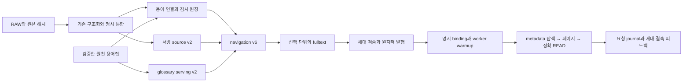

# SQLite 적재·로딩·조회 구조 개선 구현계획

작성: 2026-10-02 · 상태: **설계안, 구현·성능 비교·활성화 미실행**

## 1. 구현 방향과 적용 기준

**SQLite를 유지하면서 불필요한 조회를 먼저 줄이고, 서빙 데이터에서 큰 원천 payload를 분리한 뒤, 대량 연결표의 문자열 키를 세대 내부 정수 키로 바꾼다.** 법령 본문은 TEXT로 보존한다. 검색·조인·정렬에 쓰는 필드는 명시 컬럼으로 만들고, 가변 메타데이터·원천 기록·불변 실행 이력에는 JSON을 남긴다.

이번 계획은 [전체 생명주기 검토](SQLITE_LIFECYCLE_REVIEW_20261002.md)의 SR01~SR12를 구현 단위로 연결한 것이다. 초기 RAW 반입부터 구조화, 통합, 용어 연결, 색인, 게시, 최초 로딩, 반복 조회, 실행 원장까지 다룬다. 저장 형식 변경에 원문 재파싱·용어 의미 재검토·참조 재판정을 묶지 않는다. 그 변경들은 별도 품질 비교 대상이다.

| 구분 | 확인된 기준 | 계획에서의 취급 |
|---|---|---|
| 로컬 활성 릴리스 | `legal-agent-source-prefix-20260930-r3`, 포인터 generation 37 | 실제 활성 동작의 기준. `quality_certified=false`를 보존 |
| 활성 데이터 | `pecab-only-public-main-20260929-v1/generation`, source v1·navigation v3 | 전수 물리 크기·중복 측정의 모집단 |
| 작업 코드 | navigation v4/v5, 선택형 v6, 최소 단위 fulltext 등의 후속 변경 존재 | 최신 작업 기능을 보존하는 통합 기준. 활성 v3로 되돌려 덮어쓰지 않음 |
| GENOS | 망분리, 이 세션에서 접근 불가 | 실제 코드·데이터·Python/SQLite·스토리지 성능은 현장 기록으로 별도 확인 |

활성 release manifest SHA는 `06e47cc365538a94332d08290c26faa4f610ac72a9a91a5a782d528c469de8b6`, 데이터 manifest SHA는 `7bce6155aa762f2e9cc1453e7622b3186f47ad772cc7cd5251ad7fbc1235dabf`다. 작업 트리에 다른 변경이 많으므로 구현 시작 시 변경 대상 파일과 의존 파일의 해시를 다시 고정한다. 이 문서의 검토 입력은 [계획 검증 기록](../../../09_ARTIFACTS/AUDITS/sqlite-implementation-plan-20261002/plan-receipt.json)에 남긴다.

## 2. 작업 순서와 완료 조건

| 순서 | 작업 묶음 | 변경·재구축 범위 | 종료 조건 | 대응 검토 |
|---|---|---|---|---|
| P0 | 기준·계약·계측 고정 | 코드/세대/질문/범위/실행 환경을 명시하고 비교 계획 동결 | 실제 호출 경로, 반환 순서, 시간·메모리·쓰기 횟수 기준 확보 | SR04·06·10 |
| P1 | 조회·페이지 처리 정리 | 코드 변경. 기존 source/navigation/FTS 형식 유지 | 정의 반복 JSON 조회 제거, 페이지 밖 카드 생성 제거, 묶음 READ 및 기존 계약 검사 통과 | SR05·06·07 |
| P2 | 용어집 서빙 묶음 분리 | 새 glossary projection·manifest·cache와 이를 결속한 새 generation | 원천 graph 없이 온라인 기능 동등, 원천 감사·재구축 경로 유지 | SR02·04·11 |
| P3 | source/navigation 저장 형식 이행 | 새 source v2·navigation v6 제안, 같은 검색 단위로 FTS 재구축 | 전체 외부 ID·본문·좌표·연결·상태 동등, 양방향 조회와 실제 크기 검증 | SR01·03·05·09 |
| P4 | 적재·검증·최초 로딩 정리 | 생성기·검증 receipt·메타데이터 reader·캐시 연결 | 중복 복사/해시를 줄인 경로도 변조·입력 변경 거부, 완료본 재개 가능 | SR04·08 |
| P5 | 요청 원장의 짧은 묶음 쓰기 | 신규 요청의 handle/cursor 기록 경계, 필요 시 별도 journal 버전 | 중간 중단·재시도·동시 실행에서 고아 핸들·중복 완료·이력 손실 없음 | SR10·12 |
| P6 | 통합 검증·인계·선택 | 검증한 코드와 데이터 조합, apply/rollback receipt | 로컬 후보와 GENOS 현장 결과를 구분하여 선택·원복 확인 | 전체 |

실행 순서는 P0 → P1 → P2 → P3 → P4 → P5 → P6로 둔다. P1은 데이터 재구축 없이 독립 후보로 검증할 수 있다. P2와 P3를 한 번의 대규모 교체로 합치지 않고 중간 완료본을 남겨 원인과 효과를 분리한다. 각 단계 결과를 본 뒤 새 후보를 만들면 새 ADR과 정확한 부모 arm으로 연결한다.

## 3. P0 — 비교 기준과 실제 호출 경로

성능 비교를 시작하기 전에 저장소의 [실험 지침](../../../04_EXPERIMENTS/LEGACY_ADR/EXPERIMENT_AGENT_PROMPT.md)과 [표준](../../../04_EXPERIMENTS/LEGACY_ADR/STANDARD.md)을 끝까지 읽는다. 동일 scope reservation을 확인하고, 후보 구현 수정·첫 비교 실행 전에 stable runner로 ADR을 선점한다. 이번 문서 작성에는 실험을 실행하거나 ADR을 선점하지 않았다.

고정할 항목은 선택된 입력·용어집·코드·스키마·manifest·프로필·tokenizer·검색 단위·worker 수·Python/SQLite 버전·파일시스템이다. 정확한 부모 `experiment_id/arm_id`는 실행 준비 시 확인하며 임의로 정하지 않는다. 문서 범위, 팀 선택, 내규/외규 선택, 허용 권한을 별도 기록한다. 팀 분류만으로 ACL을 대체하지 않는다.

두 기준을 혼합하지 않는다. 활성 frozen 릴리스는 과거 실제 동작 재현용이고, 구현 후보의 직접 부모는 해당 시점에 고정한 작업 코드 및 명시 데이터 조합이다. 작업 코드와 활성 릴리스의 기능 차이를 DB 최적화 효과로 계산하지 않는다. 저장 형식 비교에서는 같은 연결·정의·참조 레코드를 입력으로 사용한다.

계측은 기존 `resources.*`, `fulltext.sql.timings`, `fulltext.location.timings`, `source_sql_*`, `source_json_decode_ms`, `journal.transaction.timings`를 확장한다. SQL 실행·행 전송·JSON 디코딩·카드/위치 구성·journal begin/body/commit·전체 응답을 구분한다. 반환 행/바이트, decode 수, 원문 상세화 수, 카드/핸들 수, commit 수, RSS도 남긴다. 로그에는 내부 본문이나 인증키를 추가하지 않는다.

문서 목록, 좁은/전체 범위 검색, 정의 검색과 다음 페이지, 다수 출현 용어, 명시 참조, exact/subtree READ, 최소 단위 hit READ, 문서 추가 후 재구축을 포함한다. 프로세스 재시작 첫 요청, 같은 프로세스 반복, 여러 worker를 분리한다. OS 캐시를 비우지 않았다면 cold disk 측정이라고 쓰지 않는다. GENOS 내부 데이터는 현장에서만 측정한다.

## 4. P1 — 기존 DB로 먼저 바꿀 조회 경로

| 변경 지점 | 구체 구현 | 보존할 동작·검증 |
|---|---|---|
| `legal_agent/exploration_tools.py:lookup_definition` | 이미 적재한 scope별 정의 카탈로그에서 ID·key·source ID를 먼저 검사. 일치 ID를 기존 순서로 정렬한 뒤 현재 페이지에 대해서만 source/card 생성 | 현재 정규화 **부분 문자열** 검색 유지. 문서 정의가 끝난 뒤 glossary lookup으로 이어지는 offset·next cursor 경계 유지 |
| `legal_agent/workflow_relation_cards.py:definitions` | label/key와 evidence 본문 조건을 먼저 검사하고 통과한 정의만 source 조회 | `LABEL_CANDIDATE`, `scope_status`, 출처·미확인 상태 유지. source가 없는 후보를 새로 노출하지 않음 |
| `exploration_tools.py:term_occurrences` | scope 교집합·any/all 집합 연산·정렬을 먼저 끝내고 페이지 ID만 node card로 변환 | 기존 source ID 순서, 경로별 이유, 정확한 total이 있는 호출의 total, 다음 페이지 누락/중복 검사 |
| `storage.py:Store`, `legal_agent/source_tools.py` | 기존 `source()` 반환 계약은 보존. **제안 API** `read_blocks(document_id, block_ids, projection)`로 필요한 text·hash·좌표를 묶음 조회하고 입력 순서로 복원 | SQL 변수 한도에 맞춰 분할. 누락 블록·잘못된 scope·잘못된 span/hash는 기존처럼 거부. 필수 메타데이터 소비자를 별도 projection으로 지원 |
| `workflow_relations_tools.py:search`, `fulltext.py`, `unit_fulltext.py` | 현재 페이지에 필요한 위치·미리보기만 상세화. unit FTS도 가능한 부분에서 key/score/소속 확인과 큰 JSON 상세화를 분리 | article/최소 단위 검색을 각각 검증. 조 단위로 자동 전환하거나 상위 본문을 합치지 않음 |
| `full_glossary_connections.py:_relations` | 사용 컬럼을 명시하여 이후 버리는 `official_relation.payload`를 조회하지 않음 | ID·관계 방향·status·alias receipt·정렬·limit 유지 |

P1에서는 정의 카탈로그의 최초 전수 적재가 남고, FTS의 전역 일치 결과 열거도 일부 남는다. 그 비용까지 해결했다고 보고하지 않는다. 기존 copy-on-read 정의 객체를 전수 deepcopy하는 것으로 바꾸는 대신, 캐시 초기화 시 ID·key·source·document의 작은 불변 요약 목록을 함께 만든다. 원래 payload는 필요한 정의만 꺼낸다. 부분 문자열 검색을 `key = ?` 또는 접두 검색으로 바꾸면 결과가 달라지므로 적용하지 않는다.

READ 재사용은 요청 내부의 `(generation binding, document_id, block_id, text hash)`에 한정한다. 재사용 전 세대 파일 상태를 검사하고 실제 인용 span 검사는 매번 수행한다. 검증 캐시가 범위·권한 검사를 대신하지 않게 한다. source/subtree 결과는 기존 block 순서와 page lookahead를 유지한다.

**P1 첫 변경 단위는 정의 선필터 + 페이지 이후 카드 생성이다.** 이어서 묶음 READ를 붙인다. 각 변경은 SQL/decode/카드 수 감소와 반환 계약을 함께 확인하여 작게 완료한다.

## 5. P2 — 큰 용어집 원장과 서빙용 묶음 분리

현재 `graph.sqlite`는 약 11.40 GiB다. 온라인 `ConnectionReader`의 외부 관계는 `identity.source_edge`를 읽고, graph에서는 노드 존재와 정의를 읽는다. 반면 구축 단계의 `glossary_knowledge.Knowledge`는 원천 graph edge를 소비한다. 따라서 graph를 삭제하는 대신 **새 서빙 projection을 생성**한다.

제안 계약명은 `glossary-serving-v2`다. 실제 버전 등록은 구현 시작 시 충돌을 확인한다.

| 새 묶음 요소 | 생성 내용 | 소비자 |
|---|---|---|
| `nodes.sqlite` | `(source, node_id)` 존재 목록, 원래 정의 배열과 ordinal, 원천 locator/해시. 정의가 객체이면 원래 객체·순서를 보존 | `_resolve`, `_definitions`의 v2 reader |
| 기존 dictionary·identity·translations·lookup | 첫 단계는 필요한 현재 DB와 컬럼을 유지. identity의 확인된 완전 중복 인덱스만 후보에서 정리 | 현재 glossary lookup/card/alias/관계 기능 |
| 준비된 label cache | 선택 dictionary, 원천 graph labels, lookup에서 구축 시 생성하고 projection/compiler 해시로 결속 | 온라인 lookup. 캐시가 없거나 다르면 온라인에서 원천 graph를 읽어 재생성하지 않고 준비 미완료로 실패 |
| serving manifest | 실제 온라인 필수 파일, 각 SHA·스키마·compiler, 원천 bundle manifest SHA와 projection receipt | `glossary_assets`, `Glossary`, `verify_assets` |
| 원천 bundle/audit | 전체 graph·원천 legal·번역/검토 자료를 기존 불변 위치에 보존하고 배포 원장에 locator·hash 기록 | 재구축·감사·승인 provenance. 온라인 필수 파일 집합과 별도 |

`term_serving_bundle.prepare_assets/verify_assets`, `full_glossary.Glossary`, `navigation_agent.glossary_assets`, `ConnectionReader`를 함께 수정한다. v1 reader를 보존하고 manifest의 명시 버전으로 선택한다. 준비 단계의 원천 전체 검증은 유지하되 온라인은 자신이 소비하는 projection 전체를 검증한다. 원천 검증 receipt가 있다는 이유만으로 projection의 해시 검증을 생략하지 않는다.

glossary binding은 source manifest에도 포함된다. 따라서 dictionary만 바꾸지 않았더라도 **새 root manifest와 navigation binding, FTS 결속을 함께 생성·검증**한다. 기존 manifest 일부를 덮어쓰지 않는다. P2에서는 원천 연결·참조의 의미를 그대로 내보내어 재결속하는 경로를 사용한다. 서빙이 읽을 수 없는 raw graph를 슬쩍 기존 파일명으로 대체하여 v1이라고 선언하지 않는다.

## 6. P3 — source/navigation 물리 계약

아래 이름과 API는 모두 제안이다. 외부 `term-runtime-v1`, 영구 문서·용어·source·정의·참조 ID, 원문 artifact SHA, 인용 좌표는 유지한다. source v2와 navigation v6는 물리 저장 계약이다. 선택형 RAG v6와 같은 버전 체계로 취급하지 않는다.

### 6.1 원문 저장소: `term-source-generation-v2`

구조화 입력은 기존 구조 원문 3테이블 계약을 유지한다. 초기 적재·통합의 DDL과 INSERT는 명시 컬럼으로 통일하고 필수 ID·원본 해시·부모·블록 소속을 검증한다. 새 publisher가 서빙용 v2를 만든다. 기존 완료 구조화 자료에서 변환할 수 있으므로 이행 때문에 RAW 파서·PDF VLM을 다시 실행할 필요는 없다.

| 테이블 | 온라인 명시 컬럼 | 별도 보존·복원 |
|---|---|---|
| `document` | `document_id`, name, artifact SHA, 표시·범위용 `metadata_json`, 계층 해석용 `ladder_json` | 전체 nodes/blocks를 내포한 원본 구조 JSON은 원천 source/audit에 보존. 누락 메타데이터는 누락 그대로 유지 |
| `source_unit` | `(document_id,unit_id)`, parent, family, surface, title, span 시작/끝 | ordinal·own_spans·가변 native 구조는 해당 행의 확장 JSON. 조·항·호·목과 문자 구간 정보 손실 금지 |
| `source_block` | `(document_id,block_id)`, unit_id, 명시 block 순서/범위 좌표, text, artifact SHA, text SHA | 중복 text를 뺀 native metadata. 기존 block dict가 필요한 호환 API에서 조립 |

서빙 본문은 `source_block.text`를 기준으로 읽는다. 기존 document JSON 전체 재현이 필요한 export/감사 소비자는 명시 원천 locator를 사용한다. 그 기능을 metadata 조회인 것처럼 온라인 loader에 숨겨 연결하지 않는다.

`block_id`는 외부 문자열 ID를 유지한다. 기존 숫자 범위 계약은 실제 숫자 좌표와 저장 순서를 분리하여 보존한다. 비숫자 ID를 일괄 `CAST`하거나 재번호 부여해서 기존 span을 바꾸지 않는다. 이행 시 기존 순서/범위와 대응하지 않는 입력은 검증 실패로 남긴다.

`Store`는 v1/v2 reader를 명시 선택한다. v1의 정확한 3테이블 검사에 새 컬럼/테이블을 끼워 넣는 방식으로 우회하지 않는다. `merge_sources`, publisher, matcher, 구조 탐색, fulltext builder의 직접 SQL 소비를 모두 대조한다. v2 publisher의 DDL에는 NOT NULL·명시 PK·필요한 FK/CHECK를 둔다. root parent와 구조 소유자가 없는 block의 unit_id는 유효한 NULL로 남긴다. FK는 같은 DB 안에서만 보장하고, DB 사이 참조는 세대 verifier가 검사한다. SQLite FK 활성화는 연결마다 확인한다. [공식 FK 문서](https://sqlite.org/foreignkeys.html)

### 6.2 탐색 저장소: `term-navigation-index-v6`

| 영역 | 제안 저장 | 조회 계약 |
|---|---|---|
| term/source | `term_pk INTEGER PRIMARY KEY`, `source_pk INTEGER PRIMARY KEY`; 외부 `id TEXT NOT NULL UNIQUE`. source는 document/unit/heading/본문 hash·좌표 등 작은 컬럼 | 외부 ID→내부 키 변환은 reader 안에서 처리. metadata 조회가 본문 조립을 유발하지 않음 |
| source→block | `source_block_map(source_pk, ordinal, block_id)` | 원문 Store와 document ID로 묶음 읽기. 기존 `text = '\n'.join(blocks.text)`와 hash를 정확히 재현 |
| occurrence | 정수 `(term_pk,source_pk)` 연결표 + source 역조회 인덱스 | any/all, term→source, source→term. 외부 ID 정렬을 보존 |
| definition | 정의 ID, document/source, 원래 key, normalized key, scope/match/verification 상태와 작은 payload | 문서·source 범위를 먼저 줄여 정의 검색. 부분 문자열은 범위 내 잔여 필터로 보존; B-tree가 임의 substring을 해결한다고 가정하지 않음 |
| definition→term | `definition_term(definition_pk, ordinal, term_pk)` | 원래 term_ids 순서·내용 복원. 의미가 다른 동음이의 후보 병합 금지 |
| reference | 참조 ID·source·predicate/status·witness 키와 가변 속성 | 같은 참조 ID·미해결 상태 유지. 승인 target과 비승인 candidate의 경계 유지 |
| witness | source/block/hash/정확 span 또는 고유 snapshot | 원문과 바이트 단위로 재현 가능하면 Store 참조. 재현 불가하면 정확한 witness text를 중복 제거한 별도 행에 보존 |
| 나머지 navigation | term_surface/stats, document_frame, source_unit_map, reference_end/target/candidate/candidate_end/witness_count, structure_anchor 등 | 입력 버전의 기능·정보를 보존. v3 입력에 없던 승인 target이나 anchor를 이행 중 새로 발명하지 않음 |

대표 연결표 DDL 초안은 다음과 같다. 전체 schema 파일 등록은 이행 verifier와 reader를 작성할 때 함께 한다.

```sql
CREATE TABLE occurrence (
  term_pk INTEGER NOT NULL REFERENCES term(term_pk),
  source_pk INTEGER NOT NULL REFERENCES source(source_pk),
  PRIMARY KEY (term_pk, source_pk)
) WITHOUT ROWID;
CREATE INDEX occurrence_by_source ON occurrence(source_pk, term_pk);
```

작고 복합키로 이루어진 이 표에 `WITHOUT ROWID`를 적용하는 안을 우선 검증한다. 큰 본문/JSON 테이블에는 일괄 적용하지 않는다. 공식 문서의 예시 절감률을 우리 예상치로 사용하지 않는다. [SQLite 저장 방식 설명](https://sqlite.org/withoutrowid.html)

내부 정수는 **세대 한정**이다. 외부 ID의 고정된 정렬 규칙으로 배정하고 매핑 digest를 남긴다. 외부 ID 정렬과 다른 정수 정렬을 결과 순서로 사용하지 않는다. journal·feedback·기억에는 영구 ID와 세대 결속을 남기며 정수 키만 저장하지 않는다. 완료된 다른 세대의 같은 정수는 같은 개체라는 보장이 없다.

필수 조회 인덱스 초안은 source의 `(document_id,id)`, unit의 `(document_id,parent_id,unit_id)`, block의 `(document_id,숫자 범위 좌표)`, definition의 `(document_id,id)`·`(source_pk,id)`·`(normalized_key,id)`, definition_term의 `(term_pk,definition_pk)`다. source_block_map은 `(source_pk,ordinal)` 순서와 역방향 block 소속 조회를 지원한다. reference의 양방향 endpoint 인덱스는 유지한다. 범위 좌표 컬럼 이름은 최종 DDL에서 고정한다. uniqueness/필수 FK는 적재 시 유지하고, 보조 인덱스의 적재 후 생성 여부는 별도 비교한다. 모든 인덱스는 실제 질의·정렬·EXPLAIN과 연결하며 쓰이지 않는 인덱스를 관성적으로 추가하지 않는다.

### 6.3 호환 reader와 FTS

`TermIndex/IndexTools`에 metadata 조회·source 본문 조립·정의 ID 검색·occurrence 질의 API를 두고 도구의 직접 SQL을 해당 API로 이관한다. `SourceMap`의 기존 전체 source dict 반환은 필요한 호출에서만 호환 조립한다. v1/v3/v4/v5/v6 분기는 데이터 reader에 모으고 각 도구에 중복 분기를 퍼뜨리지 않는다. 구현 전 `rg`로 모든 직접 테이블 SQL과 positional INSERT 소비자를 목록화하고 완료 조건으로 남긴다.

FTS는 기존 tokenizer·본문·검색 단위·BM25·동점 순서를 고정한다. **article과 unit은 별도 입력 계약**이며 DB 성능 변경을 이유로 자동 전환하지 않는다. 검색 범위용 source/document 키를 FTS rowid에 대응하는 작은 테이블에 두고 SQL 단계에서 허용 범위와 결합한다. 기존 전역 FTS 통계로 점수를 계산한다. 문서마다 FTS를 쪼개면 순위가 달라질 수 있다. [FTS5 순위·콘텐츠 계약](https://sqlite.org/fts5.html)

범위 JOIN이 실제 FTS 내부 연산까지 줄이는지는 EXPLAIN·fetched rows·wall/CPU로 검증한다. SQL로 필터를 옮겼다는 사실만으로 속도 개선을 인정하지 않는다. 정확 total과 좌표 중복 제거가 필요한 호출은 전체 허용 hit ID를 열거할 수 있다. 이 경우에도 본문·카드는 해당 페이지에만 상세화한다.

같은 검색의 다음 페이지 재계산은 **요청 내 제한된 결과 캐시**로 줄인다. 키는 요청 binding·권한/scope·generation·query·검색 단위·순위 버전이며 값은 정렬된 ID/score·total이다. 기존 cursor는 유지한다. 캐시가 없거나 퇴거됐으면 같은 결속으로 재계산하고, binding이 달라졌으면 cursor를 거부한다. 영구 전체 결과 snapshot을 journal에 추가하여 쓰기량을 키우는 방식은 첫 구현에 넣지 않는다. 캐시 상한은 P0의 실제 hit 수/RSS를 보고 동결한다.

## 7. 초기 적재·재구축·게시·로딩의 연결



| 실행 구간 | 현재 진입점·변경 대상 | 구현·소비 계약 |
|---|---|---|
| 반입·구조화 | `pipeline.py build-data-stages/build-all` → `genos_stages.structure` → `genos_unified._build_source_store` | RAW/표현본·원본 해시·명시 성공분을 보존. 기존 구조화 산출물 재사용. 새 데이터 적재의 명시 DDL·컬럼·검증을 통일 |
| 문서 통합 | `document_release.merge_sources` | 동일 문서 ID 충돌 검사 유지. `SELECT *`/위치 INSERT를 명시 컬럼·bounded fetch로 변경. 부모·범위·PARTIAL 사유 보존 |
| 용어 연결 | `glossary_linking.project` | 기존 원천 source와 links 결속 유지. P4에서 불변 source locator+hash를 허용하는 새 report 계약을 만들어 중복 복사 제거 |
| 세대 생성 | `term_generation.build_generation` | **제안 인자** `storage_profile=legacy\|compact-v1`로 writer/reader 선택을 identity에 포함. 기존 파이프라인 CLI까지 전달. 실행 중 env 변경으로 스키마 선택 금지 |
| 물리 이행 | 위 생성기의 **제안 migration 경로**, `document_release index`에 명시 연결 | 명시 부모 generation의 논리 레코드를 새 serializer로 변환. 완료 glossary/links/definitions/reference 결정을 재사용. 현재 추출기를 다시 실행해 의미가 달라지는 것을 피함 |
| 감사 분리 | `navigation_storage.separate_navigation` | 기존 동일 FS 이동·projection 경로 보존. 새 테이블의 runtime/audit 분류와 manifest를 갱신. 기능표를 이름만 보고 삭제하지 않음 |
| 전문검색 | `fulltext.build/open_index`, `unit_fulltext`, 기존 `pipeline.py fulltext` | 선택 단위를 유지해 source/navigation SHA에 재결속. 원본 완료 FTS 덮어쓰기 금지 |
| 공유 발행 | `document_release.publish_shared_generation/change_pointer` | 후보 복사·목적지 전체 hash 검증·동시 변경 검사·원자적 발행. source-only/index-only 완료와 serving 전체 완료를 구분 |
| 자원 로딩 | `service.py`, `service/service.py`, `document_agent.resources`, `navigation_match.ReverseMatcher._build` | source metadata·typed unit·작은 catalogue 사용. 기존 once-per-process 해시/cache/pool을 재사용하고 실제 선택 세대 기록 |
| 사용·피드백 | 기존 HTTP/Pipeline/Coordinator 및 source/definition/reference 도구 | 권한·영구 ID·원문 hash·span·불변 이력 유지. 피드백은 새 정답 자동 승인 없이 같은 세대의 수정 후보 |

P4에서 파일 검증 증명은 경로·파일 상태·기대한 SHA·schema·검증기 버전에 묶어 **같은 프로세스의 동일 불변 파일**에서만 재사용한다. 복사한 목적지와 새 프로세스에서는 필요한 파일을 다시 검증한다. 지속 receipt만 믿고 재배포 후 전체 검증을 건너뛰지 않는다. NFS 변경 감지는 stat만으로 완전 보장한다고 주장하지 않으며 완료 세대의 쓰기 금지 운영과 파일 해시를 함께 사용한다.

부모가 다른 FS인 경우 단순 rename을 강제하지 않는다. 원천 파일을 임의 hard link로 공유하여 한쪽 변경이 양쪽에 전파되는 구조도 기본값으로 두지 않는다. 복사 감소는 원천 참조 계약으로 처리하고, 실제 배포 목적지의 독립 검증을 남긴다.

최초 로딩은 작은 document/source/unit metadata로 구조·표기 탐색을 준비한다. full term/edge Python 객체를 무조건 없애는 것은 첫 변경에 포함하지 않는다. 이미 있는 trie·catalogue 캐시의 RSS를 측정한 뒤 필요한 필드만 보존하는 범위를 정한다. 여러 worker의 OS 페이지 공유와 Python 객체 복제는 별도로 측정한다. warmup은 명시 GENOS binding에서 실행하며 최초 사용자 질문이 로딩 전체를 떠안지 않도록 배포 확인 절차에 연결한다.

## 8. P5 — 읽기 중 발생하는 journal 쓰기

P1의 페이지 제한을 먼저 적용한 뒤 `ExplorationTools.handle`, `SourceSession`의 cursor, `workflow_relations_tools.execute`, `WorkRepository.transaction`의 경계를 정리한다. 먼저 handler 안의 모든 journal writer를 목록화하여 handle/cursor 외의 evidence·예산·action 상태 변경도 대조한다. 미분류 writer가 남은 상태에서 함수 전체를 transaction으로 감싸거나 DB 연결을 가로채지 않는다.

1. 요청별 실행을 직렬화하는 경계를 확인한다. 동일 journal에 동시 action 실행이 가능하면 명시 잠금/상태 비교를 먼저 추가한다.
2. **제안 `HandleBatch`**에서 기존 DB와 pending identity를 함께 조회하여 핸들을 예약한다. 같은 action 안의 `resolve`도 pending 값을 읽는다. 번호는 현재 kind별 상태와 예약 상태에서 배정하고 부분 실패 시 미게시 예약을 폐기한다.
3. DB 읽기·FTS·LLM 호출은 journal 쓰기 transaction 밖에서 수행한다. 카드/route/cursor의 최종 기록만 짧게 묶는다. `BEGIN IMMEDIATE`를 네트워크 호출 전체에 걸치지 않는다.
4. 핸들·cursor와 그것을 반환하는 observation의 성공 기록을 가능한 같은 transaction에 넣는다. commit 성공 전에는 외부 응답으로 핸들을 내보내지 않는다. 제안/예산 예약/실행 실패 이력의 기존 단계 의미는 보존한다.
5. 중단 후에는 기존 committed identity만 재사용하고 미완료 action을 기존 복구 정책으로 판정한다. 이미 게시한 핸들은 삭제·재번호 부여하지 않는다.

handle identity 인덱스는 우선 `(kind,binding_hash,identity_json)` 비고유 조회 인덱스를 새 요청 스키마에서 검증한다. 과거 DB의 중복 identity 가능성을 확인하지 않고 UNIQUE를 강제하지 않는다. journal schema가 바뀌면 현재 v5/v6 등의 실제 지원 버전을 조사한 후 별도 새 버전을 등록한다. source/navigation 물리 버전과 함께 숫자를 올리지 않는다. 기존 완료 journal은 그대로 읽고 새 요청에만 새 writer를 사용한다.

원장의 가변 JSON, 불변 trigger, `synchronous=FULL`을 속도 때문에 제거하지 않는다. 로컬 action-memory WAL 설정과 GENOS 공유 NFS 설정을 구분한다. 최신 v6 인계 문서의 DELETE 설정도 보존 대상으로 확인하며, DELETE라는 이유만으로 NFS 잠금 안전성이 입증됐다고 하지 않는다. 현장에서는 지원되는 잠금·동시 writer·재시작을 검증한다. [SQLite WAL 제한](https://sqlite.org/wal.html)

## 9. 이행·실패·재시도 시나리오

| 상황 | 처리와 사용자에게 보이는 결과 | 복구/보존 |
|---|---|---|
| 정상 기존 세대 이행 | 부모 전체 hash 확인 → 논리 레코드 export → 새 source/glossary/nav/FTS → 동등성·무결성 검증 → 후보 완료 | 이전 세대·원천·audit 유지. 완료됐어도 활성 포인터는 별도 |
| 신규 문서 추가 | 기존 구조화 캐시와 명시 신규 성공분 통합 → 필요한 연결/색인 재구축 → 새 세대 | 같은 이름 다른 내용은 artifact/version 충돌로 처리. 임의 최신 파일 선택 금지 |
| metadata 없는 과거 문서 | 기존 fallback/미확인 분류 보존 | 팀·내규/외규·파일 경로를 추정하여 채우지 않음 |
| 부모/블록/해시 불일치, 잘못된 JSON | 후보 검증 실패. 실패 문서·테이블·ID와 오류 종류 기록 | 일부 실패를 성공으로 삼지 않음. 부분 선택은 기존 PARTIAL 계약으로 새 입력을 명시 |
| witness 재현 불가 | 원래 snapshot을 별도 보존하거나 후보 생성 실패 | 공백·유니코드·줄바꿈 정규화로 인용을 고쳐 맞추지 않음 |
| 모호한 참조/동음이의 정의 | 같은 후보·상태·범위 단서를 유지 | 저장 이행으로 미승인 관계를 승인 target으로 올리지 않음 |
| 구축 중 디스크 부족/입력 변경 | 현재 단계 실패, 기존 활성 세대 유지 | 완료 checkpoint가 있으면 hash 검증 후 재사용. 현재 `build_generation`의 미완료 temp는 삭제되는 경로가 있으므로 임의 resume 가능하다고 안내하지 않음 |
| 후속 FTS만 실패 | 기존 document-release/fulltext 단계의 검증된 navigation checkpoint에서 재개 | checkpoint identity가 바뀌면 새 run. 임시 DB 파일 존재만으로 완료로 간주하지 않음 |
| 다음 페이지 중 scope/세대 변경 | binding 불일치 오류, 새 범위로 다시 탐색하도록 반환 | 예전 cursor/cache를 새 scope에서 사용하지 않음 |
| glossary cache/projection 누락 | warmup에서 준비 미완료로 실패 | 거대한 원천 bundle로 자동 fallback하거나 온라인 cache 재구축하지 않음 |
| journal commit 전/직후 중단 | 전자는 결과 미게시, 후자는 committed observation으로 중복 실행 방지 | 재실행 시 observation·핸들·예산 상태를 함께 대조 |
| CURRENT와 코드 버전 불일치 | 지원하지 않는 storage contract로 명시 실패 | 이전 코드+이전 데이터 binding 쌍으로 복귀. 이전 reader에 새 데이터 강제 주입 금지 |

재구축 경계: **P1은 코드만**, P2는 glossary projection과 이를 포함한 binding을 가진 새 세대, P3는 source/navigation/FTS 및 관련 cache 전체, P4는 변경된 builder identity와 검증 산출물, P5는 새 요청 journal writer다. 원본 RAW·완료 구조화·원천 용어집을 모든 단계에서 다시 생성할 필요는 없다.

## 10. 검증과 채택 조건

| 검증 축 | 기존 검사 활용 | 추가해야 할 의미 있는 검사 |
|---|---|---|
| 조회·범위 | `test_term_tools_cache.py`, `test_document_navigation_serving.py`, `test_source_prefix_routing.py`, `test_fulltext_ranking.py` | 정의 substring/빈 결과/정의→glossary 경계, any/all, 동일 점수 순서, 모든 페이지 이어 붙인 결과 동등, 페이지 밖 source/card 생성 수 |
| 원문·이행 | `test_source_store_verification_cache.py`, `test_term_source_generation.py`, `test_navigation_storage.py`, `test_document_release.py`, `test_document_release_stages.py` | 모든 영구 ID·부모·블록·본문·hash·char span 동등, occurrence 양방향 집합·정의 term 배열·참조 target/candidate 상태 동등, integer ID 세대 혼용 거부 |
| glossary | `test_genos_glossary_cache_compatibility.py`, `test_glossary_knowledge.py` | projection만으로 label/정의/별칭충돌/관계/페이지 동등. raw graph를 온라인에서 열지 않음. 구축 Knowledge는 원천 graph 계속 소비 |
| 최소 단위·v6 | `test_pipeline_unit_fulltext.py`, `test_unit_fulltext_adaptive_read.py`, `test_batch_reference_navigation.py`, `test_unified_legal_agent.py`, `test_unified_memory_recovery.py` | 항·호·목 소유 본문과 READ 일치, v4/v5 참조 및 선택형 v6 흐름 보존, 과거 journal/경험 참조 유효 |
| 실패·원복 | 위 release/원문 검증 검사 확장 | 복사 도중 중단, disk full, 부모 입력 변조, 목적지 변조, scope 변경, commit 직전/직후 중단, 코드·세대 쌍 원복 |

표의 파일은 현재 존재하는 검사 자산이며 이번 계획에서 실행했다는 뜻은 아니다. 각 단계의 변경 범위에 맞춰 수행하고, 현재 실패하는 기존 검사는 기준 실패로 분리한다. 기존 실패를 숨기거나 새 최적화의 성공으로 계산하지 않는다.

전체 논리 데이터는 가능한 항목을 전수 비교한다. 질의 결과는 질문 패밀리·문서·범위별로 고정한 suite에서 비교하고, 같은 사례의 표현 변형을 독립 표본으로 부풀리지 않는다. 성능/효과 비교·replay는 ADR 기준 동결 이후 실행한다. 물리 DB 해시는 달라지는 것이 정상이며, 논리 레코드 canonical digest와 필드별 invariant를 비교한다. opaque handle 번호 변화는 ID/경로 의미로 비교하되 한 요청 내 참조 일관성은 엄격히 검사한다.

채택의 필수 조건은 원문/권한/인용/미확인 상태 회귀 0건, 기존 반환 필드·검색 단위·결과 순서·페이지 연속성 보존, 의도한 읽기/쓰기량 감소, 그리고 실제 대상 환경에서 지연·메모리·구축비의 허용 회귀 이내다. 지연의 허용 변동폭과 반복 수는 P0 기준 측정에서 산정해 후보 결과를 보기 전에 동결한다. 현재 근거로 임의의 배수 개선이나 p95 초 값을 약속하지 않는다. 계약 검사는 실제 법률 답변 품질 인증을 대신하지 않는다.

## 11. 기대효과·자원 수치 원장

출처는 [전수 검토 evidence](../../../09_ARTIFACTS/AUDITS/sqlite-lifecycle-review-20261002/evidence.json)와 [graph dbstat](../../../09_ARTIFACTS/AUDITS/sqlite-lifecycle-review-20261002/glossary-size.json)다. byte와 실제 SQLite 페이지 점유를 구분한다.

| ID | 지표·종류 | 값·식·단위/분모 | 의미와 검증 |
|---|---|---|---|
| N01 | 관측, 활성 DB 파일 크기 합계 | 16.8361 GiB / 활성 10개 DB | 후보 완료 시 같은 파일 집합 정의로 비교. 별도 감사 DB는 포함하지 않음 |
| N02 | 관측, 원천 graph 크기 | 11,673.19 MiB ≈ 11.40 GiB | P2의 온라인 제거 대상 원천 파일 크기. 새 projection/cache 크기를 빼야 순감소량이며 원천 보존 총량은 줄지 않을 수 있음 |
| N03 | 관측·계산, occurrence 물리 점유 | 5,539,572행, 표+PK+역색인 = 1,140,047,872 bytes = 1,087.23 MiB | P3 대상. 정수 키·매핑·보조 인덱스의 실제 새 점유를 측정해야 절감량 확정 |
| N04 | 관측, 최초 metadata 탐색 대상 document JSON | 185,921,766 bytes = 177.31 MiB / 159문서 | P3/P4에서 큰 구조 JSON의 metadata-only decode를 제거. 디스크 지연 절감량으로 환산하지 않음 |
| N05 | 관측, 반복 정의 조회 payload | 52,793,879 bytes = 50.35 MiB / 8,533정의 | P1에서 이 전체 SQL JSON 재조회 경로 제거. 최초 catalogue·필요한 정의 읽기는 별도 |
| N06 | 관측·계산, reference witness 문자열 중복 | 140,793,820 − 18,533,369 = 122,260,451 bytes = 116.60 MiB | 해당 tuple 기준 반복 문자열 규모. DB 파일 절감이나 N01에서 그대로 뺄 값이 아님 |
| N07 | 계산, 최초 검증 경로의 파일 크기 합 | 16.4893 GiB | 실제 cold I/O 또는 요청당 I/O 아님. P2 projection 소비 집합으로 다시 계산하고 실제 시간을 측정 |
| N08 | 목표, 페이지 처리량 | 상세화 대상 ≤ 반환 K + 필요한 lookahead; breadcrumb/route는 해당 페이지의 고유 항목 | 전체 hit 카드 생성 방지. 정확 total용 ID 열거는 별도 계수 |
| N09 | 목표, 논리 결과 | 위에 정의한 전수/고정 suite의 회귀 0건 | 표본에서 0건인 결과를 모든 미래 질문의 오류 확률 0으로 해석하지 않음 |
| N10 | 미확인, 성능·완료 시간 | cold/warm p50·p95, RSS/worker, build wall/CPU/I/O, GENOS NFS/commit 지연 | P0 및 각 후보 비교 필요. 미산정 |
| N11 | 계산식, 추가 필요 저장공간 | 새 후보 완료본 + 동시 임시본/색인 정렬 공간 + 목적지 검증용 복사 + 새 감사 산출물 | 원래 보유한 부모=rollback을 두 번 더하지 않음. 생성 전 여유 공간 검사, 실제 최대치 기록 |
| N12 | 계산식, 전체 작업량/일정 | P0~P6 구현·검사·문서의 작업량 합 + 통합 재작업; 달력은 여기에 현장 반입/검증/배포 대기 포함 | 담당 개발자의 기준 속도·GENOS 창구 일정이 없어 인일·날짜 미산정. P0/P1 완료 후 재산정 |

P2 온라인 순절감은 `빠지는 원천 파일 bytes − 추가 projection/cache bytes`다. P3 순절감은 `기존 source/nav bytes − 새 source/nav/매핑/인덱스 bytes`로 별도 계산한다. N02·N03·N06은 서로 다른 집계이므로 단순 합산해 예상 절감률로 제시하지 않는다.

실행 시간의 손익은 `줄인 fetch/decode/card/commit 시간 − 새 JOIN/ID 변환/본문 재조립/cache 관리 시간`이다. 작은 결과에서는 새 JOIN이 더 비쌀 수 있고, 큰 READ에서는 본문 재조립이 비용을 늘릴 수 있다. 원천 보존 때문에 총 보관량은 증가할 수도 있다. 범위 선택도가 낮아지면 FTS ID 열거량이 늘고, worker 수가 늘면 프로세스별 catalogue RSS와 최초 검증 횟수가 늘어난다. 좁은 범위만으로 전체 개선을 판단하지 않는다.

## 12. 구현 산출물과 최종 인계

각 단계는 변경 코드, 명시 schema/manifest 계약, 재현 가능한 builder 입력 identity, 전수/계약 검사 결과, 비교 관측값, rollback receipt를 남긴다. `00_SYSTEM/DATA_MODEL.md`, `PIPELINE.json`의 선언·실제 CLI 배선, 엔진/code pins, 운영 가이드를 최종 구현과 함께 갱신한다. 논리 경로는 `lawrag.platform.workspace`로 해결하고 새 최상위 폴더나 별도 중복 실행기를 만들지 않는다.

GENOS 인계 시 검증한 코드 리비전·의존성·설정·데이터 세대와 실제 `python3`/SQLite를 결속한다. 기존 `~/DEV` 백업·적용, 새 NFS generation 발행, 내부 Git push, 코드서빙 리비전, workflow Python 편집 반영을 각각 확인한다. 질의·warmup 성공은 **워크플로우 테스트 화면**에서 확인한다. 코드 ZIP 반입이나 로컬 테스트 통과만으로 현장 성공을 보고하지 않는다.

최종 MAIN 승격은 Accepted·out-of-sample·`decision_eligible=true`·complete인 arm, hash 고정 승격 plan, 명시 `--confirm-main`과 apply/rollback 절차를 따른다. 원복은 이전 검증 코드+이전 generation+이전 profile/binding 조합으로 한다. 신규 세대의 정수 키·cursor·메모리 캐시를 이전 세대에 넘기지 않는다.

**이번 작업에서 완료한 것은 구현계획과 그 근거 점검이다. 제품 코드, DB, 활성 포인터, GENOS 배포는 변경하지 않았다.** 독립 에이전트 감독 검토나 성능 인증을 수행한 문서는 아니다. 최신 작업 코드의 변경과 현장 실제 환경은 구현 착수 시 다시 결속해야 한다.

## 근거 파일

- 기존 스키마 추출: [전체 schema·제약·설계 이유](../../../09_ARTIFACTS/AUDITS/sqlite-schema-20261002T071554Z/full-detail/SQLite_전체스키마_제약조건_설계이유.md), [전체 생명주기 검토](SQLITE_LIFECYCLE_REVIEW_20261002.md).
- 공통 계약: [ARCHITECTURE](../../../00_SYSTEM/ARCHITECTURE.md), [DATA_MODEL](../../../00_SYSTEM/DATA_MODEL.md), [PIPELINE](../../../00_SYSTEM/PIPELINE.json), [GENOS](../../../GENOS.md).
- 생성: [document_release](../../../02_BACKEND/lawrag/pipeline/document_release.py), [term_generation](../../../02_BACKEND/lawrag/pipeline/term_generation.py), [glossary_linking](../../../02_BACKEND/lawrag/pipeline/glossary_linking.py), [term_serving_bundle](../../../02_BACKEND/lawrag/pipeline/term_serving_bundle.py).
- 저장·검색: [storage](../../../02_BACKEND/semantic_runtime/storage.py), [term_index](../../../02_BACKEND/semantic_runtime/term_index.py), [navigation_storage](../../../02_BACKEND/semantic_runtime/navigation_storage.py), [fulltext](../../../02_BACKEND/semantic_runtime/fulltext.py), [unit_fulltext](../../../02_BACKEND/semantic_runtime/unit_fulltext.py), [최소 단위 작업 계약](../OPERATIONS/MINIMUM_UNIT_FULLTEXT_20261002.md).
- 소비자: [navigation_match](../../../02_BACKEND/semantic_runtime/navigation_match.py), [full_glossary](../../../02_BACKEND/semantic_runtime/full_glossary.py), [full_glossary_connections](../../../02_BACKEND/semantic_runtime/full_glossary_connections.py), [exploration_tools](../../../02_BACKEND/semantic_runtime/legal_agent/exploration_tools.py), [workflow_relation_cards](../../../02_BACKEND/semantic_runtime/legal_agent/workflow_relation_cards.py), [workflow_relations_tools](../../../02_BACKEND/semantic_runtime/legal_agent/workflow_relations_tools.py), [source_tools](../../../02_BACKEND/semantic_runtime/legal_agent/source_tools.py), [repository](../../../02_BACKEND/semantic_runtime/legal_agent/repository.py).
