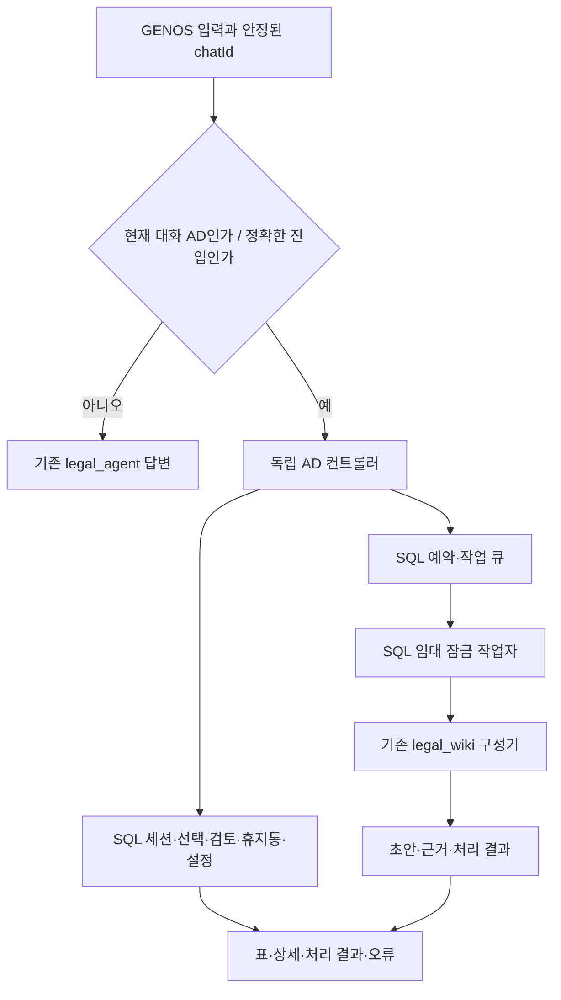

# SQL AD모드 — shortcut·legal_wiki 운영 설계와 구현

> 2026-10-06 후속 사용자 요청: 아래 고정 표현/LLM 미호출 부분은 [AD 자연어·멀티턴 연결](../../OPERATIONS/AD_NATURAL_LANGUAGE_20261006.md)로 대체한다. 기존 구현 결과·MAIN 기록은 과거 상태로 보존한다. NFS 저장소 제약의 후속 변경은 GENOS.md를 따른다.

2026-10-06. 현재 요청의 정본. 이전 대화형 관리 설계의 Redis 선택안·일반 질의에서 관리 의도 자동 판별안은 사용하지 않는다. 구현 근거는 ADR-0657 후보이며, 실제 MAIN 활성 여부·검사 수치는 별도 `RESULT.md`에 기록한다.

## 사용자와 시스템의 경계

단독 `[AD모드 시작]`을 입력한 대화만 관리 화면으로 전환한다. 같은 대화의 다음 입력부터 SQL 컨트롤러가 처리한다. `[AD모드 종료]` 뒤에는 기존 법률 답변으로 돌아간다. 다른 대화창은 전환하지 않는다. 문장 안에 들어 있는 진입 문자열로는 전환하지 않는다.

AD는 shortcut·legal_wiki 관리다. 법률 답변 프롬프트, 검색 경로 선택, 판단 모델과 합치지 않는다. AD 발언·표·실패는 AD 감사 기록에만 저장하고 shortcut 대화/위키 생성 입력에 넣지 않는다. AD 안에서 법률 질문을 해도 법률 agent로 넘기지 않고 종료 방법을 안내한다. 일반 모드의 삭제·승인 표현은 AD 변경을 일으키지 않는다. 단, 사용자가 관리한 OFF·휴지통·정정 상태는 저장 지식의 사용 가능 여부에 반영한다. 이 데이터 정책의 효과까지 없애면 삭제와 OFF가 실제로 동작할 수 없다.

별도 user_wiki나 회원가입은 만들지 않는다. 기존 GENOS 앱/게이트웨이 접근 권한을 사용하고, 서버에 고정한 TEAM_ID를 관리 범위로 사용한다. 대화 본문에 적은 팀·사용자 ID로 권한을 얻지 못한다. `/chat` 경로는 기존 신뢰 게이트웨이를 확인한다. 코드서빙 `/json`은 GENOS의 기존 서비스 접근 경계 안에 둔다. AD 진입 문구 자체가 인증 비밀은 아니다.

## 처리 흐름

고정 명령에는 LLM을 호출하지 않는다. 지원하는 한국어 표현을 폐쇄된 명령·필드·대상으로 변환한다. 해석할 수 없는 입력은 오류와 사용 예시를 돌려준다. 모든 임의 자연어를 이해한다고 주장하지 않는다. 위키 본문 구성에 필요한 모델 호출은 작업자가 기존 구성기를 통해 GENOS 내부 모델로 수행한다. 외부 모델 자동 대체는 없다.

## 읽기와 여러 턴의 선택

`shortcut 목록`, `위키 목록`, `전체 테이블`을 표로 보여준다. 표마다 view ID를 부여하고 행 번호는 전체 결과에서 고정한다. 한 번에 20행, `다음`/`이전`으로 이동한다. 첫 페이지 2번과 다음 페이지 21번이 섞이지 않는다. `V…:21 자세히`처럼 표와 번호를 함께 지정할 수 있다. 새 목록은 과거 선택을 비워 잘못된 대상 변경을 막는다.

목록의 긴 제목은 표시상 줄이지만 상세 원본은 `번호 자세히`와 `계속`으로 끝까지 조회한다. 상세에는 사건 발언·최초 입력·사실 revision·도구 결과·위키 근거·작업별 오류 등이 포함된다. 바이너리 아티팩트는 base64로 조회한다. 내부 sw_/ad_ 테이블과 열 정의도 제공한다. 타 업무 공간 자료는 제외하며, 소유권을 판정할 수 없는 과거 테이블은 OWNERSHIP_UNBOUND로 명시한다. 무제한 SQL이나 파일 경로 실행 권한을 채팅에 노출하지 않는다.

## 승인·수정·휴지통

사용자 검토 상태(PENDING/APPROVED/REJECTED), 원문 revision, 위키 DRAFT/PUBLISHED/STALE, 법률 검증 결과, 휴지통 여부는 별도다. 승인만으로 법률적으로 맞다고 바꾸지 않는다. `게시`는 현재 근거·권한·의존성 검사를 통과한 위키 초안을 공개 가능한 상태로 만든다. 법률 판단 재사용 조건은 기존 검증 정책을 따른다.

수정은 허용 필드만 처리한다. 사실과 위키 내용은 새 revision으로 남기고 원본 이벤트는 보존한다. 원문 근거의 해시/span을 임의로 바꿀 수 없다. 새로운 근거 연결은 shortcut을 보완한 뒤 위키 구성으로 추가한다. 변경된 원문과 연결된 위키/절차는 재검토 대상으로 돌린다.

삭제 요청은 휴지통 이동이다. 실제 원본 삭제·자동 영구삭제는 제공하지 않는다. `방금 버린 것 복구`와 휴지통 표 번호 복구를 지원한다. 휴지통 자료는 기본 목록과 재사용에서 제외한다. 반려 상태는 목록에 표시하고 재사용에서 제외한다. 복구해도 낡은 근거를 자동으로 유효하게 만들지 않는다. 동일 근거로 버린 위키가 야간 구성에서 그대로 다시 생성되지 않도록 제외 서명을 보존한다.

## SQL과 운영

Redis는 쓰지 않는다. 기존 shortcut SQLite v4 정본에 별도 버전의 ad_* 테이블을 추가한다. 세션·행·선택·작업 항목·예약·기능 플래그는 정규화된 관계로 저장한다. 자주 필터링하는 식별자/상태/시각/수량은 별도 열·인덱스·제약을 둔다. 상세 원문, 불변 산출물, 동일 요청 응답 캐시만 JSON/TEXT를 사용한다. [SQL 계약](CONTRACTS.md)에 열과 인덱스의 실제 DDL을 남긴다.

SQLite 정본은 영속 로컬 파일시스템의 단일 상태 볼륨을 사용한다. GENOS의 기존 NFS 원문/로그 경로와 분리해 `GENOS_STATE_DIR`로 선택한다. NFS/CIFS SQLite WAL을 허용하지 않는다. 그 환경만 제공된다면 이 배포의 관리 상태 기능은 활성화할 수 없고 서버형 SQL 저장소 이행이 필요하다. 검증 없이 제한을 해제하지 않는다.

작업은 SQL 큐와 임대 토큰으로 조정한다. 시작·재시도·예약은 접수 결과와 작업 ID를 먼저 반환한다. 종료/중지 요청은 다음 경계 및 커밋 전에 검사한다. 이미 진행 중인 모델 HTTP 호출의 즉시 중단은 보장하지 않는다. 출력 커밋은 중지/lease 만료 시 차단한다. 원본이 대기 중 수정되면 AD_INPUT_CHANGED로 실패 이력을 남긴다.

자정은 Asia/Seoul 기준 다음 해당 시각으로 해석하고 ISO 일시를 응답에 표시한다. `12시`만 있으면 정오/자정을 물어본다. `저녁 12시`는 자정이다. 매일 예약은 동일 시각으로 반복한다. 서버 중단 중 누락된 반복 실행을 무제한 쌓지 않고 재시작 뒤 한 번 처리한다. AD 종료는 작업·예약 취소가 아니다.

프로세스 import/startup에서 작업자를 복구한다. 서버가 정지/scale-to-zero 상태이면 예약 시각 실행을 보장할 수 없다. GENOS에서는 상주 프로세스와 상태 볼륨이 유지되어야 한다. 현장 접근이 없는 외부 로컬 검사는 이 조건 충족을 인증하지 않는다.

## 오류와 검증 범위

AD 오류는 유형, 단계, 원인과 traceback, 관련 작업/요청 번호를 반환한다. DB 오류로 저장 자체가 안 되는 경우에도 응답에 실패 원인을 표시한다. 인증키·서명·비밀번호만 가린다. 잘못된 테이블/필드/스키마/버전 충돌/모델 응답/작업 lease/파일시스템 실패를 숨기지 않는다. 실패한 묶음 변경은 트랜잭션 전체를 취소한다.

검사는 모의 SQL 자료와 기존 회귀 계약, 실제 서비스·채팅·워크플로우 입구 및 배포 파일 해시를 대상으로 한다. 실제 내부 데이터·GENOS 내부 모델·상주 예약 실행은 현장 워크플로우 테스트로 별도 확인한다. 이번 검사 결과를 법률 답변 품질 향상이나 자유로운 자연어 일반화 성능으로 제시하지 않는다.

- [명령어와 실제 대화 시나리오](COMMANDS.md)
- [SQL 저장 및 처리 계약](CONTRACTS.md)
- [구현·이행·검증·복구](IMPLEMENTATION.md)
- [검증·MAIN·메일 결과](RESULT.md)
