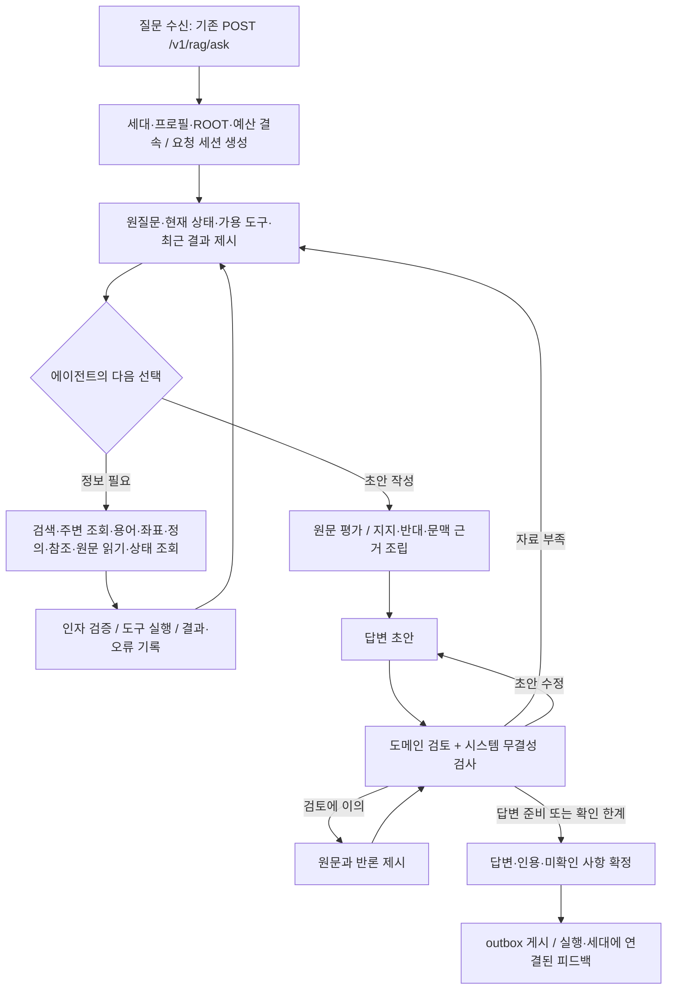

# 도구 선택형 더블하네스 구현 플로우

작성일: 2026-09-21. 상태: 구현 계획. 사용자 요청은 구현 가능성 판단과 플로우 작성이다. 이번 작업은 제품 코드 변경·모델 호출·품질 실험·활성화를 수행하지 않았다.

기준: [상세 설계](DESIGN.md), [계약](CONTRACTS.md), [수용 시나리오](ACCEPTANCE.md). implementation-design-report 절차로 현재 작업 코드와 연결 지점을 대조했다. 자체 검토이며 독립 검토가 아니다. 기존 validation.json의 PASS 범위에 이 추가 문서는 포함되지 않는다.

## 구현 판단

기존 API, 요청별 세션, StageRunner, 원문 조회, 실행 journal과 outbox를 활용하면 구현 가능하다. 가장 큰 작업은 도구 목록 추가보다 도구 결과를 다음 모델 입력에 전달하고, 판단 변경·실패·검토 재진입을 같은 요청 상태에 연결하는 것이다. 구현 가능성과 법률 답변 품질 개선은 별도 검증 대상이다.

확인한 로컬 활성 포인터는 document-navigation-rag-20260921-v1, generation 17, quality_certified=false다. service.py는 해당 release.json의 code_root와 data_path를 읽는다. 아래 변경 대상은 작업 코드다. 현재 실행 중인 프로세스의 선택 상태는 이번 작업에서 확인하지 않았다.

현재 코드에서 확인한 주요 차이:

- Pipeline.__init__/run, app.create_app, Coordinator.run에 v1 구현/프로필 비교가 고정되어 있다. v2 세션만 만들어서는 API에서 실행되지 않는다.
- LegalSession.investigate는 첫 관측이 없으면 list_documents를 자동 실행한다. v2에서는 기본적으로 원질문·ROOT·가용 도구를 먼저 제시하고 첫 행동을 선택하게 한다.
- LegalSession.answer_and_review는 packed.finding_ids가 있을 때 작성한다. v2는 사용 원문의 평가와 유효 근거를 기준으로 작성에 진입하며, finding 장부 완성을 선행 조건으로 삼지 않는다.
- Pipeline.plan은 scope 생략 시 DEFAULT_SCOPE를 사용한다. v2는 명시 제한이 없으면 등록 자료 전체를 ROOT로 잡고, 임시 문서 검색 필터를 별도 관리한다. UI의 자동 필터 전달도 함께 대조해야 한다.

## 요청 하나의 실행 흐름

시스템 하네스는 이 흐름 전체에서 실행·전달·기록·예산·오류 복구를 담당한다. 도메인 하네스는 탐색 중 원문 평가 및 작성·검토 시 적용 대상·조건·예외·사실 부족을 다룬다. 두 하네스는 별도 모델 두 개를 의미하지 않는다.

도구는 한 registry의 schema와 실제 handler를 함께 등록한다. 모델은 browse, search, match_terms, term_occurrences, locate, lookup_definition, follow_reference, read, inspect 중 필요한 것을 선택한다. 트리 조회는 필수 시작 단계가 아니다. 마지막 도구 결과도 다음 입력에서 관찰한 뒤 작성·종료를 판단한다.

원문 읽기 → 실제 입력에 제시 → 평가 → 채택 → 조립 → 검토 → 인용을 각각 기록한다. 후보 P와 원문 E를 구별하며 서버가 발급한 범위·해시를 보존한다. 이미 읽은 원문도 현재 입력에 없다면 다시 제시한다. 사용자가 특정 문서를 언급했다는 이유만으로 탐색 ROOT를 좁히지 않는다.

목록만 요청한 경우에는 검증한 메타데이터로 응답하고 법률 claim을 만들지 않는다. use_llm=false도 결정론 조회 경로로 유지한다. 예산이 부족하면 검토 완료된 독립 주장과 구체적 한계를 반환하며, 원문 무결성 실패는 영향받는 결과 게시를 차단한다.

## 구현 순서와 완료 조건

기존 설계 P1~P5의 책임은 유지하되 P5의 최소 API 연결을 앞당긴다. 이후 단계도 같은 HTTP 경로에서 확인한다. 다음 순서는 구현 계획이며 기존 단계가 완료되었다는 뜻이 아니다.

| 순서 | 구현 산출물 | 완료 확인 |
|---|---|---|
| 기준 고정 | 선택 코드·데이터·색인·정책 확인, 기존 변경과 후보의 경계 기록, capability 검사 | 실제 부모/후보 경로와 hash를 지정하고 v2가 기본 선택되지 않음 |
| 계약과 최소 연결 | v2 protocol/control/profile/journal, registry, API→Pipeline→세션→StageRunner→outbox 연결 | 모의 transport로 locate→read→원문 제시→평가→작성→검토→응답을 같은 HTTP 요청에서 확인. 첫 browse 없이 완료 |
| 탐색 도구 확장 | browse/search/match_terms/term_occurrences/definition/reference/inspect, 정확 범위·cursor | 등록 도구 모두 schema→handler→receipt→다음 실제 전송 payload로 이어짐. 기존 FTS·좌표·bridge 보존 |
| 상태와 복구 완성 | 평가 버전, 복수 유입 경로, 재제시, 부분 실패, 중복 처리, 무진전·예산 제한 | P/E 오입력·부분 READ·중복·stale view 뒤 성공한 작업 보존. 미관찰 결과 자동 채택 없음 |
| 도메인 검토와 재진입 | support/challenge/context, 주장별 검토·반론·표적 무효화, RESEARCH/RECOMPOSE/REVIEW | 잘못된 첫 문서에서 ROOT 복귀, 예외 원문 보존, 오검토 복구, 독립 부분답 보존 |
| 통합 완료 | HTTP/소비자/피드백, v1 회귀, 동시 요청, 게시 복구 | 계약 시나리오 실행 기록과 실패 목록 완성. COMMIT_READY 재게시, RUNNING은 INTERRUPTED |
| 품질 평가 | 새 ADR에서 기준군/후보·평가자료·성공/회귀/비용 기준 사전 동결 | 실제 모델 탐색·답변·검토 품질과 호출/토큰/지연을 측정. 모의 통과를 정답률로 계산하지 않음 |
| 릴리스와 현장 | 승격 자격 충족 후보의 release/승격 plan, apply/rollback, GENOS 인계 | 로컬 활성화 영수증과 GENOS 내부 모델·현장 실행 증거를 각각 확보 |

최소 연결 단계도 형식 검증·요청 격리·원문 결속·호출 상한을 갖춘다. 중간 빌드는 개발용이며 실제 지원한 도구만 노출한다. 모든 필수 capability와 계약이 연결되기 전에는 전체 v2 기능 완료로 표시하지 않는다.

## 파일별 작업 경계

아래 v2 파일과 이름은 제안이다. 기존 설계의 이름을 따른다.

| 기존 위치 또는 제안 파일 | 구현 책임 / 소비자 |
|---|---|
| service.py, semantic_runtime/app.py, pipeline.py | 명시 후보 선택, 요청 검증·scope 의미, 세션·publication 분기 → 기존 API 소비자 |
| PIPELINE.json, ENGINES/legal_agent, SCHEMAS | v2 profile/engine/port와 파일 hash → Contracts·StageRunner. v1 계약 보존 |
| legal_agent/coordinator.py, stage_runner.py | 선택 프로필의 단계 실행, RESEARCH/RECOMPOSE/REVIEW별 artifact 최신성 확인 → 요청 세션 |
| 제안 tool_agent_adapter.py, tools_registry.py | 기존 store/index/glossary 수명과 ROOT 결속, 도구 schema/handler/capability 정본 → 모델 입력과 dispatcher |
| 제안 browse_tools.py, retrieval_tools.py, read_adapter.py | FolderNavigator·FTS·matcher·occurrence·SourceSession의 기능 조합 → 위치/용어/원문 영수증 |
| 제안 tools_protocol.py, tools_session.py, journal-v2.sql / repository.py | 행동 검증·별칭·cursor·원문 평가·불변 기록·의존성 무효화 → view/조립/검토 |
| gateway.py, transport.py, views.py | 최근 결과와 정확 원문을 실제 전송 payload에 포함, 물리 시도·사용량·오류 기록 → 모델과 감사 |
| packer.py, composer.py, reviewer.py, gate.py | 지지/반대/문맥 근거·주장별 검토·반론·한계 → 기존 Result와 control-v2 |
| publication.py, 화면/브릿지 소비자 | journal 버전별 판독·outbox·canonical 인용 → 답변 표시와 피드백 |

외부 Request/Result의 기존 필드는 유지한다. 추가 실행 요약은 허용된 term_agent의 exploration_v2에 둔다. 모델 별칭을 answer.claims의 source_ids로 내보내지 않는다. 후속 발화의 세션 재개는 이번 범위에 포함하지 않는다.

기존 원문·색인의 부모/좌표/출현/참조가 충분하면 서빙 코드·정책·새 요청 DB만 필요하다. 부모 구조 결함이나 tokenizer/참조 정책 변경이 확인되면 영향받는 구조화/파생 색인을 새 세대로 만든다. 원문 재구축이 반드시 필요하다고 미리 가정하지 않는다. 경로는 lawrag.platform.workspace의 논리 root로 해결한다.

## 실패 시 실제 행동과 검증 연결

| 상황 | 시스템 행동과 사용자 결과 | 수용 항목 |
|---|---|---|
| 첫 문서/용어 의미를 잘못 선택 | 가설·유입 경로를 수정하고 ROOT에서 다시 검색, 이전 READ는 보존 | A06/A09/A19/A20 |
| P를 E로 채택하거나 새 E를 추정 | 실행 전 거절, 현재 유효 원문·오류를 다음 입력에 전달, 제한 정정 | A12/A13/A36 |
| 검색 없음·부분읽기·결과 상한 | 범위·coverage·cursor를 알려 재탐색/이어읽기, 규정 부재 단정 금지 | A11/A15/A27/A43 |
| READ 성공 후 다른 행동 실패 | 성공 영수증 유지, 실패 항목만 복구. 저장 실패 결과는 근거로 쓰지 않음 | A28/A35 및 CONTRACTS C11 |
| 맞는 초안을 검토자가 잘못 거절 | 해당 주장과 원문을 대조해 반론·재검토, 무관한 독립 주장은 보존 | A24/A25 |
| 예외가 현재 입력에서 빠짐 | 원문 복원 또는 미확인 처리, 원문 없는 검토 승인 차단 | A22/A30 |
| timeout·재시도·동시 요청 | format/semantic/transport 오류 분리, 물리 호출 예산 공유, 요청별 상태 격리 | A28/A29/A39 |
| 세대·범위 불일치 또는 재시작 | 불일치 자료 사용 차단, 완료 게시만 복구. 중단 모델 호출 자동 재개 없음 | A31/A38/A40 |

최초 완료 검사는 A01/A12/A13/A33/A35/A37을 중심으로 최소 HTTP 경로를 검증한다. 최종 통합에서 ACCEPTANCE.md의 계약 항목과 교차 조합을 확인한다. A23/A36/A44/A45의 실제 모델·의미 품질 부분은 이후 실험 결과로 따로 기록한다.

## 평가·예상 효과·이행

이번 계획에서는 개선률·완료 일수·비용 금액을 산정하지 않는다. 설계 N04/N05의 비용식, N06/N07의 미확인 구분을 따른다. 예상 효과는 도구 접근 누락과 결과 전달 손실을 검출·복구할 수 있다는 것이다. 같은 모델의 적용 오독과 오검토는 남으며, 반대 원문과 재검토 증가로 비용·지연·미답변이 늘 수도 있다. 추가 처리 비용과 중복 탐색 절감이 같아지는 지점이 비용 손익분기다.

품질 실험에 착수할 때는 저장소 실험 표준을 끝까지 읽고 reservation·부모 arm·새 ADR·snapshot/register/freeze를 구현/첫 실험 호출보다 앞에 둔다. 일반 구현 계약 테스트와 품질 비교를 구분한다. 신규 외부 실험은 Gemini/gemini-3.1-flash-lite 공통 클라이언트와 허용 자료 범위를 따르고, 최종 GENOS는 내부 모델로 확인한다. 모델 fallback을 두지 않는다.

승격은 Accepted·out-of-sample·decision_eligible=true·complete 요건 및 hash 고정 promotion plan과 명시 apply 절차를 따른다. 롤백은 이전 code/data/profile release로 복귀하고 v2 journal을 보존한다. 현장 인계에는 코드 리비전·의존성·설정 이름·API 계약·시작/검증/중단 복구/롤백을 포함한다. 이 세션의 GENOS 직접 접근은 불가하다.

## 확인한 근거

- [MAIN 단계와 책임](../../../../00_SYSTEM/ARCHITECTURE.md), [파이프라인 선언](../../../../00_SYSTEM/PIPELINE.json), [workspace 계약](../../../../00_SYSTEM/WORKSPACE.json), [GENOS 진입점](../../../../GENOS.md).
- [활성 포인터](../../../../01_DATA/ACTIVE/local/ACTIVE_RELEASE.json), [선택 릴리스 manifest](../../../../08_DEPLOYMENT/RELEASES/document-navigation-rag-20260921-v1/release.json), [서비스 선택 코드](../../../../service.py).
- [Pipeline](../../../../02_BACKEND/semantic_runtime/pipeline.py), [HTTP 앱](../../../../02_BACKEND/semantic_runtime/app.py), [StageRunner](../../../../02_BACKEND/semantic_runtime/stage_runner.py), [세션 adapter](../../../../02_BACKEND/semantic_runtime/legal_agent_adapter.py).
- [Coordinator](../../../../02_BACKEND/semantic_runtime/legal_agent/coordinator.py), [현행 세션](../../../../02_BACKEND/semantic_runtime/legal_agent/session.py), [원문 도구](../../../../02_BACKEND/semantic_runtime/legal_agent/source_tools.py).

확인 범위는 로컬 문서·선택 manifest·작업 코드의 정적 대조다. 실험 arm의 실패는 기존 DESIGN의 F01~F12 정리를 참고했으며 이번에 원실험을 재실행하거나 독립 재판정하지 않았다. 구현 전에 작업 트리·선택 세대의 실제 파일 hash를 다시 고정한다.
