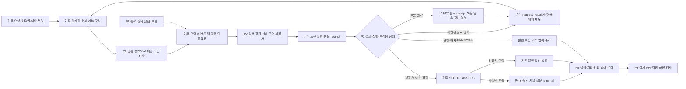

# 도구 선택·실패·부분 완료 후속 구현 설계

작성: 2026-10-14 · 상태: **설계 완료, 제안 기능 미구현·미검증** · 검토: 코드 기반 자체 검토

기존에 정상 동작하는 탐색·원문 검증·판단·저장을 유지하면서, 실패 이유가 사라지는 경계와 부분 완료를 잘못 해석할 수 있는 소비자를 보완한다. 새 에이전트나 별도 복구 실행기를 추가하지 않는다. 기존 SELECT 조사 루프, 요청 저널, 사건 저장소, outbox를 확장한다.

**권장 순서: P1 실패 계약 → P2 도구 정책 → P3 실패 행렬을 먼저 함께 구현한다. 이후 P7 부분 변경 기록 → P4 사실 질문 → P5 전달·취소를 별도 변경으로 진행한다. P6 출력 형식 실험은 보류한다.** 아래 제안 이름은 기존 함수와 구분해 표시했다. 이 문서는 구현·실험·승격·배포·메일 발송을 수행한 기록이 아니다.

## 1. 기준선과 범위

| 구분 | 확인 상태 | 이번 설계에서의 취급 |
|---|---|---|
| 전체 MAIN | 용어집 → 입력·구조화 → 문서–용어 연결 → 색인 → RAG → 피드백 | 이번 변경의 담당은 RAG 서빙 및 응답·재사용 소비자. 상위 문서 구조화·색인 정책은 유지 |
| 선택된 로컬 RAG | `schema-recovery-20261014-r1`, ACTIVE generation 62, `quality_certified=false` | 실제 포인터와 manifest를 기준으로 삼음. ARCHITECTURE 상단 MAIN61 문구는 최신 포인터와 차이가 있음 |
| 작업 코드·도구 R1 인계 | 상황별 도구 제한, 구조 부모의 자식 원문 읽기, 의존 근거·CLARIFY 소비자 보완 | 후속 구현의 부모로 보존. MAIN62 전체 snapshot으로 덮어쓰지 않음 |
| GENOS | 사용자가 제공한 사진·인계 기록만 확인 가능 | 실제 반입·리비전·내부 모델·워크플로우 결과는 미확인. 현장 연결 재시도 안 함 |
| 제외 | `selected team and scope have no documents`의 422 | 사용자 지시대로 수정 대상에서 제외. 다른 원인의 422까지 제외하지 않음 |
| 검사 | 이번에는 소스·문서·설계 산출물 검사 | 신규 런타임 테스트·모델 호출·품질 실험 수행 없음 |

현행 사용자 선택 항목은 **37개(N01)**다. navigation 16, reference 3, ending 3, memory 12, entry 2, wiki hint 1의 합이다. entry와 memory에 이름이 같은 항목이 있으므로 정책 키는 `(surface, name)`으로 만든다. `history_ids`는 도구 호출이 아닌 선택 필드다. 구 v1/v2 도구, 서버 고정 실행, 최초 DIRECT 라우팅은 별도 경계로 검사하며 37개에 억지로 합치지 않는다.

근거 지문은 [SOURCE_BINDING.json](SOURCE_BINDING.json), 선택지별 설계는 [POLICY_DESIGN.json](POLICY_DESIGN.json), 실패 시나리오와 기존 검사 연결은 [FAILURE_MATRIX.json](FAILURE_MATRIX.json)에 있다. JSON은 **설계 자료**이며 실행 설정으로 로드하지 않는다.

## 2. 문제별 기존 처리 → 변경 후 목표

| ID / 같은 입력·상황 | 현재 방식과 실제 관측 | 원인·확인 수준 | 수정 방식 / 확인할 목표 |
|---|---|---|---|
| H01 구조 부모에 자체 본문 없음 | 사진 `hit has no own original blocks`; 합성 구조 부모로 재현하고 도구 R1에서 수정 | 같은 source의 실제 자식 원문과 요청 subtree를 보존해야 함. 현장 실제 hit·generation은 미확인 | 이미 수정된 `article_plan`을 유지. 빈 범위·다른 source·합계 읽기 예산을 정책 행렬에 고정 |
| H02 원문 없는 DEPENDENCY·잘못된 인용 | 사진의 판단 실패·조사 미완료; 도구 R1은 제공된 원문 ref/정확 인용을 요구 | 근거 미전달과 모델 제안 오류 구분 필요 | 원문 없는 의존 도구 비노출, 실행 전 재검증, 교정 소진 후 원래 cause 보존 |
| H03 ERROR / NOT_EXECUTED / DENIED | `unit_reading.read`가 세 반환 상태를 같은 `ContractError('unit READ failed')`로 변환 | 코드 확인. 세 상태가 모두 현재 handler에서 발생한다고 단정하지 않음; 현장 빈도 미관측 | P1: 결과 상태·실행 여부·남은 대상·실제 원인 보존. DENIED와 무결성 오류는 복구 우회 금지 |
| H04 저수준 오류가 문자열로 변환됨 | workflow tool의 handler `ERROR`는 `ToolExecutionError`로 감싸짐. 예외 cause chain은 보존되지만 반환 dict의 상세 원인은 별도 보장이 없음 | 경로별 차이 확인. `SourceSession.execute`의 SQL 오류도 일반 `SOURCE_QUERY_ERROR`로 반환하므로 공통 helper 영향 범위 점검 필요 | P1: 결과형 오류와 예외형 오류 모두 같은 진단으로 정규화. 알려진 transient만 대체 조사 가능 |
| H05 일시 장애 후 메뉴·재개 정책 불일치 가능성 | `request_repair`에는 이미 transient 판별·동일 실패 반복 차단·대체 메뉴가 있음. navigation/menu, reference, memory는 각각 검사 | 기존 구현 존재. 모든 조합이 같은 정책을 따른다는 증거는 없음 | P2: 기존 검사를 감싸는 공통 명세. 기존 owner는 유지하고 정책 중복만 줄임 |
| H06 묶음 일부 성공 뒤 실패·중단 | 완료 target와 원문 receipt를 보존하는 read plan/재개 검사 존재 | 완성된 기능을 다시 만들 필요 없음. 예외 발생 시 action_context가 RUNNING에 남는 경로와 구조적으로 연결 필요 | P1/P2: 완료 receipt 재사용, 미완료 대상만 판단. 저널에 terminal receipt가 없으면 UNKNOWN; 자동 재실행 금지 |
| H07 진짜 사실 부족, claim 없음 | v6.prepare는 facts-only gap을 LIMITED_ANSWER로 유도할 수 있으나 공통 검증은 claim 없는 완료 답변을 거부. 이후 ASSESS도 claim 없으면 Pending | 코드상 확인. 이번 턴 현장 입력으로 재현한 것은 아님 | P4: 검증된 사실 질문 terminal을 별도 계약으로 발행. 단순 `return CLARIFY`만으로 해결하지 않음 |
| H08 위키 연결 저장 뒤 재판단 실패 | `corrected_memory._execute`는 REMAP transaction을 먼저 commit하고 이후 REUSE/ASSESS 실행 | 코드상 부분 commit 가능. 발생 빈도 미관측 | P7: 연결 적용 receipt와 후속 판단 상태를 분리. 같은 요청 재개는 연결 재저장·이력 중복 없이 후속 단계만 수행 |
| H09 화면 단절과 사용자 취소 | 현행 `stream_app`은 browser disconnect 후에도 worker를 계속 실행하도록 명시 | 의도된 현재 정책. 단절을 곧바로 취소로 바꾸면 정상 기능 회귀 | P5: disconnect는 전달 상태, 명시적 cancel은 실행 제어. 현재 deadline·작업 잠금 유지 |
| H10 발행·화면·공유 로그 실패 | outbox/no-clobber export/현재 권한 재검증 구현. 공유 보고는 best effort, delivery_confirmed=false | 저장 완료와 표시 완료는 다름. kill/disk-full/취소 전체 조합 미검증 | P3/P5: 저장·전달·보고서 상태를 별도 검증. 저장 실패를 성공 표시하지 않고 optional 보고 실패는 이미 발행된 답변을 실패로 바꾸지 않음 |
| H11 source gap + REQUEST_FACT | 과거 현장 오류. 현재 `source_gap_actions`는 부족을 유지하며 RESEARCH로 보정 | MAIN60/62에 반영된 방어 | 보존 검사. P4 사실 질문이 이 경계를 다시 우회하지 못하게 함 |
| H12 중복 branch·빈 이유·READ와 DEFER·예외 상태·source_ref | 이전 사진/개발 기록에서 구분된 문제. 형식·관계·원문 검증과 단일 교정이 현재 존재 | 최초 사진의 복합 오류 문구만으로 정확 원인 하나를 확정할 수 없음 | P3에 서로 독립적인 행으로 유지. 다른 branch 근거·예외 삭제·자동 ADOPT 금지 |
| H13 JSON length / SSE length·종료 / schema400 | 일반 JSON length와 SSE UNKNOWN은 다름. wire uniqueItems 투영 뒤 원래 schema 검증 존재 | 현재 경로별 의미가 다름 | P3에서 구분. 429 담당은 gateway, 도구 복구에서 모델 전송을 재시도하지 않음 |
| H14 테스트·작업·선택·현장 코드 차이 | 이전 recovery 4개 의도는 MAIN62에서 현행 fixture로 재확인. 도구 R1 별도 legacy 제외4건과 다름 | 기록 확인 | P3 검사 nodeid·code hash·환경·제외 사유 연결. 기존 실패를 새 통과로 덮지 않음 |
| H15 TRANSFER 위치·실제 배포 불일치 | 사용자 보고의 업로드 경로 수정, 작업 패치와 MAIN62 분리 | 현장 지침으로 확정된 실행 위치 원칙 | 반입은 실제 TRANSFER cwd의 정확한 상대경로, 적용은 기존 ~/DEV. 모델·원문 문제와 별도 release gate |

## 3. 유지할 실행 경로와 목표 구조

실제 경로는 `service.service` → `app`의 `/v1/rag/ask` → `Pipeline` → coordinator → `unified_runtime` → `CaseRepository` 또는 `ShortcutCases` → 기존 단계 실행이다. SELECT에서 `law_navigation.Investigation`, 실제 READ에서 `workflow_relations_tools`/`unit_reading`, 판단에서 `CompletionExecution`, 발행에서 `publication`/`unified_publication`을 사용한다. GENOS 화면 소비자는 `stream_app.py`와 `workflow/genos_rag_chat.py`다.



모델이 도구 허용 여부·재시도 횟수·성공 receipt를 결정하지 않는다. 모델은 현재 제시된 선택지에서 조사 방향을 제안하며 서버는 실제 수행 가능성과 결과를 검증한다. 법률 의미의 정확성은 구조 검사만으로 인증하지 않는다.

## 4. P1 — 실패를 분해하고 원래 원인·부분 결과를 보존

### 4.1 변경 지도

| 기존 파일·함수 | 변경 책임 | 소비자 / 호환성 |
|---|---|---|
| `errors.py: ToolExecutionError` | 기존 exception code 유지, 선택적 typed failure payload와 cause 참조 추가 | 기존 catch·HTTP 기본 매핑 보존. 분류만으로 HTTP를 성공으로 바꾸지 않음 |
| **제안** `tool_outcome.py: normalize_result / classify_exception / validate_outcome` | 정규화와 불변조건 검사만 수행하는 순수 함수 | 호출·sleep·DB 접근·모델 추론 금지 |
| `workflow_relations_tools.py: _execute_batched` | 실행 전 intent, 확정된 실패의 terminal receipt와 원인 코드 기록 | 기존 action_context/observation 소비. RUNNING 상태를 무조건 미실행으로 재해석하지 않음 |
| `source_tools.py: SourceSession.execute`, `relations_tools.py: execute` | 실제 호출 버전에서 원래 SQL 코드·실행 단계 보존 | v1/v3 등 기존 계약 사용자를 따로 검사. 활성 v6와 동일 경로라고 가정하지 않음 |
| `unit_reading.py: read` | generic ContractError 변환 대신 typed failure 전달; 완료 페이지·사용량 유지 | `acquire_batch`, reference reads, context reads, SELECT |
| `request_repair.py: recoverable_tool_failure / record_tool_failure` | payload/cause를 읽고 기존 복구 규칙 적용 | wrapper message나 오류 문자열로 권한·무결성 여부를 추정하지 않음 |
| `request_report.py`, `readable_log.py`, `investigation_diagnostics.py: exception_diagnostics` | root cause·단계·정책·남은 대상과 receipt 참조 표시 | 공개 응답에는 안전한 분류·요청 ID만. 원문·SQL·경로는 내부 원장 |

### 4.2 내부 계약 (모든 이름은 제안)

```python
@dataclass(frozen=True)
class ToolOutcome:
    version: str                 # tool-outcome-v1
    surface: str                 # navigation/reference/memory/entry/wiki_hint/system
    name: str
    operation_key: str           # 의미상 같은 실행; 새 action_id로 실패 한도 초기화 금지
    action_id: str | None         # 실제 저수준 실행 ID; 고수준 선택과 1:1 가정 금지
    binding_hash: str            # principal/scope/generation/profile/policy와 현재 revision 결속
    status: str                 # SUCCESS/EMPTY/PARTIAL/FAILED/BLOCKED/INTERRUPTED
    execution: str              # NOT_STARTED/STARTED/COMPLETED/UNKNOWN
    effects: str                # NONE/OBSERVATION_COMMITTED/DOMAIN_COMMITTED/UNKNOWN
    failure_kind: str | None    # PROPOSAL/TRANSIENT/DEADLINE/BUDGET/AUTH/INTEGRITY/STATE/UNKNOWN/INTERNAL
    cause_code: str | None
    receipt_refs: tuple[str, ...]
    remaining_target_refs: tuple[str, ...]
    usage_ref: str              # 기존 요청 원장의 reservation/usage; 숫자 새로 초기화하지 않음
    failure_ref: str | None     # 접근 통제된 원래 예외·원장 위치
```

`status`는 내부 설명 축이며 기존 tool result.status를 일괄 대체하지 않는다. 초기 단계는 기존 result에 `outcome_version/outcome_ref`를 선택적으로 연결하고 원장 event에 정본을 둔다. 오래된 기록에 없는 정보는 UNKNOWN이며 추측하여 채우지 않는다.

`effects`는 확인된 가장 강한 효과의 요약이며 실제 복구는 개별 receipt_refs로 판정한다. 관측 저장과 사건 변경이 함께 있을 수 있으므로 단일 enum만 보고 전체 rollback/재실행을 결정하지 않는다. 고수준 READ와 내부 read/문맥 읽기/참조 읽기의 parent-child action 관계도 기존 ID로 보존한다.

필수 불변조건:

- `DENIED → BLOCKED/AUTH`, 일반 대체·모델 보정 금지. 실행 전 권한 검사가 거절한 경우만 `NOT_STARTED/NONE`; 그 외 execution/effects는 관측된 값 또는 UNKNOWN.
- `NOT_EXECUTED`라는 문자열만으로 미실행을 확정하지 않는다. validator/pre-reserve 거절 receipt 또는 handler의 확인된 no-effect 계약이 있어야 `NOT_STARTED/NONE`이다. 사후 검증에서 거부한 경우 STARTED일 수 있다.
- `ERROR`는 일시 장애의 동의어가 아니다. 원인 코드가 없으면 `FAILED/UNKNOWN`, 복구 금지. 알려진 SQLITE_BUSY/LOCKED·허용된 timeout 등은 현재 원인 체인을 확인한 경우에만 TRANSIENT다.
- `EMPTY`는 정상 검색 결과다. exact-target 부재 증명은 기존 독립 receipt 검사로만 허용한다.
- `PARTIAL`의 receipt_refs는 기존 저장 원문을 다시 verify한 것만 포함한다. 실패 페이지·단순 preview·계획된 span은 포함하지 않는다.
- 결과 UNKNOWN 또는 effect UNKNOWN이면 동일 동작 replay 금지. 완료 receipt 조회·검증을 거쳐 다음 결정을 내린다.
- 내부 버그(TypeError/KeyError), ACL/원문 hash/모델 binding/상태 revision 실패는 모델 수정으로 복구하지 않는다.

### 4.3 저장·충돌·재개

기존 `action_context` 및 native event에 `TOOL_OUTCOME_RECORDED`를 추가한다. 확정 실패는 실행 ID와 immutable binding으로 기록하고 기존의 `result_json` 반환에 연결한다. 같은 실행 ID의 다른 입력 또는 결과는 Conflict다. 같은 실패 결과를 다시 읽는 것은 저널 조회이지 도구 재실행이 아니다.

실행 앞뒤 I/O 자체가 실패할 수 있다. intent를 저장하지 못하면 실행하지 않는다. tool 결과가 생겼으나 terminal receipt 저장에 실패하면 UNKNOWN으로 멈춘다. 이미 저장된 원문을 삭제하거나 모델 결과로 성공 receipt를 만들지 않는다. 사건 DB와 native journal 사이의 분산 transaction을 가정하지 않는다. 각 저장소의 정본 receipt를 연결하고 소유권 확보 후 reconciliation한다.

기존 문자·페이지·모델·도구 사용량은 그대로 소유 저장소에서 계산한다. `ToolOutcome.usage_ref`는 이를 참조한다. read가 실패한 뒤 `action_state.count` 증가에 도달하지 못한 경우도 실제 `reserve_tool` 기록과 보수적으로 대조하고, 이미 발생한 비용을 환급하지 않는다.

## 5. P2 — 도구 제공·실행·재개 정책을 한 명세로 연결

### 5.1 책임을 나누는 방식

현재 `tool_availability`와 `request_repair`가 이미 하는 일을 보존한다. **제안 `tool_policy.py`**에는 정적 등록부와 판정 함수만 둔다. navigation의 원문 범위·비용 계산은 `tool_availability`, memory 목표·READY 검사와 허용 field는 `memory_methods`, 참조 queue 검사는 `unit_relations`가 계속 담당한다.

```python
@dataclass(frozen=True)
class ToolSpec:
    key: tuple[str, str]           # surface, name
    precondition: str             # 등록된 기존 검사 어댑터 ID
    recovery_owner: str            # investigation / reference / case / gateway / publication
    effect_class: str              # observation / case_mutation / terminal / hint
    resume_rule: str
    allowed_recovery: tuple[str, ...]
    result_contract: str

def assess_availability(spec, binding, state) -> Availability: ...
def choose_recovery(spec, outcome, current_state, request_budget) -> RecoveryDecision: ...
```

두 함수는 도구 실행과 모델 호출을 하지 않는다. `Availability`는 offered, reason_code, current_binding_hash, predicted_cost, policy_version을 반환한다. `RecoveryDecision`은 아래 행동 중 하나와 이유/owner/소비할 기존 예산을 반환한다. 정책 선택·실행 효과는 기존 조사 루프가 기록한다.

| 복구 행동 | 허용 조건 | 실행 담당 |
|---|---|---|
| CONTINUE | 실제 검증된 SUCCESS/EMPTY/부분 진전 | 기존 단계 |
| REBUILD_MENU | 실행 전에 거절·상태 refresh 가능, 현재 principal/scope 불변 | 기존 menu builder. 해시/권한/소유권 실패에는 사용 안 함 |
| OFFER_ALTERNATIVE | 알려진 transient, 같은 허용 scope, 실패와 다른 유효 operation, 예산·시간 있음 | 기존 `Investigation` + `request_repair` |
| RESUME_REMAINDER | 검증된 완료 receipt·미완료 범위·same binding·잔여 예산 존재 | 기존 read plan / reference checkpoint |
| ASSESS_VERIFIED_ONLY | 실제 전달·채택 정책을 만족하는 원문과 종료 예산 있음 | 기존 bounded_result → ASSESS. claim 생성 성공을 보장하지 않음 |
| ASK_FACT | P4가 확인한 실제 사실 부족 terminal | 사건 실행기·terminal publisher |
| RECOVER_PUBLICATION | 이미 준비된 동일 hash 결과·현재 권한·case guard 유효 | 기존 publication owner |
| STOP | 권한·무결성·stale·unknown·내부 오류 또는 복구 한도 없음 | 기존 실패 경로 |

**기본 동일 도구 자동 retry=0(목표 N02)**이다. 기존 대체 조사와 완료 receipt 재사용만 연결한다. 이후 같은 읽기 재시도가 필요하면 read-only 의미만으로 허용하지 말고 실제 local state/receipt 멱등성까지 별도 검증한다. provider 429는 이미 gateway가 소유하며 이 정책에서 중복 retry하지 않는다. schema/decision 교정도 기존 단일 담당과 한도를 유지한다.

### 5.2 실제 연결 순서

1. `build_view/view`와 `memory_methods.offered`가 기존 후보를 생성한다. P2가 공통 명세를 확인하고 현재 대상별 기존 precondition을 호출한다. 미등록 도구는 표시하지 않고 진단한다.
2. 제공한 action map, policy_version/hash, presentation/state binding을 기존 immutable view에 저장한다. 모델은 policy ID·deadline·효과 상태를 수정할 수 없다.
3. `execute_tool` 첫 줄의 기존 `require_navigation`에서 같은 policy와 **현재** scope/revision/cursor/합계 비용을 다시 검사한다. memory/reference도 실제 mutation 전에 동일 패턴을 연결한다.
4. 읽기·조회 실행 후 P1 outcome을 기존 저널에 결속한다. 실패는 단일 owner가 `choose_recovery`로 처리한다. 예외를 받는 여러 계층에서 재실행하지 않는다.
5. resume는 accepted view·policy·generation·최초 deadline·사용량·receipt를 먼저 검사한다. 정책 버전이 달라졌으면 명시된 호환 reader 또는 중단을 선택하며 새 정책으로 조용히 재해석하지 않는다.

`RETURN_TO`는 과거 권한을 복원하는 기능이 아니다. frame은 조사 위치와 기록을 복원하고 현재 ACL·scope·예산으로 메뉴를 다시 만든다. 배치 READ는 전체 선택 조합의 예측 비용을 실행 전에 검사하고, 이미 읽힌 범위와 필수 ancestor 문맥 비용을 기존 계산 그대로 반영한다.

### 5.3 우선순위 규칙

충돌하면 AUTH/INTEGRITY/STATE/UNKNOWN > 명시 취소/DEADLINE/BUDGET > 확정 TRANSIENT/PROPOSAL > 정상 결과 순서로 판정한다. transient cause 안에 원문 변조가 있으면 복구 가능으로 내려가지 않는다. deadline이 끝났으면 bounded fallback용 새 모델 호출도 금지한다. 부분 원문 존재만으로 제한 답변의 성공을 확정하지 않는다.

STOP은 해당 동작을 금지한다는 뜻이다. 선택적 `wiki_hint.history_ids`의 접근 불가·낡은 후보는 현재처럼 후보를 제외하고 일반 조사를 계속할 수 있다. 금지된 후보를 다른 도구로 우회해 사용해서는 안 된다. 필수 원문 검증 실패와 optional hint 제외를 같은 요청 전체 실패로 합치지 않는다.

구현 순서를 고정하는 의사코드는 다음과 같다. 반환값은 계획이며 함수 안에서 실행하지 않는다.

```python
def choose_recovery(spec, outcome, current, budget):
    validate_outcome(outcome)
    permitted = set(spec.allowed_recovery)
    if not current.same_authority_and_binding(outcome):
        return STOP("CURRENT_BINDING_REQUIRED")
    if outcome.failure_kind in {"AUTH", "INTEGRITY", "STATE", "UNKNOWN", "INTERNAL"}:
        return STOP(outcome.cause_code)
    if outcome.execution == "UNKNOWN" or outcome.effects == "UNKNOWN":
        return STOP("RECEIPT_RECONCILIATION_REQUIRED")
    if current.stop_requested or budget.deadline_expired:
        return STOP("STOP_OR_DEADLINE")
    if outcome.failure_kind == "BUDGET":
        return (existing_bounded_exit(current, budget)
                if "ASSESS_VERIFIED_ONLY" in permitted else STOP("BUDGET"))
    if outcome.status in {"SUCCESS", "EMPTY"}:
        return CONTINUE()
    if ("RESUME_REMAINDER" in permitted and outcome.status == "PARTIAL"
            and current.can_resume_verified_remainder(budget)):
        return RESUME_REMAINDER(current.remaining_receipt_targets)
    if ("OFFER_ALTERNATIVE" in permitted and outcome.failure_kind == "TRANSIENT"
            and current.has_distinct_offered_alternative(budget)):
        return OFFER_ALTERNATIVE()  # 선택은 기존 조사 루프; 같은 실패 자동 retry 아님
    if ("REBUILD_MENU" in permitted and outcome.failure_kind == "PROPOSAL"
            and current.pre_execution_rejection):
        return REBUILD_MENU()       # 사용량·no_progress를 초기화하지 않음
    return STOP("NO_ALLOWED_RECOVERY")
```

UNKNOWN receipt reconciliation은 owner가 기존 저널을 읽는 별도 단계이며 성공 확인 전에는 위 판정을 다시 통과할 수 없다. 별도 복구 예산을 새로 만들지 않고 기존 model/tool/read/reentry/no_progress 카운터와 finalization reserve를 참조한다. schema 교정은 이 함수에 들어오기 전 기존 담당이 소유한다.

`same_authority_and_binding`은 이 동작의 검증된 receipt로 설명되는 자체 revision 전이는 허용하되 다른 요청의 변경은 거부한다. memory 명령 전체를 read-only 도구로 취급하지 않는다. P7 재개는 case owner가 개별 effect receipt를 검사한 뒤의 후속 단계에만 적용한다.

등록부에 37개 전체와 역할별 `resume_rule`, `checkpoint_owner`, `success`, `failures`, `existing_tests`, `planned_matrix`를 둔다. 서버 고정 tool/prefetch와 구 프로토콜은 별도 목록에서 호출 경로별 검사를 하고 공유 helper 변경의 영향을 빠뜨리지 않는다.

현재 설계 JSON은 `success_transition`, `failure_policy`, `existing_tests_ref`를 해당 의미의 필드로 사용한다. family 단위 기존 검사 목록은 한 번만 저장해 참조하며 개별 도구의 모든 실패가 이미 검증됐다는 뜻으로 해석하지 않는다.

## 6. P3 — 실패 행렬과 실행 증거를 검사에 연결

`FAILURE_MATRIX.json`은 테스트 실행 결과가 아닌 **구현해야 할 검사 명세**다. 각 행은 입력·실패 지점·기대 상태·예산·호출·저장·재사용 조건, 기존 nodeid, 신규 예정 nodeid, 적용 surface를 가진다.

테스트 runner는 기존 pytest 안에서 구현한다. 별도 제품 실행기는 추가하지 않는다. **제안** `test_tool_failure_matrix.py`는 정책 등록부의 모든 `(surface,name)`에 정상·비제공·상태 변경·잔여 예산·실패·재개 중 적용되는 셀을 요구한다. 해당 없음은 이유를 기록한다. 각 셀에는 PASS/FAIL/NOT_RUN/NOT_APPLICABLE을 분리한다. matrix에 행이 있다는 이유로 테스트 완료라고 표시하지 않는다.

검사 assertion은 예외 타입 하나로 끝내지 않는다:

- 실제 모델·도구 실행 횟수와 기존 reservation 증가량; 미제공 도구의 실제 handler 호출=0.
- 원문·읽은 span·전달·ADOPT/DEFER/EXCLUDE·정확한 gap의 변화. 실패를 부재 증명으로 사용하지 않음.
- 같은 request의 최초 deadline·code/data/policy binding과 재개 usage가 감소하지 않음.
- 부분 성공 원문은 유지하고 미완료 페이지는 완료로 채택하지 않음. restart 후 duplicate effect 없음.
- 동일 요청 재사용과 다른 입력/request/principal 충돌, ACL/판본/revision 변경 시 차단.
- API 결과와 사건 SQL·native journal·outbox·shortcut/wiki·공개 표시 상태 일치.
- disk full/SQLite busy/kill은 임시 fixture 저장소와 subprocess에만 주입. 실제 runtime/현장 저장소를 손상시키지 않음.

변경 파일별 테스트 → 공유 helper를 쓰는 현재 버전별 계약 → 실제 로컬 `service.service` 동일 frozen code/pin → GENOS 워크플로우 현장 검증 순서로 통과 증거를 쌓는다. 테스트가 이미 지나간 과거 기록은 그대로 링크하고 이번 실행의 통과 수로 합산하지 않는다.

구현 후 사용할 로컬 검사 명령 예시는 아래와 같다. 이번 설계 작업에서 이 명령을 실행한 것은 아니다. 첫 명령은 기존 보장, 둘째는 구현자가 추가할 matrix 검사다.

```bash
bash 06_TOOLS/check_wsl_dev_environment.sh
.venv/bin/python -m pytest -q \
  05_TESTS/CONTRACTS/test_tool_availability.py \
  05_TESTS/CONTRACTS/test_container_article_read.py \
  05_TESTS/CONTRACTS/test_investigation_scope_recovery.py \
  05_TESTS/CONTRACTS/test_main50_request_repair.py \
  05_TESTS/CONTRACTS/test_output_contract_recovery.py \
  05_TESTS/CONTRACTS/test_assessment_gap_action.py
.venv/bin/python -m pytest -q 05_TESTS/CONTRACTS/test_tool_failure_matrix.py
```

matrix 실행기는 F01~F49를 실제 fixture/hook에 매핑하고 사용한 각 code/policy/fixture hash를 저장해야 한다. family별 공통 시나리오에 해당되지 않는 선택지는 구체 이유로 NOT_APPLICABLE을 남긴다. 파일 존재 검사나 enum 순회만으로 PASS를 만들지 않는다. 선택 릴리스의 실제 `service.service` 검사는 기존 `test_genos_compact_service_boot.py` 등의 부팅 검사를 보존하고, 새 contract의 성공/실패/중복/terminal 경계를 같은 frozen 코드에 결속해 추가한다.

## 7. P7 — 부분 변경이 남는 명령의 재개·표시

우선 대상은 `WIKI_RELINK`이고 FACT_UPDATE/STATE_RESTORE/PURPOSE_REVISE/RESEARCH_REPLAN의 사건 변경에도 같은 원칙을 적용한다. 현재도 사건 변경과 완료된 단계가 저장되므로 실패했다고 원상 복구된 것으로 표시하면 안 된다.

**권장 정책은 적용한 연결을 보존하고 후속 판단을 재개하는 것**이다. 자동 보상 rollback은 나중의 사용자 수정을 덮어쓸 수 있으므로 기본값으로 만들지 않는다.

제안 `case_operation_effect` additive table:

```sql
CREATE TABLE case_operation_effect (
  request_key TEXT NOT NULL,
  effect_key TEXT NOT NULL,
  input_hash TEXT NOT NULL,
  binding_hash TEXT NOT NULL,
  expected_revision INTEGER NOT NULL,
  kind TEXT NOT NULL,
  payload_hash TEXT NOT NULL,
  receipt_json TEXT NOT NULL,
  followup_status TEXT NOT NULL,
  PRIMARY KEY (request_key, effect_key)
);
```

연결 변경과 effect receipt·wiki_event를 **같은 case DB transaction**에서 commit한다. receipt는 old/new knowledge, 위키 event ID, 현 source/generation binding을 가리키고 원문을 중복 복사하지 않는다. followup_status는 PENDING/COMPLETE/FAILED/BLOCKED만 사용한다. 늦은 결과는 expected_revision과 receipt hash 검사를 통과해야 갱신한다.

동일 요청 재개 시 receipt가 있으면 현재 연결·지식권한·수정 revision을 검사한다. 일치하면 relink와 wiki_event를 다시 만들지 않고 ASSESS 이후만 실행한다. 이미 다른 요청이 연결을 바꿨다면 BLOCKED로 종료한다. receipt 없는 과거 실패는 당시 effect를 추측해 새 행으로 꾸미지 않는다. owner 하에서 기존 wiki_event/request/현재 연결의 유일한 일치가 증명될 때만 명시 migration receipt를 남기고, 불명확하면 운영 진단으로 멈춘다.

후속 실패 응답 예시는 “연결 변경은 저장됐지만, 그 연결로 검토를 완료하지 못했습니다.”다. 이 문구는 실제 receipt가 있을 때만 사용한다. 사용자의 사실 변경이나 연결 적용 성공과 법률 판단 완료를 분리하며, 실패한 후속 판단은 경험·성공 shortcut으로 승격하지 않는다.

## 8. P4 — 실제 사실 부족을 질문으로 끝내는 명시적 계약

### 8.1 현재 계약 때문에 필요한 범위

`completion_execution.py`에 `return CLARIFY` 한 줄을 추가하면 부족하다. 앞의 `completion_v6.prepare → assessment_errors`가 claim 없는 LIMITED_ANSWER를 거부하고, 뒤의 `CaseRepository.validate_response`와 `unified_publication.validate_saved`는 goal이 있는 응답에 READY/current route를 요구한다. `result_port`도 ASSESS/COMPOSE를 전제로 읽는다. 기존 target clarification은 goal 없는 경우이므로 동일하지 않다.

**기존 v5~v8 계약은 보존한다. 제안 profile `fact_clarification_version=user-fact-clarification-v1`이 켜진 새 계약 경로만 추가한다.** 새 completion 계약은 다음 빈-claim terminal을 명시적으로 허용하며 모든 공통 원문/필드 검사를 그대로 적용한다. 모델이 내는 disposition을 무조건 승인하지 않는다.

구현 파일은 **제안 `completion_v9.py` / `investigation-completion-v9`**로 분기한다. v8의 원문 ref·조건/예외 구조를 유지하고 gap의 선택적 `fact_question` 계약을 추가한다. 공통 검증을 `validate_assessment_core`(schema·issue·gap·claim·원문·사실)와 `validate_answer_completion`(claim이 있는 정상/제한 답변 종결)로 분리하되 구 버전은 두 검사를 원래 순서대로 호출한다. v9도 core 검사는 생략하지 않으며 `validate_fact_terminal`을 통과한 경우에만 일반 답변 종결 대신 사실 질문 종결을 허용한다. 예외 문자열을 잡아서 claim 검증 실패를 무시하는 방식은 금지한다.

### 8.2 허용 조건과 계약

- 사용자 요청이 실제 사건 적용을 요구함을 기존 INTENT의 원문 범위·request binding으로 확인한다. 일반 규칙 설명에는 개인 사실을 요구하지 않는다.
- 검증된 gap은 MISSING_FACT, REQUEST_FACT, material=true, material_id=null이어야 한다. 저장 법령·서식·원문을 묻는 gap은 거부한다.
- 질문 항목은 issue_id, 부족한 사실명, 필요한 이유, 해당 사용자 요청 구간을 가진다. 실제 사실값은 만들지 않는다. 기제공 사실과의 중복 질문을 검증한다.
- 어떤 사실이 법률상 필수인지의 의미 판단은 검증 대상이다. 구조·원문 provenance가 맞아도 의미 정확성은 별도 사례 검토가 필요하다.
- source gap과 fact gap이 함께 있으면 허용된 원문 조사를 먼저 수행하고 남은 두 부족을 모두 보존한다. 원문 조사를 fact 질문으로 대체하지 않는다. 종료 시에도 source 부분은 unresolved임을 명시한다.
- 검증된 claim이 있으면 기존 LIMITED_ANSWER에 사실 질문을 부가할 수 있다. claim이 없을 때만 별도 fact-clarification terminal을 사용한다.

새 계약에서는 ASSESS 응답의 MISSING_FACT 항목에 `fact_question`을 함께 제안하도록 한다. 서버는 비어 있지 않은 사실명·issue/request 연결·기제공 여부를 검증하고, 검증된 이름으로 고정 질문 템플릿을 렌더링한다. 기존 reason의 자유문장에서 사실명을 추측하지 않는다. 필드가 없거나 검증을 통과하지 못하면 기존 단일 교정 또는 명시 Pending으로 종료한다. 별도 질문 작성 모델 호출을 추가하지 않는다.

제안 `user-fact-clarification-v1` 정본 필드:

```text
request_key, goal_id, revision, input_hash, scope_hash, generation_binding
assessment_ref, intent_ref, gap_refs, unresolved_source_gap_refs
questions[{issue_id, fact_key, reason, request_quote_ref}]
status=CLARIFY, clarification_kind=USER_FACT, legal_answer_complete=false
requires_new_user_input=true, automatic_resume_available=false
```

종료된 현재 요청의 예산은 되살리지 않는다. 같은 요청을 다시 보내면 같은 현재 질문 결과를 재검증해 반환한다. 사용자 답변은 **새 요청**으로 FACT_UPDATE에 연결하며 해당 fact 값의 실제 사용자 원문을 보존한다. revision/권한이 달라졌으면 이전 terminal을 재사용하지 않는다.

### 8.3 변경 지도와 저장/발행

| 변경 지점 | 필요한 동작 |
|---|---|
| `completion_contracts.py`, `completion_v5.py`~`completion_v8.py`의 계약 선택 경계 | 기존 validator는 유지. 새 contract에서만 fact terminal 허용; claims와 gap을 삭제해 통과시키지 않음. 공통 의미/근거 검증 재사용 |
| `CompletionExecution.completion_stage` | 새 terminal 객체를 작성·검증. invalid proposal 교정 담당은 기존 owner. 질문만 생성하는 새 추가 모델 호출은 기본 사용 안 함 |
| `corrected_memory._execute` / `case_repository.py` | ASSESS terminal 검증·저장 후 COMPOSE를 실행하지 않고 반환. goal은 PENDING/pending=ASSESS 유지; 가짜 READY·가짜 route 생성 금지 |
| **제안** `request_terminal` table | request_key + terminal_hash로 current goal/revision·실제 assessment ref 저장. 기존 request.status COMPLETE는 요청 처리 완료이지 법률 해결을 뜻하지 않음 |
| `validate_response`, `unified_runtime.result_port/execute` | 일반 답변 / 대상 질문 / 사실 질문을 판별하는 버전 명시. fact terminal은 실제 partial refs만 검증; COMPOSE 직접 접근 금지 |
| `publication.py` / `unified_publication.py` | **제안 `prepare_terminal`**은 같은 durable outbox/export 핵심을 재사용하되 terminal 전용 guard를 호출. 기존 일반 답변의 FINAL/READY guard는 그대로 유지 |
| `PIPELINE.json` + **제안** `legal.terminal-binding-v1` 스키마 | 새 terminal validator·schema hash·consumer version 결속. 기존 `legal.case-binding-v1` 필드나 의미를 소급 변경하지 않음 |
| `successful_answer.py`, shortcut/wiki 소비자 | fact clarification·target clarification·실패를 법률 성공으로 등록하지 않음. 현재 요청 종료와 답변 완료를 구분 |
| chat view·GENOS workflow·request report | 사용자에게 필요한 사실 질문과 미확인 원문을 표시. backend COMPLETE 또는 HTTP200만 보고 성공 라벨 부착 금지 |

새 외부 응답은 `legal-agent-unified-response-v2` / `legal-agent-shortcut-response-v2`를 **제안**한다. old/new reader를 함께 두고 selected profile·workflow capability가 일치할 때만 발행한다. 새 terminal을 구 소비자가 정상 답변으로 오인할 수 있으면 activation을 차단한다. 코드 ZIP과 별도로 워크플로우 편집기 반영 여부를 확인해야 한다.

## 9. P5 — 실행·발행·전달·명시 취소의 수명 관리

### 9.1 서로 다른 상태 축

| 축 | 제안 상태 | 정본 |
|---|---|---|
| 실행 | RUNNING / STOP_REQUESTED / STOPPED / COMPLETED / FAILED / UNKNOWN | 요청 제어 record + worker 확인 receipt |
| 법률 결과 | ANSWER / LIMITED_ANSWER / CLARIFY / PENDING / FAILED | 검증한 기존 결과 또는 P4 terminal |
| 발행 | NOT_PREPARED / PREPARED / PUBLISHED / BLOCKED | 기존 native publication outbox |
| 전달 | NOT_STARTED / EMITTING / SERVER_FINISHED / DETACHED / FAILED / CLIENT_ACKED | delivery event; CLIENT_ACKED는 실제 지원하는 소비자만 |
| 공유 보고 | QUEUED / WRITTEN / FAILED / UNKNOWN | 기존 DeferredReport 기록; 답변의 정본 아님 |

서버가 delta를 보냈다고 사용자가 보았다고 기록하지 않는다. CLIENT_ACKED는 request/result hash/최종 seq를 결속한 실제 consumer acknowledgement가 있을 때만 허용하며, GENOS가 지원하지 않으면 SERVER_FINISHED와 `delivery_confirmed=false`를 유지한다. ack 부재만으로 검증·발행 완료된 서버 답변을 실패나 재생성 대상으로 바꾸지 않는다.

### 9.2 명시 취소와 단절

초기 P5a는 관측·조회·단절 검증만 구현하고 현재 disconnect 후 worker 계속 실행 정책을 보존한다. P5b에서 사용자의 **명시적 취소**만 협력적 stop token으로 연결한다.

제안 API는 `GET /v1/rag/requests/{request_id}/outcome`, `POST /v1/rag/requests/{request_id}/cancel`이다. 현재 API가 아니다. `app.py`와 `service.py`의 명시 route allowlist/JSON gateway adapter에 같은 인증·팀·세션·입력 binding을 연결한다. 문자열 prefix만으로 경로를 열지 않으며 타인 request ID는 조회·취소할 수 없다. platform 사용자 신원 전달 여부는 GENOS에서 별도 확인한다.

cancel은 실행 worker의 owner lock을 뺏지 않는다. 별도 짧은 transaction으로 request control에 STOP_REQUESTED만 저장하고 worker가 안전 지점에서 확인한다. API의 취소 접수는 worker 종료 확인이 아니다. 요청 제어 record에는 request_key, input_hash, requested_seq, request_control_revision과 stop acknowledgement가 필요하다.

`RequestContext.remaining` 및 실제 model/tool 호출 전, 배치 페이지 사이, case commit/publication 직전에 stop 검사를 둔다. `dataclasses.replace`로 만드는 child context에도 같은 token을 전달한다. asyncio task 취소만으로 thread·외부 호출이 중단됐다고 기록하지 않는다. 전송 중이면 결과는 UNKNOWN일 수 있으며 새 호출을 만들지 않는다.

commit/publication과 cancel의 경쟁은 순서가 명확해야 한다. cancel 접수가 이미 commit된 작업을 자동 rollback하지 않는다. 부작용·최종 발행 직전에는 request control revision을 재확인하고 operation receipt와 연결한다. 같은 case DB에 넣을 수 있는 변경은 한 transaction으로 직렬화한다. native publication과 case DB는 분산 원자성을 보장하지 않으므로 PREPARED/EXPORTED receipt를 확인해 `취소 전에 완료됨`, `중단됨`, `결과 확인 필요`를 구분한다. PUBLISHED면 기존 결과를 유지하고 이미 완료됐음을 반환한다.

### 9.3 코드와 표시 소비자

`stream_app.py`의 detach/queue/active-request 관리, `answer_stream.capture`, workflow의 `answer_delta/finish`, `request_report`에 동일 delivery ID와 result hash를 연결한다. delta의 request/seq·prefix 검증을 유지한다. 기존 answer text 이벤트는 바꾸지 않고 terminal 상태 envelope를 별도로 버전 관리한다. 부분 생성 후 실패는 실패 안내를 구분해서 표시하고 새로운 생성 답변을 이어 붙이지 않는다.

로그가 막힌다고 legal worker가 영원히 기다리지 않도록 기존 bounded best-effort 보고 정책을 유지한다. 필수 native receipt 저장 실패는 실패/UNKNOWN으로 종료하고, 선택적 공유 로그의 실패는 별도 운영 상태로 남긴다. 재개 가능 표시는 실제 checkpoint와 현재 권한/예산이 확인된 경우에만 켠다.

## 10. P6 — 조건부 후속 실험: 지금은 비활성

key 기반 출력·sparse patch·입력 축소는 이 설계의 필수 구현에 포함하지 않는다. 이전 sparse 교정은 행동·근거를 따로 바꾸는 문제가 있었고, schema 문자 수 감소가 실제 호출/토큰/품질 개선을 보장하지 않았다. 현재 전체 결정 교정·원래 validator·원문 ref를 유지한다.

후속 실험을 하려면 새 ADR 선점 → 현재 선택 부모와 후보의 코드/프롬프트/model/data/schema 동결 → 같은 독립 조건에서 비교 → 심각한 인용·권한·상태·소비자 회귀 검사 순서를 따른다. 기본 실험 모델 정책을 다시 읽고 내부 질문의 외부 반출 승인으로 확대하지 않는다. 새 형식을 제품 설정에 미리 넣거나 fallback으로 활성화하지 않는다.

## 11. 구현 작업 패키지와 완료 조건

| 패키지 | 순서·의존성 | 구현 산출물 | 완료 조건 |
|---|---|---|---|
| A0 기준 고정 | 먼저 | MAIN62 manifest + 현재 후속 patch 파일별 차이 + profile/engine pins | 검사 대상 코드와 보존할 최신 변경 구분. 기존 dirty 변경 덮어쓰기 없음 |
| A1 P1 | A0 | outcome 정규화·error payload·실패 receipt·unit_read 연결 | ERROR/NOT_EXECUTED/DENIED·unknown·부분 결과 서로 구별; 정상 결과/원문/호출 보존 |
| A2 P2 | A1 | 37개 정책 어댑터·menu/execute/resume binding | 현재 성공 메뉴 보존, 불가능 도구 handler 호출0, 단일 owner, 같은 실패 맹목 반복0 |
| A3 P3 | A1부터 병행 작성, A2 후 통합 | matrix pytest, 결과 manifest, API/소비자 검사 | 모든 적용 셀 결과/미검증 이유 존재; 기존 테스트 의도 보존 |
| B P7 | A1~A3 | case effect receipt·명령별 부분 완료 표시·멱등 재개 | relink/상태 변경 중복 없음; 후속 판단 실패를 전체 rollback/법률 성공으로 오표시하지 않음 |
| C P4 | A1~A3, B 저장 규칙 | terminal 계약·공통 검증·pending case·발행·UI·재사용 제외 | no-claim fact 질문 가능, 법령 gap 떠넘기기 불가, duplicate/revision/권한/소비자 검사 |
| D1 P5a | A1~A3 | 결과 조회·delivery 상태·disconnect/kill 검사 | 단절 후 기존 worker 정책과 no-regeneration 보존; 저장과 표시 구분 |
| D2 P5b | D1, B | 인증된 취소 명령·stop token·commit 경합 처리 | 취소 접수/실제 중단 구분, 타인 취소 거절, in-flight unknown·후속 비용 차단 검증 |
| E P6 | 별도 사용자 범위·ADR | 동결 후보·비교 결과 | 실험 전 동결 기준 충족 때만 별도 채택 검토 |

`tool_outcome_version`, `tool_policy_version`, `fact_clarification_version`, `request_lifecycle_version`, `case_effect_receipt_version`는 **제안된 selected-profile 설정명**이다. 환경 변수로 몰래 활성화하지 않는다. 동일 코드·schema·policy·profile hash를 engine pins/manifest에 연결하고 HEALTH binding에 실제 effective version을 표시한다. 정확한 새 release ID·generation 번호는 구현 시 예약/승격 절차에서 정하며 여기서 선점하지 않는다.

## 12. 이행·활성화·롤백

1. 문서·원문·색인 재구축은 이번 설계에 필요 없다. 정본 source, generation, 검색 정책은 유지한다. outcome/event 및 case table은 additive migration으로 검사하고 원본 기록은 보존한다.
2. 오래된 journal/route는 기록된 계약 reader로 검증한다. 정보가 없으면 UNKNOWN/legacy로 표시한다. migration 완료가 이미 진행 중인 요청의 새 정책 사용을 뜻하지 않는다.
3. P1/P2는 먼저 metadata와 진단부터 연결하고 기존 정상 처리의 차이를 검사한다. 실패 분기 변경·P4/P5는 별도 profile version과 소비자 capability가 모두 준비된 뒤 켠다. feature를 끈 상태의 경로도 계약 검사한다.
4. 로컬 MAIN 승격이 요청되면 해당 ADR 절차와 hash 고정 promotion plan, 명시 `--confirm-main`, 포인터 및 실제 로컬 service 선택 확인까지 수행한다. Git main 병합과 제품 MAIN 선택은 별도다.
5. GENOS 반입은 검증된 설치 바이트/알려진 inventory만 기존 ~/DEV에 적용한다. 실제 TRANSFER cwd에서 ZIP·정확한 RUN 상대경로를 사용한다. 현장 명령은 `python3`다. code push, 리비전 배포, SSE 재시작, P4/P5 workflow 편집기 반영, 워크플로우 테스트를 별개 receipt로 기록한다.
6. rollback은 데이터 삭제 없이 이전 code/profile 선택으로 한다. **새 terminal/receipt를 읽을 수 없는 이전 reader로 진행 중 새 요청을 넘기지 않는다.** admission을 잠시 제한하고 현재 worker를 drain한 뒤, 미종료 요청은 구 reader와 호환되는 checkpoint인지 확인하거나 새 reader에서 보류한다. additive table과 실패 이력은 남긴다.
7. 제안 기능의 실제 효과는 로컬 합성 검증과 현장 검증을 나눠 보고한다. GENOS 내부 모델·원문·화면 미검증 상태를 지우지 않는다.

## 13. 기대 효과·부담·판정 기준

정확도·재발률·평균/p95 지연·인일은 **미산정**이다. 신규 모델·현장 실행 없이 수치 개선을 주장하지 않는다. 아래는 구현 목표와 측정식이다.

| ID | 종류·단위/분모 | 기준·계산·목표 | 검증·악화 조건 |
|---|---|---|---|
| N01 | 관측 / 선택 항목 수 | 16+3+3+12+2+1=37. 동일 이름은 surface로 구분 | 소스 등록부와 catalogue 비교. DIRECT·서버 실행은 별도 |
| N02 | 목표 / 자동 동일 operation retry 수 | P1/P2 기본0. 기존 gateway429 한도는 별도 보존 | transient/unknown/restart 주입에서 실제 handler/model counter 확인 |
| N03 | 목표 / 정상 요청당 추가 모델 호출 | P1/P2/P7 및 P5a = 0. P4 질문은 검증된 gap으로 결정적으로 렌더링 | 기존 정상 fixture와 calls/답변/근거 동일 비교. P6는 해당 없음 |
| N04 | 계산식 / 요청당 추가 시간 | `정책 검사 시간 + 추가 durable 기록 시간 + 복구 경로 시간 - 피한 실패·반복 시간` | 복구가 안 일어나면 검사·쓰기만큼 느려질 수 있음. NFS/fsync p95 별도 측정 |
| N05 | 목표 / 부분·실패 요청당 잘못된 성공 등록 수 | 0 | shortcut/wiki/publication 소비자 DB assertion. 검사0건은 현장 위험0 증명 아님 |
| N06 | 계산식 / 순 호출 변화 | `추가 조사·교정 물리 호출 - 방지한 불가능 선택·중복 호출` | 근거 없는 절감률 금지. P2가 더 많은 정상 조사를 허용하면 호출은 늘 수 있음 |

성능 손익분기는 N04≤0이다. P1/P2의 성공 기준은 시간 절감 자체보다 원인 구별·잘못된 실행 차단·정확한 재개다. 비용 증가를 숨기지 않도록 원장 쓰기 수/bytes/fsync 지연과 사용자 응답 지연을 함께 기록한다. P4 의미 품질은 일반 질의에서 불필요한 사실 질문이 늘지 않는지 별도 사례 평가가 필요하다.

## 14. 자체 검토 결과와 남은 확인

- 기존 transient 복구, 부분 read 재개, schema 단일 교정, budget 복원, publication outbox를 미구현이라고 재분류하지 않았다.
- 기존 “도구 R1”의 모든 파일이 MAIN62에 선택된 것으로 설명하지 않았다. SOURCE_BINDING에 작업/선택 hash를 따로 기록한다.
- P4는 schema 허용·case PENDING·current guard·terminal publication·shortcut/UI까지 연결해야 완료다. 단일 함수의 예외 완화로 끝내지 않는다.
- P5는 현재 disconnect 후 계속 실행을 보존하고, 사용자 취소를 별도 구현으로 둔다. 실제 UI ACK를 관측하지 못하면 전달 완료로 선언하지 않는다.
- 알려진 실패 사건은 행렬에 연결했지만 **모든 가능한 예외를 완전하게 증명한 것은 아니다**. 미분류 오류는 원인 보존 후 중단하고 새 행으로 추가한다.
- 이번 검토는 자체 검토다. 독립 에이전트·현장 실험·런타임 회귀 실행을 수행하지 않았다. [VALIDATION.json](VALIDATION.json)은 문서/참조/등록부 검사만 보고한다.

핵심 근거: [실패 복구 지침](../../OPERATIONS/AGENT_FAILURE_RECOVERY_POLICY.md), [MAIN62 구현 기록](../SCHEMA_FAILURE_RECOVERY_DESIGN_20261014/IMPLEMENTATION_20261014.txt), [도구 R1 검증 기록](../../../../08_DEPLOYMENT/GENOS/handoffs/tool_availability_20261014_r1/VALIDATION_SUMMARY.txt), [GENOS 진입점](../../../../GENOS.md). 원문과 완료 기록은 수정하지 않았다.
