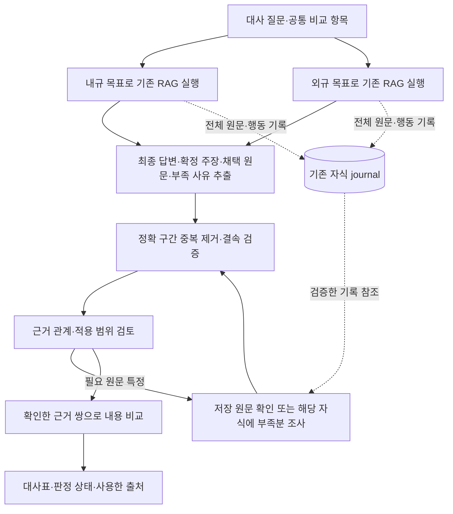

# 최종 채택 근거를 사용하는 내규·외규 대사 최적화 설계

2026-10-15 · **설계만 완료. 제품 구현·신규 모델 실험·MAIN 승격·GENOS 반영은 수행하지 않았다.**

기준은 로컬 **MAIN73 `latest-document-selection-20261015-r1`**이다. 실제 실패 수치는 MAIN72의 ADR-0795 한 질문에서 관측했다. 두 릴리스의 대사 반환·입력 구성·판단 코드는 같은 해시이며, MAIN73에서 같은 질문을 다시 실행한 것은 아니다. 선택 334파일을 manifest와 대조했다. [코드·데이터·관측 근거](EVIDENCE.json).

## 1. 설계 결정

**각 RAG가 최종 답변에 채택한 주장과 정확한 원문 구간을 대사에 전달한다. 전체 조사 이력은 자식 실행 기록에 보존하고, 부족한 근거만 기존 RAG에 추가 요청한다.**

대사의 기본 입력은 다음 네 가지다.

1. 내규·외규의 최종 답변, 상태와 주장별 근거 연결.
2. 채택한 원문 구간과 판본·좌표. 같은 구간은 한 번만 보낸다.
3. 확인된 조건·예외·상충 및 미해결 사항. 인용되지 않았다는 이유로 이미 확인된 반대 근거를 숨기지 않는다.
4. 원래 조사 기록으로 돌아갈 실행 ID·revision·해시. 전체 검색식·행동 목록·본문을 다시 붙이지 않는다.

이미 있는 **SELECT → ASSESS → COMPOSE의 확정 기록**을 사용한다. 이를 다시 고르는 별도 LLM·요약 에이전트는 만들지 않는다. 최종 채택은 시스템의 근거·상태 검증을 통과했다는 뜻이며 법률 판단의 정답 인증은 아니다.

처음부터 전체 94건을 분할 처리하거나 입력 제한을 높이는 방식은 채택하지 않는다. 우선 전달 대상을 바로잡고, 필요한 근거가 실제로 큰 경우에만 그 근거를 나눈다. ‘최대 11개’처럼 이번 사례의 개수를 일반 제한으로 고정하지 않는다.

## 2. 확인한 현재 상태

### 관측 수치와 단위

아래는 모두 MAIN72/ADR-0795, 알려진 유동성 질문 1건의 보존 기록을 읽어 집계한 값이다. 최적화 후보를 실행한 결과가 아니다.

| ID | 항목 | 내규 | 외규 | 합계·의미 |
|---|---|---:|---:|---|
| O01 | 읽어서 저장한 evidence 기록 | 24 | 70 | 94건; 서로 다른 조문 94개가 아님 |
| O02 | 읽은 서로 다른 source ID | 12 | 17 | 29개 원문 단위 |
| O03 | 같은 source ID·본문 해시의 반복 기록 | 12 | 35 | 47건; 서로 다른 문서의 같은 문장은 합치지 않음 |
| O04 | 최종 답변에서 인용한 source ID | 3 | 8 | 11개 원문 단위 |
| O05 | 확정 ASSESS의 인용 구간 `span_receipts` | 3 | 13 | 16개 원문 구간 |
| O06 | O05의 원문 본문 길이 | 147 | 985 | 1,132자; 메타데이터·답변·주변 문맥 제외 |
| O07 | 기존 입력의 원문 본문 길이 | — | — | 46,122자 |
| O08 | 중단 직전 workflow 입력 재구성 | — | — | 129,927자; 제한 100,000자 초과 |
| O09 | 기존 실행 | — | — | 모델 16/40회, 약 297.8초; BASIS·COMPARE 호출 0회 |
| O10 | 현재 MAIN73 설정 | — | — | 전체 모델40회·1800초·입력100,000자; 개선된 처리량의 실측이 아님 |

O08의 `sources` JSON은 89,816자, `rag_results` JSON은 38,943자다. 원문 이외에도 반복 메타데이터와 조사 행동 목록이 입력을 키웠다. 제공자에 BASIS 요청을 보내기 전에 `Runtime.view()`가 중단했다. HTTP200·END·partial 보고서 저장은 대사 성공이 아니다.

### 실제 연결과 차이

- `workflow_rag.execute()`가 `child.evidence()` 전체를 부모 observation에 복사하고, 모든 자식 observation을 `records`에 담는다.
- `Runtime.view()`는 부모 `ctx.rag.evidence()` 전체와 양쪽 `rag_results` 전체를 한 입력에 넣는다. `report.build()`도 전체 evidence를 출처 카드와 본문으로 다시 출력한다.
- RAG의 `case:ASSESS`에는 이미 `claims[].span_receipts`, `issue_refs`, `gaps`, `issue_assessments`가 있다. `case:SELECT.selected_originals`에는 채택 구간과 완전성 상태가 있다. 공개 `answer.claims[].source_ids`만 쓰면 이 정밀도가 사라진다.
- `unified_publication.validate_saved/validate_current()`는 현재 case commit·route·판단 참조·원문·권한을 검증한다. 새 추출도 이 경계를 재사용해야 한다.
- MAIN73의 최신 파일 선택은 유지한다. 최신 표시를 법적 효력의 검증으로 취급하지 않는다.
- **표시 배선 차이:** 작업 트리 `source_tiers_ui.py`에는 `workflow-source-v1` 처리가 있지만, 선택 MAIN73 파일은 `source-tiers-v4`만 처리한다. 현재 API 응답과 인라인 답변이 있다는 사실로 선택 UI의 대사 출처 카드까지 연결됐다고 간주하지 않는다.
- 과거 `COMPARE_INTERNAL_EXTERNAL.md`는 이미 내규 조문이 주어지는 다른 입력을 중심으로 설명한다. 현행은 질문으로 양쪽 RAG를 호출한다. 과거 v4 출처 tier 기능도 v6의 확정 case 기록을 대신하는 정본으로 재도입하지 않는다.

## 3. 문제별 전후 비교

| 문제·동일 상황 | 기존 방식과 실제 결과 | 수정 방식 | 원하는 결과·통과 조건 |
|---|---|---|---|
| 최종 답변이 일부 원문만 채택 | 읽은 94기록 전부 전달; 실제 인용은 11 source/16 span | 확정 ASSESS 인용 구간을 기본 집합으로 추출 | 채택한 구간 누락 0, 별도 이유 없는 미채택 원문 유입 0 |
| 같은 원문을 여러 번 읽음 | 같은 source·본문 반복 47건 | 판본·문서·구조·블록·offset·해시로 중복 제거하고 origin 참조 보존 | 같은 구간 1회 전달; 문서·판본이 다르면 별도 유지 |
| 답변·조사 이력이 커짐 | `rag_results` JSON 38,943자 | 모델용 경량 view와 감사 기록 분리 | 답변·부족 사유 유지; 행동 전체 목록은 journal 참조로 대체 |
| 한꺼번에 근거 관계 판단 | 129,927자 입력으로 BASIS 전에 중단 | 채택 집합을 먼저 구성하고 필요한 쟁점·근거 쌍만 입력 | BASIS·COMPARE 실제 호출/검증 결과/보고서 행을 각각 확인 |
| 일부 문장만으로 법적 판정 | 새 설계에서 생길 수 있는 위험; 미관측 | 조건·예외·정의·명시 참조와 필요한 전체 구조 범위만 추가 읽기 | 인용 몇 줄을 읽고 전체 조문·적용성 확인으로 표시하지 않음 |
| 내규 RAG가 외규 부족을 주장 | 원질문을 양쪽에 그대로 전달; 내규 결과에 외규 부족이 남음 | 공통 비교 쟁점과 자식별 조사 목표를 분리 | 내규 자식은 내규, 외규 자식은 외규의 확인 범위만 판정 |
| 재조사할 때 옛 근거 누적 | 현재 부모 evidence는 누적 저장소이며 view도 전체 읽음 | 저장은 누적하되 현재 유효한 bundle revision만 view에 투영 | 과거 근거는 보존되지만 새 입력에 자동 재등장하지 않음 |
| 버전 불명확 | ADR0795 허용443문서의 workflow_version 0개, 기준일 미지정 | 최신 선택과 적용성 검증을 분리; 확인되지 않으면 보류 | 입력 축소를 이유로 기존 적용성 검증을 생략하지 않음 |
| 사용자 화면 | 전체 원문을 붙인 partial 보고서; 선택 UI의 대사 카드 분기 미연결 | 보고서가 실제 사용한 근거만 카드로 출력하고 소비자까지 검사 | 화면·저장 결과·API가 같은 근거와 미완료 상태를 표시 |

이 변경은 조사 과정의 보존량을 줄이는 정책이 아니다. **다음 판단에 자동으로 넘기는 범위**를 줄인다. 새 질문, 추가 조사, 재시작에서도 같은 원칙을 적용한다.

## 4. 목표 실행 흐름



그림의 두 RAG는 논리적 분리다. 초기 구현은 현재처럼 순차 실행한다. 동시에 큰 원문 자원을 로드하는 병렬 실행은 이 최적화에 포함하지 않는다.

### 4.1 자식 질문의 책임

공통 쟁점은 ‘내규 쟁점/외규 쟁점’이라는 중복 분류보다 비교할 항목을 기준으로 한다. 예를 들어 ‘유동성비율의 정의·적용 대상·기준·관리 절차’를 공통 항목으로 두고 양쪽 결과를 연결한다.

INTAKE의 현재 호출에서 양쪽 조사 목표를 생성하고 저장한다. 별도 분류 호출을 추가하지 않는다. 부모 원질문·요청 사실·기준일은 그대로 보존한다. 자식에게 전달할 문장은 각각 자신의 규정 범위와 필요한 확인 항목으로 한정한다. 다른 쪽 규정을 못 찾았다는 이유로 자기 쪽 답변을 실패시키지 않도록 역할을 명시하되, 실제 발견한 참조·충돌·원문 부족은 보존한다.

원질문에서 회사 유형이나 적용 시점을 추정해 채우지 않는다. `internal_queries/external_queries` 같은 키워드 목록만으로 업무 요구를 대체하지 않는다. 자식의 `Q1`과 부모 쟁점 ID는 namespace로 구분하고, 코드가 의미를 추측해 연결하지 않는다. 기존 BASIS 모델이 답변과 원문을 보고 연결하되 모호하면 보류한다.

### 4.2 최종 근거 추출 — 새 모델 없이 수행

제안 함수 `export_comparison_bundle()`은 기존 RAG 실행 뒤 반환 경계에서 호출한다.

1. envelope의 `case`·`judgment_refs`와 현재 case commit을 확인하고 기존 publication 검증을 통과시킨다.
2. 반환 결과가 참조한 **정확한 ASSESS/SELECT/COMPOSE revision**을 읽는다. 무조건 최신 head를 읽지 않는다. 참조가 이전 자식 run을 가리키면 기존 origin journal 확인 방식을 따른다.
3. ASSESS의 현재 claims 및 `span_receipts`를 기본 근거로 삼는다. 원답변 텍스트·coverage·gaps·중단 원인을 함께 보존한다. `model_proposal`의 거절된 초안은 정본으로 쓰지 않는다.
4. 원문 구간을 document/source/block/offset 및 원문 해시로 재검증한다. 공개 답변의 source ID와 확정 주장 사이의 일치도 확인한다.
5. 같은 구간을 한 번만 실체화하고 모든 claim·origin 참조를 연결한다. 동일한 문구라도 문서·판본·구조가 다르면 합치지 않는다.
6. 인용의 하위 구간은 기존 큰 evidence ID의 본문을 바꿔 재사용하지 않는다. 공통 exact-evidence 생성·검증 helper로 새 부모 receipt를 만들고 원래 evidence ID·판단 참조와 연결한다. 이 materialization은 새 검색이나 모델의 추가 채택을 뜻하지 않는다.
7. 부모에는 이 반환 묶음의 근거만 기록한다. 자식의 읽기 전체를 부모 `record_observation()`에 다시 복사하지 않는다.

`source_id`만 필터링하는 임시 수정은 충분하지 않다. 같은 source에 속한 읽기 조각·반복 기록을 여전히 전부 가져올 수 있기 때문이다.

### 4.3 보존할 계약

아래 이름은 **제안**이며 현재 API에 구현돼 있지 않다.

```text
workflow-rag-result-v2                    # 부모가 소비하는 자식 반환 계약
  side / status / answer / continuation
  comparison_bundle
    schema_version: workflow-comparison-bundle-v1
    producer: child_run_id / case_revision / judgment_refs / result_hash
    binding: principal_scope_hash / generation / code / profile / search policy
    claims: claim_id / issue_refs / text / evidence_refs
    evidence: exact parent receipts + origin_evidence_ids + claim_refs
    constraints: verified linked context / unresolved context references
    gaps: identity / kind / scope / reason / source references
    counts: read / selected / exported / duplicate observations
    bundle_hash
  audit_ref: child journal identity / observation_hash / observation count
```

같은 근거 본문은 evidence 사전에 한 번만 넣고, 여러 주장에서 참조한다.

`constraints`는 이미 확정된 판단·선택 기록의 조건/예외/충돌만 구조적으로 옮긴다. 현재 기록에 그런 구조화 정보가 없으면 새로 만들어 넣지 않고 `확인 필요` 참조와 원래 사유를 유지한다. 이름만 비슷한 원문을 자동 보완하지 않는다.

모델 view에는 최종 답변과 필요한 claims·원문·부족 사유·간결한 문서 식별 정보를 넣는다. 전체 observation 배열, 원문 경로 ancestry의 반복, 원답변 envelope의 scope 목록·provider receipt·감사 해시 반복은 제외한다. 이 정보는 저장 bundle과 binding에 남는다. 답변과 주장에 동일 문자열이 반복되면 동일성에 근거해 참조할 수 있지만, LLM 요약으로 법적 조건을 줄이지 않는다.

### 4.4 중복 제거와 원문 범위

중복 판단 키는 `generation + artifact hash + document ID + source ID + block ID + start/end + text hash`다. 문구만 같다는 이유로 합치지 않는다. 인접/겹친 구간은 같은 블록·판본임을 검증한 뒤 읽은 범위의 합집합으로 표현할 수 있으며, 사이의 미독 구간을 끼워 넣지 않는다. 원래 span ID와 claim 연결은 별도로 보존한다.

다음 세 상태를 분리한다.

- 자식이 원문을 읽어 저장했는가.
- 부모에게 해당 구간이 전달됐는가.
- 이번 BASIS/COMPARE 모델 호출에 해당 구간이 실제 제시됐는가.

현재 `Services.structured()`는 workflow view 저장 시 evidence ID 목록으로 빈 배열을 준다. 새 경로는 실제 view에 포함한 부모 receipt ID를 `save_view()`에 전달하여 presentation 기록을 남겨야 한다. 잘린 구간을 큰 원문 전체의 전달로 기록하지 않는다.

## 5. 비교에 필요한 추가 근거와 크기 처리

**짧게 인용했다고 필요한 조건·예외가 모두 전달됐다고 간주하지 않는다.** 기본 bundle은 판단의 시작점이다.

1. BASIS는 주장의 출처·적용 대상·정의·명시 참조와 부족 사유를 검토한다. 이미 명시된 반대 근거/예외가 있으면 같은 비교 항목에 유지한다.
2. 필요한 자료가 자식 journal에 있으면 같은 권한·세대·원문 해시를 확인한 뒤 기존 저장 원문 읽기를 재사용한다. 모델을 다시 부르지 않아도 되는 조회를 RAG 전체 재실행으로 확대하지 않는다.
3. 실제로 읽지 않은 원문이 필요하면 기존 해당 side의 continuation으로 구체적 부족분만 요청한다. 현재 추가 조사 루프와 총 예산을 사용한다.
4. 부모 view의 허용 목록은 ‘현재 bundle의 채택 근거 + 명시적으로 요청해 검증된 보완 근거’다. 부모 journal에 과거 evidence가 있다는 것만으로 인용할 수 없다.
5. 현재 검증기가 요구하는 조문 전체 범위·중간 참조·적용 판본을 충족하지 못하면 `comparison_eligibility=false`다. 필요 범위를 읽은 뒤 실제 판단 모델에 전달했는지도 검사한다.

### 입력이 여전히 클 때

- 먼저 중복 본문·반복 metadata·전체 조사 배열이 남았는지 확인한다. 근거를 임의 top-K로 잘라 통과시키지 않는다.
- 공통 쟁점/확인할 근거 쌍별로 packet을 만들고, 같은 쟁점의 조건·예외·반대 근거는 같은 검토 단위로 묶는다. 무관한 항목을 한 view에 다시 합치지 않는다.
- 기존 100,000자 설정을 높이지 않는다. 실제 직렬화한 view 및 최종 provider request의 크기를 각각 계측하고, 시스템 문구·스키마·control 공간을 제외한 가용량으로 packet을 만든다. 이 제한은 모델 토큰 한도와 같은 단위가 아니며 GENOS 내부 모델 수용량은 별도 검증한다.
- 한 필수 조문/근거 묶음도 너무 크면 기존 block/offset 읽기로 이어서 전달한다. 모든 필수 범위를 처리하기 전 최종 준수 판정을 확정하지 않는다.
- packet 결과는 source·issue·검증 상태로 병합한다. 다른 packet에서 나온 충돌을 확인 없이 덮어쓰지 않는다. 추가 판단 호출이 필요하면 같은 부모 예산에 청구한다.
- 진행 위치, 전달 hash, 미처리 범위, 사용한 호출·시간을 저장한다. 모두 전달할 수 없으면 완료한 항목과 미완료 사유를 분리한 partial로 끝낸다.

적용성·판본이 미확인이어도 확인된 문구 차이와 판정 보류 이유는 행으로 보여줄 수 있다. `CONFORMS/CONFLICT` 등 법적 확정 판정을 얻기 위해 현재 버전 검증을 완화하지 않는다. 적용 버전 메타데이터 연결은 별도 데이터 과제다.

## 6. 변경 지도와 소비자

경로의 공통 기준은 저장소 루트다. 아래 함수명 중 ‘제안’ 표시는 신규 설계다.

| 변경 지점 | 책임·입출력 | 소비자·보존 계약 |
|---|---|---|
| `workflow/risk_team_compare_workflow/query_scope.py` 및 `contracts.py` | 공통 비교 쟁점과 side별 목표 생성 | 같은 INTAKE 호출; 원질문/사실/기준일 보존 |
| `workflow/.../retrieval.py` | 원질문 복사 대신 해당 side 목표로 기존 ask_rag 호출 | 현재 continuation·추가 조사·request identity 보존 |
| `semantic_runtime/workflow_rag.py` | publication 검증 후 확정 근거 추출; 경량 반환·audit_ref | 자식 scope, 결과 hash, 원문, 중복 요청·재개 검증 |
| `legal_agent/unified_publication.py` | 기존 검증을 재사용하는 확정 결과 조회 helper 제안 | 현재 case_commit·route·judgment_refs가 정본 |
| `semantic_runtime/workflow_evidence.py` **제안** | 위 실행부의 내부 helper로 exact receipt materialization·중복 제거·bundle hash | 독립 실행기/별도 RAG를 만들지 않음 |
| `semantic_runtime/workflow_bridge.py` | 필요한 구간만 읽기·검증; 실제 전달 목록을 save_view에 결속 | 원문·권한·세대·전달 증명 유지 |
| `workflow/runtime.py` | 현재 bundle revision의 단계별 view와 packet 구성 | 전체 journal 조회를 모델 입력 기본값으로 쓰지 않음 |
| `workflow/.../basis.py`, `compare.py` | view에 제시된 근거만 인용; 관계/적용/내용 검증 유지 | 필수 문맥·근거 쌍·판본 확인 없이는 확정 금지 |
| `workflow/.../recovery.py` | 현재 bundle의 부족에 한해 보완; 반복 target 차단 | 같은 예산·deadline; 반대쪽 결과 불필요 재호출 방지 |
| `workflow/repository.py`, `adapters/model.py` | bundle/packet revision·입력 hash·상태 저장 | 모델 호출 전 intent, 응답/완료 후 receipt; 불명확 전송 재시도 금지 |
| `workflow/.../report.py` | 실제 비교행에 사용한 원문과 필요한 보류 근거만 표시 | `workflow-result-v1` 외부 기본 필드 유지; 중단도 실제 단계 표시 |
| `legal_agent/source_tiers_ui.py` | 선택 릴리스에 누락된 workflow-source-v1 처리 통합·작동 확인 | textContent·escape 유지; API 반환만으로 UI 완료 판정 금지 |
| GENOS `genos_rag_chat.py` | 기존 workflow-source-v1 소비와 선택 출처 표시 확인 | 현장 편집기 적용·workflow 테스트는 별도 배포 단계 |
| PIPELINE·workflow manifest·엔진 pin·profile | 후보 동결·검증 후 같은 파일 해시로 선택 | MAIN73 최신 문서 선택과 정의 최초 탐색을 보존 |

### 버전·이행

내부 자식 반환을 `workflow-rag-result-v2`, 새 bundle을 `workflow-comparison-bundle-v1`로 명시한다. 외부 결과의 기존 `answer/report/status/binding` 및 `workflow-source-v1` 카드 형식은 유지하고, 필요하면 선택 근거의 출처·계수·미완료 정보를 추가한다. 폐쇄 스키마 소비자는 함께 수정한다. 변경된 의미는 workflow 버전을 `1.1.0`으로 올려 구분하는 제안이다. API 기본값, 등록 manifest, 정책·설정 hash도 함께 묶는다.

기존 v1 실행 기록을 v2인 것처럼 다시 저장하지 않는다. 활성 실행은 전환 전에 마무리하거나 구 binding에서 처리한다. 릴리스가 달라진 요청의 재개는 기존 binding 충돌을 유지하며, 필요하면 보존된 이전 릴리스로 접근한다. 새 요청에는 새 버전을 사용한다. 롤백 시 새 journal을 삭제하지 않는다.

원문·용어집·navigation·fulltext 재구축은 필요 없다. 비교용 적용 버전 정보를 보강하는 과제는 별도 데이터 세대·출처 검증이 필요하며 이번 전달 최적화에 섞어 임의 생성하지 않는다.

## 7. 실행·실패·복구 계약

| 상황 | 처리와 상태 | 담당·한도 |
|---|---|---|
| 정상 반환 | 두 답변과 검증된 bundle → BASIS → COMPARE → 사용한 근거의 보고서 | 기존 workflow flow |
| 자식이 partial | 채택 주장·근거와 gap을 함께 전달; 완료로 승격하지 않음 | 해당 side만 구체적 추가 조사 |
| 채택 주장 0개 | 빈 bundle+부족 사유 반환; 전체 읽기 자료로 자동 대체하지 않음 | 기존 recovery에서 조사 가능성 판단 |
| 주장은 있는데 receipt 없음/변조 | 계약 오류로 해당 반환 차단; 로그에 원본·차이 보존 | materializer가 검출; LLM 추정 보정/재인용 금지 |
| 현재 scope·판본·case revision 변경 | stale bundle 재사용 금지 | 기존 권한·binding 검증; 저장 근거 임의 재승인 금지 |
| 원문 구간이 불완전 | 미처리 범위를 유지하고 해당 위치만 읽기 | 저장 조회는 도구 예산, 신규 판단은 모델 예산 |
| 조건·예외·상충 미해결 | 양쪽 원문·기준을 유지하고 보류 또는 제한 답변 | 기존 BASIS/COMPARE 교정 담당 |
| 같은 보완 요구 반복 | `issue + side + missing target + scope/binding`의 안정 키로 차단 | recovery가 유일한 추가 조사 담당; 현행 최대2회 유지 |
| 모델 형식/판단 오류 | 동일 packet·근거·오류로 전체 제안 수정 | stage 교정 최대1회, gateway/client와 중복 수정 금지 |
| 입력 크기 초과 | materializer/packetizer가 결정적 재구성; 못 담는 항목은 미완료 | 모델에게 입력 크기를 고치라고 재호출하지 않음 |
| 40회/1800초 소진 | 처리된 행과 미완료 항목만 반환 | 현행 선택 profile의 전역 예산 유지 |
| 응답 전송 결과 불명 | 저장된 attempt/receipt 확인, 자동 재송신 차단 | 현행 model adapter |
| 프로세스 중단·중복 요청 | 동일 bundle/packet hash·cursor·deadline 복원, 완료 호출 재사용 | journal + 실행 lock; 카운터 초기화 금지 |
| 재조사 후 주장 변경 | 새 revision의 bundle 생성; 의존 pair/row만 재검토 | 과거 기록 보존, 현재 view에서 자동 누적 금지 |
| 보고서/화면 불일치 | 같은 저장 result/bundle에서 렌더링 | 출처 카드·인라인·STATUS·중복 결과 비교 |

정확 원문 검증은 모델 판단 검증과 다르다. 모델이 채택한 엉뚱한 서식의 구간을 정확하게 전달할 수도 있다. 해당 내용의 적합성은 BASIS/COMPARE의 업무 판단과 별도 품질 검사에서 확인해야 한다.

## 8. 기대치와 측정 계획

| ID | 종류·산식 | 값·단위 | 해석·미확인 |
|---|---|---|---|
| C01 | 계산: O05 내규+외규 | 3+13=16개 구간 | 확정 기록에서 직접 꺼낼 수 있는 기본 인용 집합 |
| C02 | 계산: O06 합계 | 147+985=1,132자 | 첫 인용 본문량; 최종 전체 입력량으로 사용 금지 |
| C03 | 계산: O07−C02 | 44,990자 | 주변 문맥을 제외한 본문 차이; 실제 절감량·비율 예측 아님 |
| T01 | 목표: export에 신규 LLM 호출 | 0회 | 기존 확정 기록의 결정적 투영으로 검증 |
| T02 | 목표: 필수 근거 누락/무단 유입/상태 조작 | 각각 0건 | 기술 계약 행렬의 통과 기준 |
| T03 | 목표: 생성된 각 모델 입력 | 현재 설정 한도 이내 | 실제 직렬화 크기와 model receipt로 검사; 필요한 범위 삭제 금지 |
| U01 | 미확인: 새 전체 입력·토큰·비용·시간 | 미산정 | 조건/예외/판본·metadata·prompt/schema를 포함한 후보 실행 필요 |
| U02 | 미확인: 정확도·대사 성공률 | 미산정 | 알려진 1건은 일반화 표본 아님 |

새 전체 입력 크기는 `답변/주장 + 고유 채택 구간 + 필수 보완 문맥 + 문서 식별/상태 + 비교 지시/스키마`로 측정한다. 1,132자만으로 대사가 끝난다고 예측하지 않는다.

호출 비용의 손익분기는 `없어진 반복/불필요 재조사 비용 > 새로 필요한 문맥 확인·packet 판단 비용`이다. 확정 기록 추출 자체의 모델 비용은 없지만 packet 수가 늘면 호출 비용이 증가할 수 있다. 이번 기준 실행은 비교 전에 중단됐으므로, 끝까지 비교하는 후보의 총 시간이 더 길어질 수도 있다. 실패까지의 297.8초를 정상 완료 후보의 지연 우월성 기준으로 쓰지 않는다.

원문을 모두 읽고 저장하는 기존 RAG 자체의 메모리·검색 비용이 이 변경만으로 줄어드는 것은 아니다. 부모 복사·모델 입력·보고서의 중복 비용이 1차 대상이다. 개발 일정과 비용 절감률은 아직 산정하지 않는다.

## 9. 검증·도입 순서

### 구현 전 동결할 검사

- 기본 집합: 확정 claim/span 전체 포함, 거절된 model proposal 배제, read-only 원문이 자동 혼입되지 않음.
- 정확성: 동일 구간 반복, 겹친 구간, 중간 미독 구간, 같은 문장의 다른 문서/판본, 상충 근거 유지.
- 상태: claim 없는 partial, receipt 없는 claim, 이전 revision 참조, 잘못된 origin journal, 추가 조사로 주장·근거 교체.
- 문맥: 인용이 짧아 조건/예외/산식이 빠진 사례에서 실제 보완 읽기·전달 후만 판단; unresolved closure는 보류.
- 복구: 모델 수정 성공/실패, 같은 target 반복, 한도 소진, packet 중단·재개, 전송 결과 불명, 동일 request 재사용.
- 권한: scope·문서 hash·bundle hash·판단 참조 변조 시 차단; 다른 팀의 audit/source 조회 차단.
- 실제 소비자: 같은 frozen code/pin으로 service → 저장 → STATUS/중복 → report/source card 확인. BASIS·COMPARE 물리 호출, 검증된 row, 근거 범위를 검사한다. HTTP200만으로 통과시키지 않는다.

### 구현에서 로컬 MAIN까지

1. 착수 때 ACTIVE 포인터와 동일 scope reservation을 다시 확인한다. 현재 MAIN73 위의 작업 차이 중 필요한 부분만 이어받는다. 후보 snapshot 전체를 작업 트리에 덮어쓰지 않는다.
2. 구현·모델 효과 비교 전에 저장소의 두 실험 표준을 끝까지 읽고 ADR을 선점한다. 정확한 완료 부모/arm, 코드·데이터·profile·검색 정책, 질문·평가 역할·오류 기준을 사전 동결한다. 현행 MAIN73 baseline과 반환 최적화 후보를 동일 조건에서 비교한다.
3. 먼저 확정 근거 추출·중복 제거·model view 분리와 계약 검사를 구현한다. 이어 side 목표, 필요한 문맥 조회, packet 복구, 보고서/표시 소비자를 같은 후보에 연결한다.
4. 알려진 ADR0795 질문은 회귀 관찰로 구분한다. 제품 입력에 정답 좌표를 주입하지 않는다. `risk_cm` 105문항은 승인 전 question_only이며 독립 정답률 자료로 취급하지 않는다. 실제 모델 실행은 해당 시점의 ExperimentClient 정책을 사용하고 fallback을 추가하지 않는다.
5. 별도 사전 동결한 기술 무결성/독립 검증 기준으로 통과 여부를 판단한다. 모든 의미 답변이 정답이어야 한다는 기준을 새로 만들지 않지만, 인용·권한·상태·실제 배선 실패는 통과시키지 않는다.
6. Accepted·out-of-sample·decision_eligible·complete 조건을 만족한 arm만 stable `rag_main_promotion.py`의 해시 고정 plan과 `--confirm-main`으로 승격한다. `adr_structure.py validate --final`/graph 결과와 기존 오류·신규 오류를 구분한다.
7. 검증 후보의 변경 부분을 작업 코드에 통합하고 같은 파일·pin으로 재확인한다. 선택 포인터, 실제 service binding, 결과 재조회/중복, 실제 UI 출처 표시를 확인한 뒤 로컬 MAIN 완료로 보고한다.
8. 이전 포인터·apply/rollback receipt·구/신 workflow journal을 보존한다. 근거 손실/권한·해시 오류/상태 훼손/실제 소비자 불일치가 있으면 같은 절차로 롤백한다.

GENOS는 이 설계에서 접근·반입하지 않는다. 후속 현장 반영은 검증 코드/의존성/설정·입출력·재개/원복을 인계하고, 필요한 표시 코드를 워크플로우 편집기에 별도 적용한 뒤 **워크플로우 테스트 화면**에서 내부 모델로 확인한다. 로컬 Qwen 결과를 GENOS 성공으로 보고하지 않는다.

## 10. 완료 기준과 남는 과제

설계 구현의 핵심 완료 기준은 **‘선택 근거를 줄였다’가 아니라 ‘필요한 근거를 유지한 작은 입력으로 실제 비교가 진행되고, 검증된 비교행과 보류 이유가 저장·표시된다’**이다.

적용 버전 정보 부족, 내규 검색의 의미적 적합성, 외규 답변이 다른 적용 대상의 규정을 섞는 문제는 전달량 최적화만으로 해결되지 않는다. 현행 근거 관계·판본 확인이 충족되지 않으면 내용 차이를 설명하더라도 확정 판정은 보류한다.

이번 산출물은 [근거 원장](EVIDENCE.json)과 이 설계서다. 자체 검토이며 독립 에이전트 검토나 실제 성능 인증이 아니다. 기존 제품 코드·데이터·활성 포인터를 변경하지 않았다.
