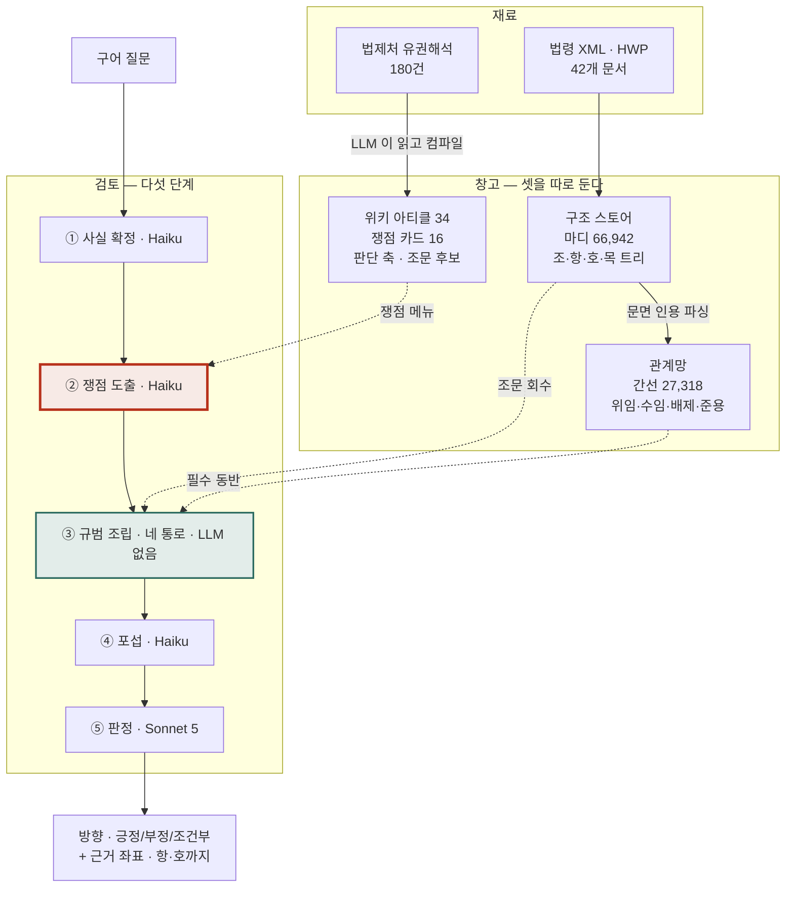
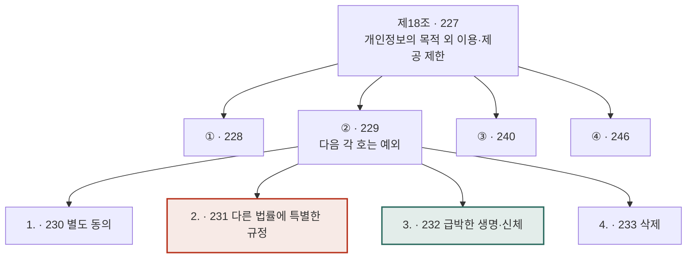
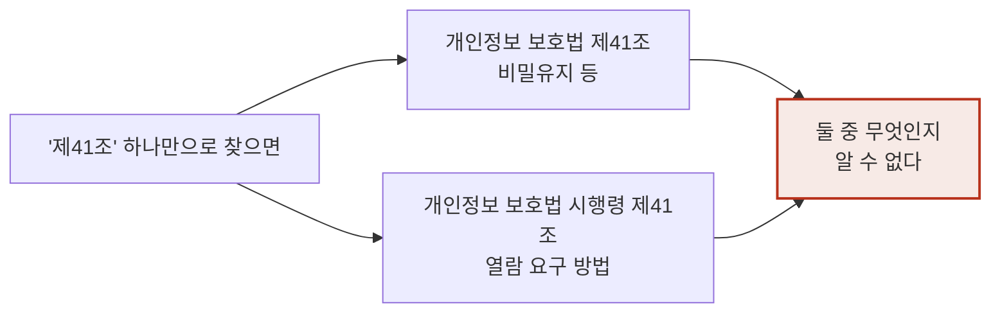
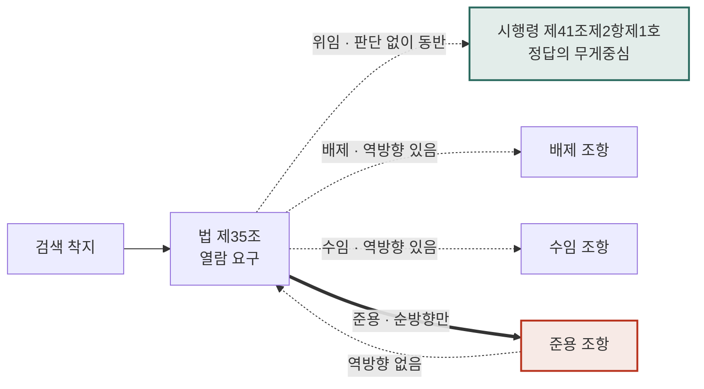
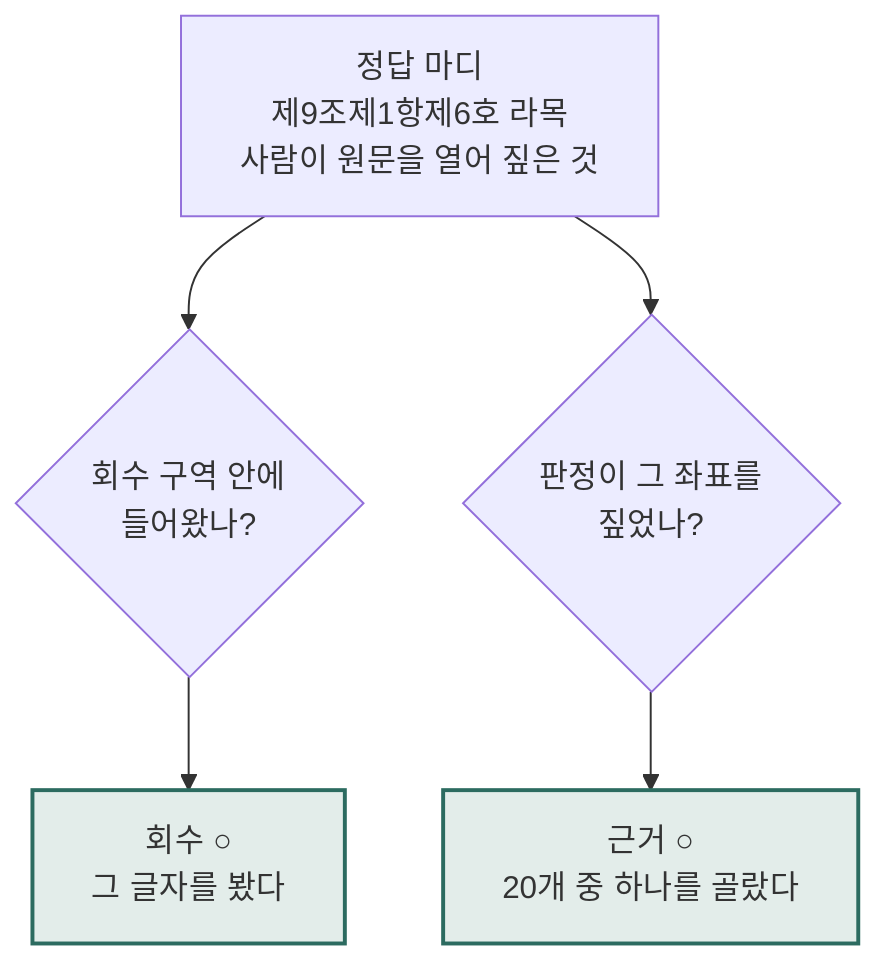
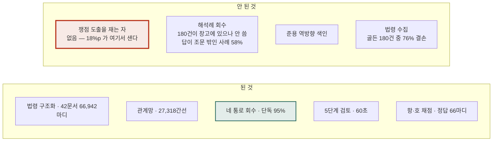

# 법령해석 RAG — 한 장

> 전체 구조와 병목을 도판 여덟 장으로. 상세는 [NOTION_ARCHITECTURE.md](NOTION_ARCHITECTURE.md).
>
> 노션에서는 `···` → **Import** → **Markdown & CSV** 로 가져오세요(붙여넣기는 코드블록이 깨집니다).

| 항목 | 값 |
|---|---|
| 담은 법령 | 42문서 · 마디 66,942 |
| 조문 연결 | 간선 27,318 |
| 한 사건 | 5단계 · 60초 |
| **병목** | **회수기 95% · 파이프라인 77% → 18%p 가 쟁점 도출에서 샌다** |

---

## 도판 1 — 전체



붉은 칸에서 18%p가 샌다. 초록 칸은 단독으로 95%다.

---

## 도판 2 — 담는 모양: 조는 마디 20개다



붉은 칸은 사건 25-0484의 답, 초록 칸은 25-0554의 답. **“제18조”로 채점하면 둘이 같아진다** —
정답은 항·호·목까지 짚어야 한다.

---

## 도판 3 — 좌표는 짝으로만 성립한다



법과 시행령은 별개 문서다. 마디번호도 문서마다 1부터 다시 매겨진다 →
좌표는 반드시 `(법령명, 마디번호)`. 부칙도 마디로 들어오고, **부칙이 정답인 사건도 있다.**

---

## 도판 4 — 연결: 착지하면 따라간다, 단 준용은 한 방향



준용 역방향이 없어 못 가는 실례 — 자본시장법 제160조는 “제159조제2항을 준용한다”고
쓰지만, **제159조에는 ‘반기·분기보고서’라는 말이 한 번도 없다.** 저기서 여기로 올 단서가 없다.

---

## 도판 5 — 회수: 네 통로 + 상한 밖의 정의 칸

```mermaid
flowchart TD
  Q["쟁점 하나"]
  Q --> C1["① 문면 인용 좌표<br/>검색 없이 직행"]
  Q --> C2["② 쟁점 카드의 조문 후보<br/>사안이 그 법을 말할 때만"]
  Q --> C4["④ 키워드 사다리 + 의미 검색<br/>의미를 앞에 둔다"]
  C1 --> C3["③ 관계망 바닥<br/>한 걸음 동반"]
  C2 --> C3
  C1 --> M(("합류"))
  C2 --> M
  C3 --> M
  C4 --> M
  M --> K["규범 6개 · 상한"]
  M --> G["용어 정의<br/>상한 밖 별도 칸"]
  K --> J["판정"]
  G --> J
  style G fill:#E3EDEA,stroke:#2C6B60,stroke-width:2px
```



의미 검색을 앞에 두자 주소 없는 질문의 회수가 **15% → 61%**. 정의를 상한 밖으로
빼자 사건 24-0239가 **0/3 → 3/3**. 상한 안에서는 앞자리도 뒷자리도 실패했다.

---

## 도판 6 — 자(尺): 회수와 근거를 다른 잣대로



옛 자는 회답을 정규식으로 긁어 **조 단위**로 쟀다 — 결함 여덟이 과대·과소 양쪽으로
동시에 났다. 새 자는 정답 **66마디**를 사람이 원문에서 짚었다. 회수한 것의 86%는
실제로 인용된다 — 회수와 근거는 두 문제가 아니다.

---

## 도판 7 — 병목은 회수기가 아니다


```
회수 단독  (쟁점 고정 · LLM 없음)   ███████████████████░  95%   63/66
파이프라인 (쟁점을 LLM 이 만듦)     ███████████████░░░░░  77%   51/66
```

**증명** — 같은 회수기에 질의만 바꿔 사건 24-0239를 세 번 넣었다.

| 넣은 질의 | 결과 |
|---|---|
| “공시대상기업집단에 속하는 회사의 부당한 이익제공 금지” | 제47조 회수 **성공** |
| “공시 대상 기업집단의 이익제공” | 실패 — 공시 지정 조문으로 |
| “공시대상기업집단 기업집단현황 공시 의무” ← 시스템이 실제로 간 길 | 실패 — 공시 의무 조문으로 |

`공시대상기업집단`은 법률용어 한 낱말인데 쟁점이 “공시”로 쪼개 읽었다.
**회수는 시킨 대로 정확히 가져왔다. 주문이 틀렸다.**

---

## 도판 8 — 무엇이 되고 무엇이 안 됐나



**다음은 하나다** — 쟁점 도출을 재는 자를 만든다. 회수 벤치와 같은 방식으로, 사실을
고정하고 “쟁점이 정답 조문에 닿는 질의를 만들었나”를 LLM 없이 결정론으로 잰다.

> 회수기는 그만 만진다 — 95%인 것을 여섯 번 고치려 했다.
