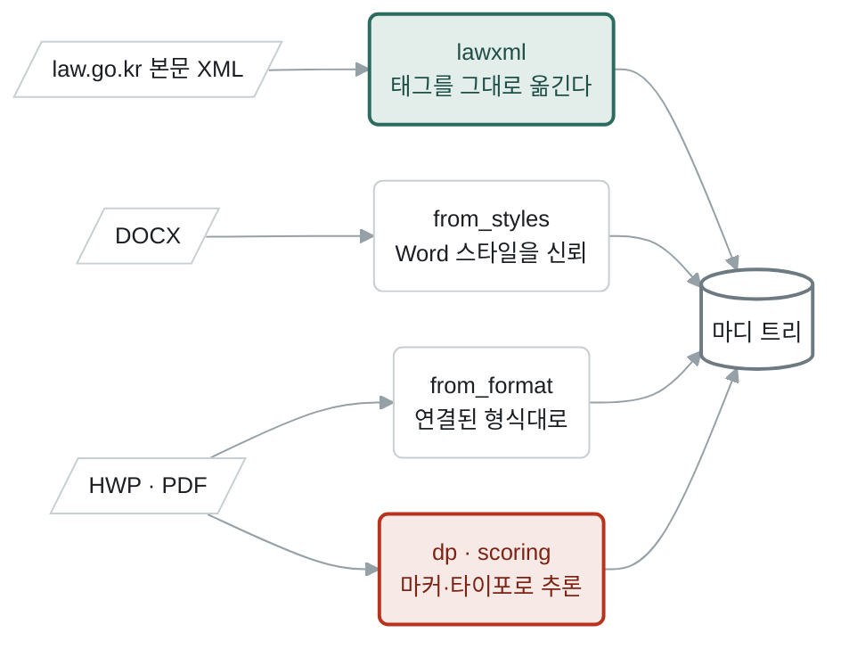
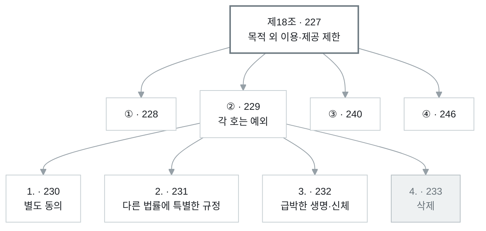
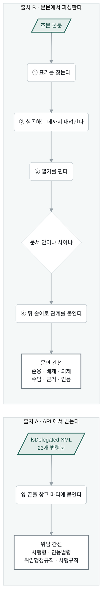
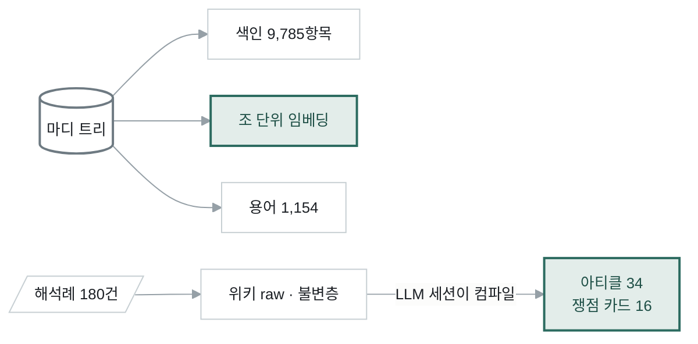
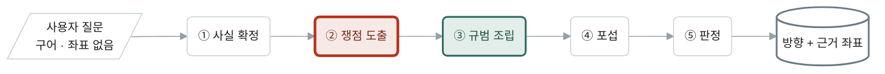
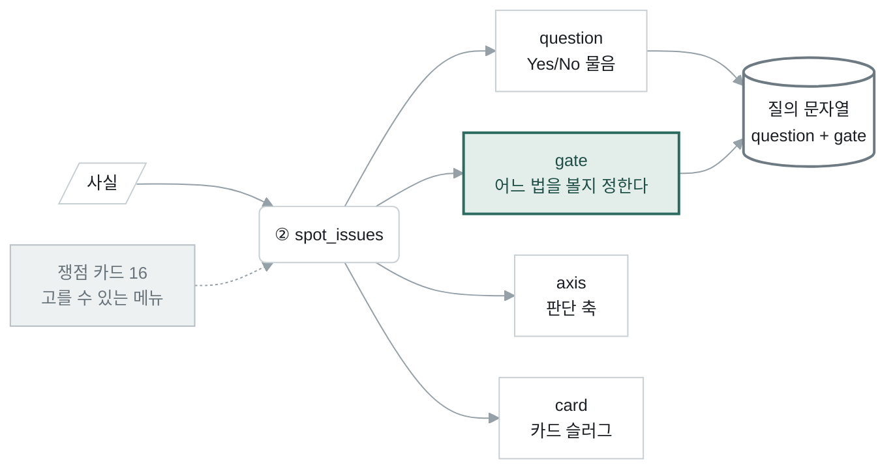
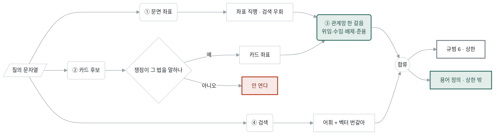
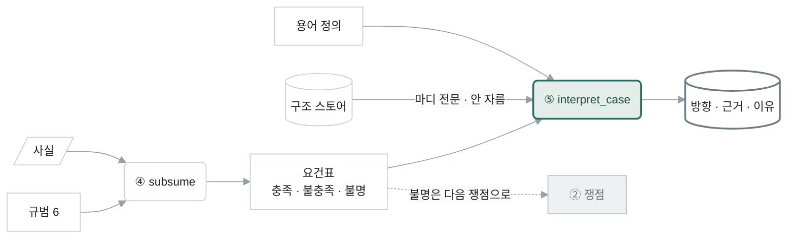

# 시스템 아키텍처 — 두 단계

이 시스템은 **두 단계**로 돌아간다.

| 단계 | 무엇을 하나 | 언제 도나 |
|---|---|---|
| **1단계 · 수집** | 법령을 마디로 쪼개 담고, 조문끼리 잇는다 | 법령이 새로 들어올 때 (한 번) |
| **2단계 · 질의** | 사용자 질문을 법령이 알아듣는 형태로 바꿔 조문을 회수한다 | 질문마다 (매번) |

1단계가 만든 것 위에서만 2단계가 돈다. 1단계에 없는 법령은 2단계가 절대 못 찾는다.

노션: `···` → **Import** → **Markdown & CSV**

---

# 1단계 — 수집

## 1-1. 무엇을 모았나

| 재료 | 수 | 형태 |
|---|---|---|
| 법령 본문 | 42문서 | law.go.kr 본문 XML · HWP · DOCX · PDF |
| 조문 위임 관계 | 23개 법령분 | law.go.kr `lsDelegated` XML |
| 법제처 유권해석 | 180건 | 질의요지 · 회답 · 이유 |

법령 42문서의 종류는 법률 15 · 시행령 11 · 규정 9 · 시행세칙 6 · 시행규칙 1이다.
**법과 그 시행령은 별개 문서로 담는다** — 조번호가 겹치기 때문이다.

## 1-2. 어떻게 쪼갰나 — 입력에 따라 세 경로



**왜 세 경로인가.** law.go.kr 본문 XML은 조·항·호·목이 이미 태그로 갈라져 있어
**옮기기만 하면 된다**(초록). 반대쪽 끝인 HWP·PDF는 계층 정보가 아예 없어서
줄머리 마커(`제1조` · `①` · `1.` · `가.`)와 글자 크기·들여쓰기로 **추론**해야
한다(붉음). 같은 파서로 둘을 다루면 확실한 쪽에서도 틀린다.

## 1-3. 담긴 모양 — 마디 트리

한 조가 여러 마디로 쪼개진다. 개인정보 보호법 제18조의 실제 모양:



| 마디마다 붙는 것 | 뜻 |
|---|---|
| `node_id` | 문서 안에서만 고유한 번호. 문서마다 1부터 다시 매겨진다 |
| `span` | 원문의 문자 구간 — 원문 어디서 왔는지 되짚을 수 있다 |
| `path` | 조상 사슬. 본칙인지 부칙인지가 여기서 갈린다 |
| `surface` | 표면형 — `제18조` · `②` · `1.` · `가.` |

**좌표는 반드시 `(법령명, node_id)` 짝으로 쓴다.** `node_id` 하나만으로는 어느
문서인지 알 수 없다 — 개인정보보호법 제1조도 `[1]`이고 신용정보법 제1조도 `[1]`이다.

**부칙도 같은 트리에 들어온다.** 정보공개법에는 `제2조`가 넷 있다(본칙 정의 ·
부칙 경과조치 · 부칙 적용례 · 부칙 개정경과조치). 조번호 문자열만 비교하면
부칙을 본칙으로 착각한다.

---

## 1-4. 조문을 어떻게 이었나 — 출처가 둘이고 로직이 완전히 다르다



### 출처 A — 위임 간선은 왜 파싱이 아니라 API인가

위임 문구에는 **목적지 좌표가 문면에 없다.**

```
법 제35조제5항
  "…열람 요구의 방법과 절차는 대통령령으로 정한다."
                            └──────┬──────┘
                    이게 시행령의 몇 조인지 본문에 안 적혀 있다
```

본문만 읽어서는 “대통령령으로 정한다”가 시행령 제41조로 가는지 제42조로 가는지
알 수 없다. 그 대응은 법제처가 관리하고 `lsDelegated` API로만 나온다. 그래서
이 간선은 **파싱하지 않고 받는다.**

받은 간선 하나의 실제 모양:

```json
{ "kind": "시행령",
  "src": { "name": "금융복합기업집단의 감독에 관한 법률",
           "jo": "제2조", "jo_title": "정의",
           "anchor": "제2조제1호가목", "node": 2 },
  "dst": { "name": "금융복합기업집단의 감독에 관한 법률 시행령",
           "jo": "제3조", "node": 31 },
  "link": "대통령령" }
```

`anchor`가 **항·호·목까지** 내려간다 — “제2조제1호**가목**이 위임한 것”까지
특정된다. 받은 뒤 양 끝을 창고의 실제 마디에 붙인다(`node`). 창고에 그 법령이
없으면 붙지 않고 미해결로 남는다 — 결손 1위는 금융위설치법 176건이다.

### 출처 B — 문면 간선은 왜 파싱이 되는가

법령의 참조 표기는 **문서와 무관한 관례**다. 어느 법령이든 같은 문법으로 쓴다.
그래서 문자열 패턴으로 결정론적으로 찾을 수 있다 — LLM을 부르지 않는다.

**① 표기를 찾는다**

```
제N조                     제18조
제N조의M                  제28조의8
조 아래 사슬               제9조제1항제6호라목
장·절·편·관                제3장 · 제2절
별표 · 별지                별표 3 · 별지 제1호
조 뒤에 붙은 표면형        제9조 ① · 제9조 (2)
```

**② 가리키는 마디로 내려간다 — 실존하는 데까지만**

`제1조 (2)`는 먼저 제1조를 찾고, 그 아래에 둘째 항목이 **실제로 있으면** 거기까지
내려가고, 없으면 조에 머문다. 항을 `(1)`로 쓰는 약관이 있어서 단위 이름을
고정할 수 없다.

**③ 열거를 편다**

```
"제19조제1항ㆍ제3항"        → 연결사(ㆍ · 및 · 또는 · 부터 · 와 · 과) 뒤에 조 없이
                             온 항·호·목은 같은 조의 다른 가지로 잇는다
"제129조부터 제132조까지"   → 양 끝을 잡고, 앞 끝의 문서 이름(「형법」)이 뒤 끝도 덮는다
```

**④ 문서 안이냐 사이냐를 가른다**

| 함수 | 무엇 | 판정 |
|---|---|---|
| `resolve()` | 문서 **안** — 제2조 본문이 제4조를 가리킴 | 전부 결정론 |
| `cross_resolve()` | 문서 **사이** — 「수수료규정」 제2조 | 문서명 힌트가 한 문서로 떨어질 때만 확정 |

`동법` · `같은 규정` 같은 **대용어**나 후보가 여럿이면 **보류**로 돌린다.
판정은 LLM(닫힌 후보)이나 사람이 한다. 새 문서가 들어오면 색인이 다시 서고 이
대조도 다시 돈다 — 어제 빈손이던 「수수료규정」이 그 문서가 올라오는 순간
확정 간선이 된다.

**⑤ 관계를 라벨링한다 — 참조 바로 뒤의 술어를 읽는다**

이게 문면 간선의 핵심 로직이다. 같은 `제42조` 참조라도 뒤에 무엇이 오느냐로
의미가 정반대가 된다.

| 관계 | 뒤에 오는 문면 | 예 | 왜 필요한가 |
|---|---|---|---|
| **준용** | `…을 준용` | “제159조제2항을 준용한다” | 다른 규범을 변경 가해 적용 |
| **배제** | `…에도 불구하고` · `…적용하지 아니` | “제42조를 적용하지 아니한다” | **놓치면 반대 답이 나가는 유일한 부류** |
| **의제** | `…으로 본다` | “제N조를 위반한 것으로 본다” | 간주 |
| **수임** | `…에서 "` (여는 따옴표) | “제2조에서 ‘…’이란” | 하위 법령이 상위 조문을 되가리키는 유일한 좌표 |
| **근거** | `…에 따라/따른/의하여` | “제11조에 따라” | 조건·근거 표시 |
| 인용 | 그 밖 | 술어 없는 언급 | |

**수임이 특별한 이유** — 위임 API의 행정규칙 대상은 **문서 수준까지만** 나온다
(“이 조는 감독규정이 정한다”까지고, 감독규정의 몇 조인지는 안 나온다).
그런데 감독규정 쪽 본문에는 “제2조에서 ‘금융위원회가 정하여 고시하는 것’이란
…”이라고 **되가리키는 좌표가 있다.** 이 문장을 쓴 조문이 곧 그 위임의 구체
내용이다. 그래서 수임은 수직 체인을 아래에서 위로 복원하는 핵심 간선이다.

**⑥ 건너뛰는 것**

```
자기 자신 · 조상 · 자손 참조   계층 간선이 이미 담당한다
"같은 조" · "전항" 류 대용어    문맥 해석이 필요 — 결정론 밖
문장 첫머리의 맨 "제N항"        어느 조의 항인지 문맥이 필요
"법 제87조" 의 '법'            이름이 아니라 그 문서가 정의한 총칭
```

**⑦ 보수적 분류** — 열거(`제1항ㆍ제3항을 준용`)는 술어가 **마지막 참조 뒤에만**
붙으므로 앞 항들은 인용으로 남는다. 확실한 것만 라벨한다.

### 이어진 결과

| 종류 | 수 | 방향 |
|---|---|---|
| 인용법령 | 23,352 | 순 |
| 시행령 | 2,283 | 순 · 역 |
| 위임행정규칙 | 1,251 | 순 |
| 시행규칙 | 129 | 순 |
| **합** | **27,318** | |

역방향 색인은 배제·수임에 있고 **준용에는 없다.** 준용은 조문 안에 “저기로 가라”는
단서가 있지만 반대쪽에는 없어서, 아래 예처럼 되짚을 수 없다.

```
자본시장법 제160조제1항 후단
  "…제159조제2항…을 준용한다"      ← 160 → 159 로 갈 단서가 본문에 있다
자본시장법 제159조
  '반기·분기보고서' 라는 말이 없다   ← 159 → 160 으로 올 단서가 전혀 없다
```

---

## 1-5. 함께 세우는 것



**임베딩은 조 단위로 만든다.** 호·항 단위로 쪼개면 “①항 개인정보처리자는…”
같은 머리글이 떨어져 나가 문장이 뜻을 잃는다.

**용어는 두 곳에서 긁는다** — ㉠ 정의 조항(`제2조(정의)`)의 각 호, ㉡ 본문 속
`(이하 "X"라 한다)` 같은 인라인 정의.

**위키는 두 층이다** — 유권해석 원문은 `raw/`에 **불변**으로 두고, LLM 세션이 그걸
읽어 아티클을 쓴다. 아티클에는 판단 축·조문 후보·트리거 낱말이 들어간다.
쟁점 카드 하나의 실제 내용:

```
아티클: 다른-법률-근거의-문턱
  판단 축   그 법률이 정보의 종류·범위와 이용·제공 요건을 명시하는가
            — 여는 문은 좁게, 일반적 협조 규정은 문턱을 못 넘는다
```

---

# 2단계 — 질의

## 2-0. 전체



**②가 붉은 이유** — 사용자 질문과 법령 사이의 통역이 여기서 일어난다.
여기가 틀리면 뒤가 다 옳아도 답이 안 나온다.

## 2-1. 사용자가 실제로 넣는 것

```
교육지원청에서 교육장 이름으로 나간 공문서를 공개해 달라는 청구가 들어왔습니다.
그 문서에는 기안한 담당 직원부터 중간에 검토한 사람, 결재한 사람까지 성립 과정에
관여한 공무원들의 직위와 이름이 그대로 남아 있습니다. … 공문서 작성 과정에 참여한
공무원의 성명이 적혀 있다는 이유만으로 그 공문서를 사생활 침해 우려가 있는 비공개
대상으로 볼 수 있는지 알고 싶습니다.
```

법령명도 조번호도 없다. 이 상태로는 색인을 때릴 수 없다.

## 2-2. ② 쟁점 도출 — 질문을 법령 형태로 바꾼다

쟁점 하나는 **네 조각**으로 이뤄진다.



| 조각 | 하는 일 |
|---|---|
| `question` | 압축된 물음. 이게 검색 질의의 본체가 된다 |
| `gate` | **어느 법을 볼지**를 정하는 관문 질문. “개인정보가 있는가”가 참이면 개인정보법이 열린다 |
| `axis` | 판단 축. 카드에서 오며 일반화된다 |
| `card` | 카드 슬러그. 조문 후보를 들고 오지만 **조건부로만** 쓴다(→ 2-3 ②) |

위 예의 질문은 이런 쟁점들로 바뀐다 — 사안 하나에 최대 **4개**를 세운다.

```
쟁점   공문서에 적힌 공무원 성명이 비공개 대상 개인정보에 해당하는가
관문   이 사안에 '개인에 관한 정보' 가 있는가        → 정보공개법이 열린다
판단 축 개인정보 비공개 사유에서 명시적으로 제외된 것이 있는지 본다
```

**여기서 질의 문자열이 만들어진다.**

```
q = issue.question + " " + issue.gate
qx = _review_query(q, spots)      ← 카드가 준 것까지 붙인 최종 질의
```

## 2-3. ③ 규범 조립 — 네 통로로 회수



### ① 문면 인용 좌표 — 검색을 안 거친다

사용자 질문에 `「개인정보 보호법」 제17조제1항`처럼 좌표가 있으면 **바로 그 마디를
연다.** 색인값이 조문 제목이라 저 문자열은 검색으로 안 물린다. 사안 자신의
좌표가 가장 강한 신호라 맨 앞자리를 준다.

### ② 카드 조문 후보 — 사안이 그 법을 말할 때만

카드의 조문 후보는 그 카드를 컴파일할 때 본 **사례들의 좌표**다. 사안이 다르면
무관한 조문이 딸려온다.

```
쟁점 문장 + 관문 + 원 질문을 스코프로 삼는다
  카드 후보의 법령명이 스코프 안에 있으면      → 연다
  없으면                                      → 안 연다
```

카드가 조문을 **밀어 넣는** 길만 막는 것이고, 그 법이 오는 길을 막는 게 아니다 —
필요하면 어휘 사다리와 벡터가 스스로 찾아온다.

### ③ 관계망 한 걸음 — 판단 없이 동반

①②로 연 좌표는 **곧바로 합류하지 않고 이 단계를 통과한다.** 착지 조문의
위임·수임·배제·준용을 **무조건 함께 데려온다** — LLM이 고르지 않는다.

```
착지    개인정보 보호법 제35조 (열람 요구)
동반    개인정보 보호법 시행령 제41조제2항제1호   ← 법 제35조제5항이 위임한 조문
```

배제를 놓치면 **반대 답**이 나가므로 이 통로는 스위치가 켜져 있는 한 무조건 돈다.

### ④ 검색 — 어휘와 벡터를 둘 다, 벡터를 앞에


**벡터를 앞에 둔 이유.** 옛 구조는 사다리였다 — 정확 일치가 하나라도 걸리면
벡터를 **아예 안 돌렸다.**

```
주소 없는 질문 41건의 조문 회수율     15%
실패한 33건 대부분의 원인
  "제47조" · "공공기관" · "적용대상" 같은 우연한 조 제목 일치가
  정확 일치 단에 걸려 벡터가 한 번도 안 돌았다
벡터만 따로 돌리면 정답 조가 1~4위였다

바꾼 뒤   15% → 61%
```

주소가 **있는** 질문은 ①이 답을 펴므로 이 순서에 영향받지 않는다.

**벡터가 착지한 항·호는 조로 올린다**(`_article_of`). 답이 제9조제1항제6호
라목이라도, 판정이 읽으려면 제9조 ①항 머리글이 필요하다.

### 합류와 상한

```
정렬    직행 좌표(①②)  >  관계망 바닥(③)  >  참조 확장
상한    규범 6개 / 쟁점  ·  쟁점 4개 / 사안
정의    상한 밖 별도 칸(glossary) — 규범 6칸을 잡아먹지 않는다
```

**정의를 상한 밖으로 뺀 이유** — 용어 정의는 판단 대상이 아니라 낱말의 뜻이다.
상한 안 앞자리에 넣으면 원래 들어오던 정답이 6칸 밖으로 밀려나고(회수 77→73%),
뒷자리에 넣으면 이미 6.0개로 꽉 차 하나도 안 들어간다.

## 2-4. ④⑤ 포섭과 판정



**판정 입력은 자르지 않는다.** 포섭용 요건 조각은 260/400자로 줄여 넣지만,
판정에는 스토어의 **마디 전문**을 넣는다 — 조 아래 항·호·목 전부. 답이
제9조제1항제6호 라목인데 요건 조각에는 라목이 안 들어가기 때문이다.

**불명이 쟁점으로 되먹임된다.** 포섭에서 ‘불명’이 나온 요건은 다음 회차의
쟁점으로 승격될 수 있다(`Issue.from_req`).

## 2-5. 단계별 모델과 예산

| 단계 | 함수 | 입력 → 출력 | 모델 | 출력 예산 |
|---|---|---|---|---|
| ① 사실 | `extract_facts` | 텍스트 → Fact[≤8] | Haiku 4.5 | — |
| ② 쟁점 | `spot_issues` | Fact[] + 카드 → Issue[≤4] | Haiku 4.5 | 8,000 |
| ③ 규범 | `build_norms` | Issue → Section[≤6] + 정의 | **없음** | — |
| ④ 포섭 | `subsume` | Section[] + Fact[] → Req[≤18] | Haiku 4.5 | 12,000 |
| ⑤ 판정 | `interpret_case` | 마디 전문 + 요건표 + 정의 → 방향·근거 | **Sonnet 5** | 12,000 |

③이 LLM을 안 쓴다 — 검색과 관계망 걷기뿐이라 **결정론**이다. ⑤만 강한 모델을
쓰는 이유는 실측이다: 같은 입력 5회에 하이쿠는 긍정2·조건부3으로 흔들렸고
소넷5는 5/5 일치했다.

사건 하나에 평균 60초 · LLM 호출 4회.

---

# 저장 위치

| 무엇 | 어디 |
|---|---|
| 마디 트리 | `data/structure/<doc_id>/` |
| 문서 목록 · 인제스트 원장 | `data/law_index.json` · `data/structure_ledger.json` |
| 위임 간선 | `data/delegation.json` |
| 조 단위 임베딩 | `data/embeddings/sections/` |
| 용어 · 약칭 | `data/glossary.json` · `data/aliases.json` |
| 위키 (불변층 + 아티클 + 적중원장) | `data/wiki/raw/` · `data/wiki/wiki/` · `data/wiki/ledger.jsonl` |
| 해석례 | `data/expc/index.json` |
| 평가 정답 | `data/review/marked.json` |

**DB는 없다. `data/` 파일이 전부다.** 서버는 호스트에서 `scripts/serve.sh` +
uvicorn 재시작으로 반영하고, 포트는 5566이다.

# 코드 위치

| 단계 | 모듈 |
|---|---|
| 1단계 구조화 | `core/structure/` — `lawxml` · `from_styles` · `from_format` · `dp` · `scoring` |
| 1단계 문면 간선 | `core/rag/refs.py` — `resolve` · `cross_resolve` · `rel_of` |
| 1단계 용어·임베딩 | `core/terms/` — `build` · `embed_sections` |
| 2단계 회수 | `core/rag/` — `index` · `search` · `vector` · `expand` · `delegation` · `wikictx` |
| 2단계 검토 | `core/casereview/pipeline.py` — 5단계 함수 |
| 표면 | `api/structure_app.py` · `api/routers/` 13개 · `api/viewer/` 10개 |
