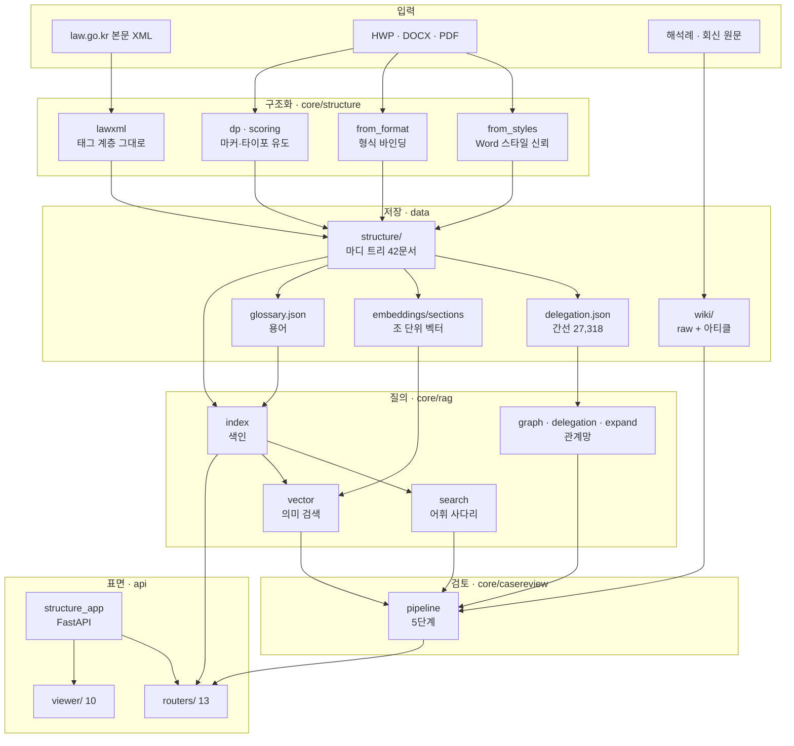
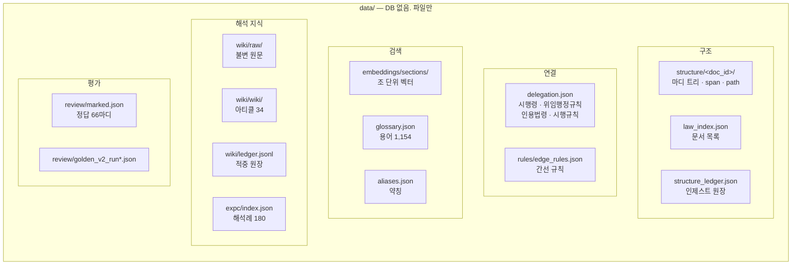
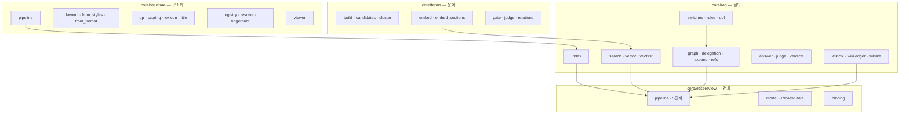
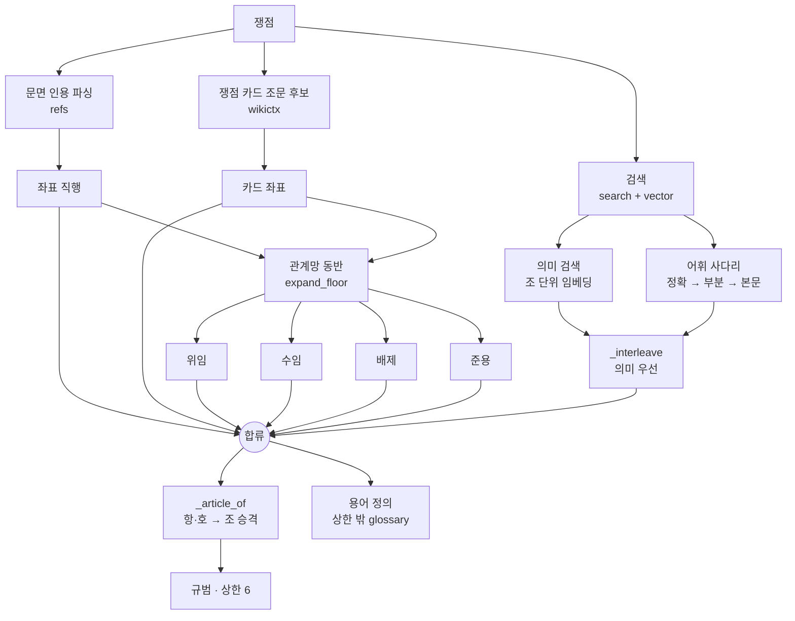
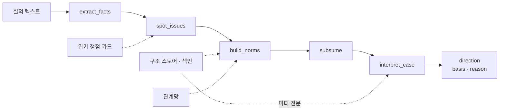
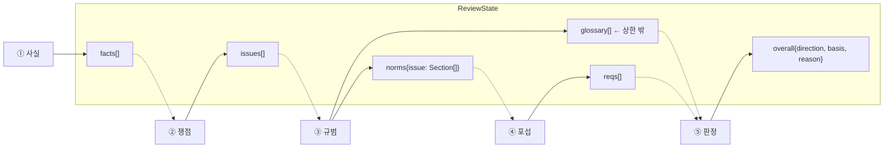
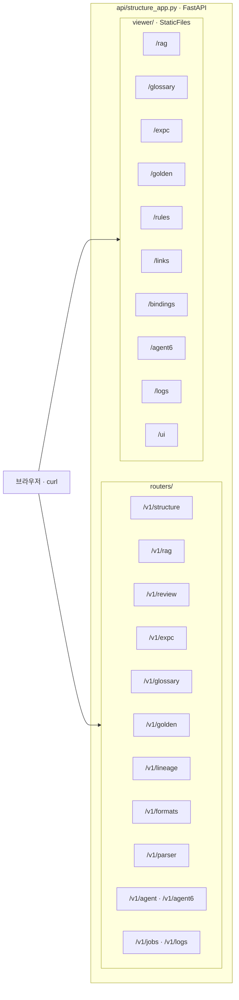

# 시스템 아키텍처

노션: `···` → **Import** → **Markdown & CSV**

---

## 1. 계층

---

## 2. 저장 계층

| 좌표 규칙 | 내용 |
|---|---|
| 마디 지정 | `(법령명, node_id)` — 법과 시행령은 별개 문서, `node_id`는 문서마다 1부터 |
| 마디 계층 | 편 · 장 · 절 · 조 · 항 · 호 · 목 |
| 부칙 | 본칙과 같은 트리에 들어오며 `path`로 구별 |
| 간선 anchor | 항·호·목까지 (`제2조제1호가목`) |

---

## 3. 모듈

---

## 4. 회수 경로

| 스위치 | 대상 |
|---|---|
| `floor_delegation` | 위임 동반 |
| `floor_reception` | 수임 동반 |
| `floor_exclusion` | 배제 동반 |
| `floor_junyong` | 준용 동반 |

| 간선 방향 | 순방향 | 역방향 |
|---|---|---|
| 위임 → 시행령 | ○ | ○ |
| 수임 | ○ | ○ |
| 배제 | ○ | ○ |
| 준용 | ○ | 미구현 |

---

## 5. 검토 파이프라인

| 단계 | 함수 | 입력 → 출력 | 모델 | 예산 |
|---|---|---|---|---|
| ① 사실 | `extract_facts` | 텍스트 → Fact[≤8] | Haiku 4.5 | — |
| ② 쟁점 | `spot_issues` | Fact[] + 카드 → Issue[≤4] | Haiku 4.5 | 8,000 |
| ③ 규범 | `build_norms` | Issue → Section[≤6] + glossary | 없음 | — |
| ④ 포섭 | `subsume` | Section[] + Fact[] → Req[≤18] | Haiku 4.5 | 12,000 |
| ⑤ 판정 | `interpret_case` | ReviewState + 마디 전문 → 방향·근거 | Sonnet 5 | 12,000 |

| 상수 | 값 |
|---|---|
| `NORM_SECTIONS` | 6 |
| `ISSUE_MAX` | 4 |
| `SUB_REQ_CAP` | 18 |
| `REQ_LEAF_CHARS` / `REQ_STEM_CHARS` | 260 / 400 |
| 판정 입력 절단 | 없음 (`cap=10**9`) |
| 클라이언트 타임아웃 | 120초 |

---

## 6. 상태

`ReviewState` 하나가 5단계를 관통한다.

---

## 7. API 표면

| 배포 | 내용 |
|---|---|
| 실행 | `scripts/serve.sh` + uvicorn 재시작 |
| 컨테이너 | 쓰지 않음 (`docker build` 금지) |
| 포트 | 5566 |
| DB | 없음 — `data/` 파일이 전부 |
| 스토어 위치 | `STRUCTURE_STORE` 환경변수 |

---

## 8. 규모

| 계층 | 수 |
|---|---|
| 문서 | 42 (법률 15 · 시행령 11 · 규정 9 · 시행세칙 6 · 시행규칙 1) |
| 마디 | 66,942 |
| 색인 항목 | 9,785 |
| 간선 | 27,318 (인용법령 23,352 · 시행령 2,283 · 위임행정규칙 1,251 · 시행규칙 129) |
| 위키 아티클 | 34 (쟁점 16 · 법령갈래 15 · 해석원칙 3) |
| 해석례 | 180 |
| 용어 | 1,154 |
| 라우터 · 화면 | 13 · 10 |
