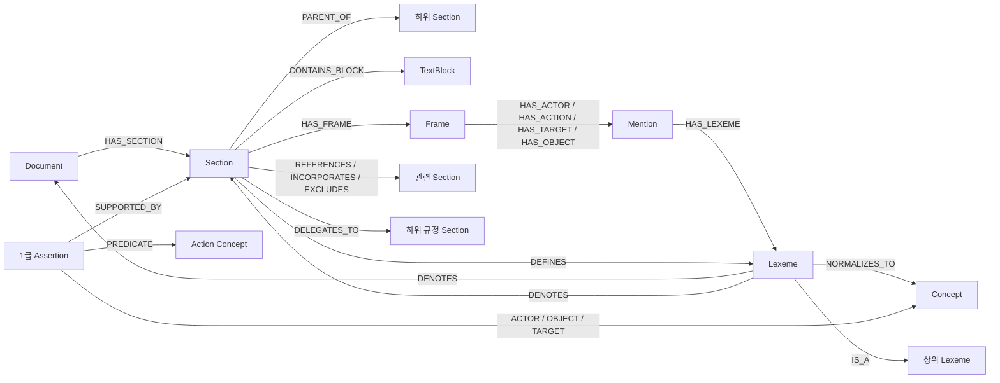

# 도메인 중간 레이어: 구조화 지식 그래프

이 그래프의 목적은 문서 검색 결과를 하나 더 만드는 것이 아니다. 사용자의 표현을
도메인의 **개념과 확정 좌표**로 번역하고, 그 좌표에서 관련 규범까지 결정적으로 걸어
가기 위한 중간 레이어다.

## 가장 중요한 세 층

```text
원문/LLM 출력              표기 통합                    의미 통합
Mention ──HAS_LEXEME──▶ Lexeme ──NORMALIZES_TO──▶ Concept
"투자 설명서를 교부"       투자설명서를교부              투자설명서 교부
 (출처·조항·slot 보존)       (공백·대소문자만 통합)         (용어집/승인 근거 필요)
```

- `Mention`은 실제 출현이다. 프레임의 actor/act/target/object, 정의어, 용어집
  occurrence가 어떤 문서·조항·추출기에서 나왔는지 보존한다.
- `Lexeme`은 글자 표기형이다. 공백과 대소문자만 접는다. LLM이 뽑은 모든 문자열은
  우선 여기에 모인다.
- `Concept` 후보는 glossary에서도 부트스트랩할 수 있지만, **1급 active Concept**은
  `data/domain_graph/canonical.json`에서 별도 승인된 것만 허용한다. glossary의
  `활성`은 검색 표면형 상태이지 1급 의미 승인이 아니다.

따라서 Concept 하나에서 역방향으로 걸으면 "어떤 글자들이 이 개념으로 합쳐졌고,
각 글자가 어느 조항의 어떤 프레임 칸에서 나왔는가"를 모두 복원할 수 있다.

## 노드와 간선



`제1조제3항`, 문서명, 문서 별칭도 `Lexeme`이다. 해당 표기에서 `DENOTES`를 따라가면
실제 `Section`/`Document`에 도착한다. 같은 `제1조`가 여러 문서에 있으므로 간선에는
항상 `doc_id` 스코프를 둔다.

참조가 아직 확정되지 않았다면 확정 간선을 만들지 않는다. 대신
`PendingReference ─MAY_REFER_TO→ 후보 Section`으로 보존한다. 그래프가 불확실성을
숨기지 않게 하기 위해서다.

## 현재 입력 재료

- `result.json/meta.json`: Document, Section, TextBlock, 계층, 좌표
- `frames/*.jsonl`: Frame과 네 slot의 Mention
- 결정론 정의 추출: `DEFINES`
- `taxonomy/*.jsonl`: `IS_A`와 그 근거 좌표
- `glossary.json`: 2급 검색 표면형과 occurrence (1급 승인을 뜻하지 않음)
- `aliases.json`: 문서 별칭
- 내부/문서 간 참조: 관계형 Section 간선
- `delegation.json`: 위임 간선
- 태그·정량 추출: Tag, Quantity

SQLite 파일은 정본이 아니라 재생성 가능한 파생물이다. 저장 계약이 일반적인 property
graph(`nodes`, `edges`, `kind`, `props`)이므로 Graph DB 도입 시 JSONL export를 통해
라벨과 relationship을 그대로 옮길 수 있다.

## 빌드와 조회

```bash
.venv/bin/python -m lawrag.core.domain_graph build
.venv/bin/python -m lawrag.core.domain_graph resolve '제1조제3항' --doc-id <doc_id>
.venv/bin/python -m lawrag.core.domain_graph resolve '자본시장법'
.venv/bin/python -m lawrag.core.domain_graph counts
.venv/bin/python -m lawrag.core.domain_graph export /tmp/domain-graph-jsonl
```

## 1급 지식 발행 규율

런타임 LLM은 1급 지식을 쓰거나 승격할 수 없다. `active` Concept은 허용 type과
`approved_by`가 필요하고, `active` Assertion은 action 타입 `PREDICATE`, 승인된 Concept
role, 실재하는 `source.doc_id/node`, confidence, `approved_by`가 필요하다. 등록되지 않은
role/relation, 잘못된 endpoint, `IS_A` 순환은 빌드 전에 거부한다.

```text
1급  Concept + ActionConcept + Assertion     RAG 첫 조회
2급  Lexeme + alias                          표현 해소
3급  Mention + Frame + TextBlock             원문 증거·fallback
```

명시적 개념·Assertion 파일 예시:

```json
{
  "concepts": [
    {
      "id": "deliver_prospectus",
      "label": "교부하다",
      "type": "action",
      "aliases": ["교부", "제공하다"],
      "status": "active",
      "approved_by": "reviewer-id"
    }
  ],
  "assertions": [
    {
      "id": "rule-123-1",
      "status": "active",
      "roles": {
        "ACTOR": "financial_operator",
        "PREDICATE": "deliver_prospectus",
        "OBJECT": "investment_prospectus"
      },
      "source": {"doc_id": "...", "node": 123},
      "confidence": 0.99,
      "approved_by": "reviewer-id"
    }
  ]
}
```

이 파일의 변경은 의미 변경이므로 검수 대상이다. 프레임 재추출은 Mention만 바꾸고,
기존 개념 병합 규칙을 몰래 바꾸지 않는다.

## Concept-first RAG와 OQL

자연어를 Cypher로 변환하지 않는다. 질문은 먼저 승인 Concept의 닫힌 후보 메뉴에
정렬되고, 서버가 OQL pattern과 Concept ID 파라미터를 만든다.

```text
사용자 질문
  → Concept Alignment (닫힌 후보 번호 선택)
  → OQL {pattern, params: concept_ids}
  → 고정 prepared query
  → active Assertion의 근거 Section
  → 기존 배제·준용·참조 확장과 답 합성
  → 빈손이면 Lexeme → Mention/Frame → Vector fallback
```

OQL pattern은 `oql_patterns.yaml` 카탈로그에 선언된 것만 실행한다. 자연어, 임의
relationship, 함수나 Cypher 조각은 OQL 파라미터가 될 수 없다. 현재 pattern은
`relation_between_concepts`, `assertions_for_concept`, `actor_obligations`,
`actions_on_object`, `concept_definition`이다.
