# 법령해석 RAG 시스템 — 아키텍처와 실측

> 2026-08-17 · 법령·규정을 **수집 → 구조화 → 연결 → 검토**로 잇는 시스템
>
> **다이어그램 보는 법** — 아래 `mermaid` 코드 블록은 노션에서 블록 우측 상단
> **Preview** 를 누르면 그림으로 그려집니다.

---

## 한눈에

| 항목 | 값 |
|---|---|
| **담은 법령** | 42개 문서 · 마디 66,942개 (편·장·절·조·항·호·목) |
| **연결** | 조문↔조문 간선 27,318개 |
| **해석 지식** | 법제처 유권해석 180건(불변) + LLM이 쓴 아티클 34개 |
| **한 사건 처리** | 5단계 · 평균 60초 · LLM 호출 3종(Haiku 2 · Sonnet 1) |
| **정답을 사람이 짚은 시험** | 23건 · 결정 마디 66개 (항·호·목 단위) |
| **핵심 발견** | **회수기 단독 95%, 파이프라인 77% — 18%p가 쟁점 도출에서 샌다** |

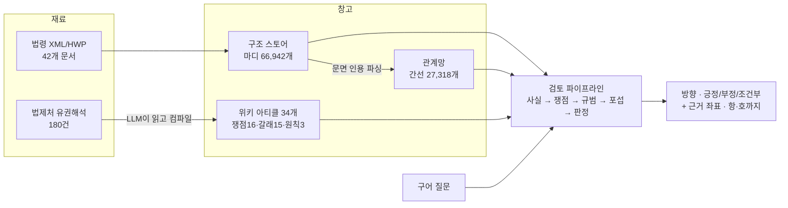

---

## 1. 법령을 어떻게 쪼개 담았나

법령 원문을 **편-장-절-조-항-호-목의 부모-자식 트리**로 만든다. 마디마다 문서 안에서
고유한 번호와 원문의 문자 구간이 붙는다.

### 실물 — 개인정보 보호법 제18조

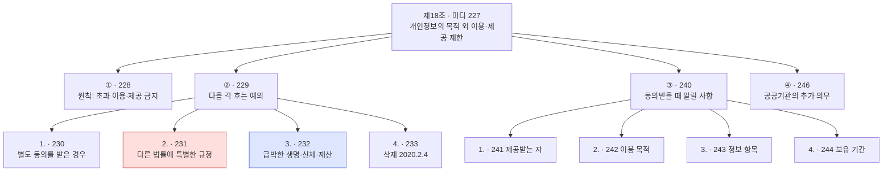

```
[227] 제18조  제18조(개인정보의 목적 외 이용ㆍ제공 제한)
  [228] ①    개인정보처리자는 개인정보를 제15조제1항에 따른 범위를 초과하여 이용하거나
             제17조제1항 및 제28조의8제1항에 따른 범위를 초과하여 제3자에게 제공하여서는…
  [229] ②    제1항에도 불구하고 개인정보처리자는 다음 각 호의 어느 하나에 해당하는 경우에는
             정보주체 또는 제3자의 이익을 부당하게 침해할 우려가 있을 때를 제외하고는…
    [230] 1.   정보주체로부터 별도의 동의를 받은 경우
    [231] 2.   다른 법률에 특별한 규정이 있는 경우          ← 사건 25-0484 의 답
    [232] 3.   명백히 정보주체 또는 제3자의 급박한 생명, 신체,
               재산의 이익을 위하여 필요하다고 인정되는 경우  ← 사건 25-0554 의 답
    [233] 4.   삭제 <2020.2.4>
  [240] ③    …동의를 받을 때에는 다음 각 호의 사항을 정보주체에게 알려야 한다
    [241] 1.   개인정보를 제공받는 자
    [242] 2.   개인정보의 이용 목적
    [243] 3.   이용 또는 제공하는 개인정보의 항목
    [244] 4.   개인정보의 보유 및 이용 기간
  [246] ④    공공기관은 제2항제2호부터 제6호까지… 목적 외의 용도로 이용하거나…
```

**한 조가 20개 넘는 마디로 쪼개진다.** 위 그림에서 붉은 칸과 파란 칸은 **서로 다른
사건의 정답**이다. "제18조"로만 채점하면 둘이 구분되지 않는다 — 실제로 그렇게
뭉개져 있었다(→ §5).

### 규모

| 항목 | 수 |
|---|---|
| 문서 | 42개 |
| 마디 (편·장·절·조·항·호·목) | 66,942개 |
| 색인 항목 | 9,785개 |

```
문서 종류
  법률       ███████████████ 15
  시행령     ███████████ 11
  규정       █████████ 9
  시행세칙   ██████ 6
  시행규칙   █ 1
```

### 두 가지 함정

**① 법과 시행령은 별개 문서다.**

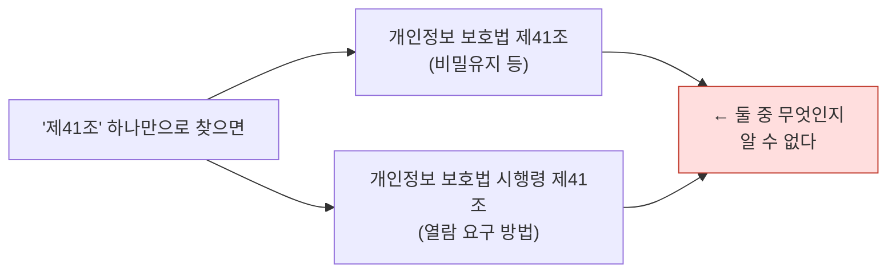

좌표는 반드시 `(법령명, 마디번호)` **짝**으로 쓴다. 마디번호는 문서마다 1부터 다시
매겨져서, 개인정보보호법 제1조도 `[1]`이고 신용정보법 제1조도 `[1]`이다.

**② 부칙도 마디로 들어온다.** 정보공개법에 `제2조`는 **넷**이다.

```
정보공개법의 "제2조"
  ├── 본칙 제2조  (정의)                ← 이게 보통 찾는 것
  ├── 부칙 제2조  (경과조치)
  ├── 부칙 제2조  (일반적 적용례)
  └── 부칙 제2조  (개정 경과조치)
```

조번호 문자열만 비교하면 부칙을 본칙으로 착각한다. 그런데 **부칙이 정답인 사건도
있다** — 사건 13-0365는 정답 넷 중 셋이 부칙이다(→ §6).

---

## 2. 해석 지식은 원문과 다른 층에 둔다

법령 원문("무엇이라 쓰였나")과 해석 지식("어떻게 읽는가")을 섞지 않는다.

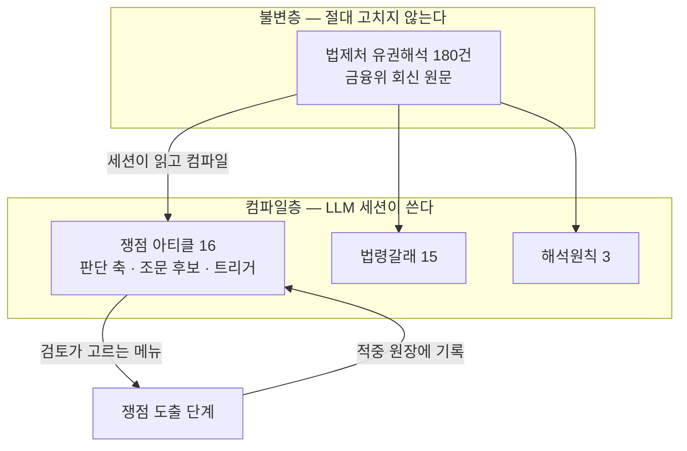

**왜 두 층인가** — 세션은 리셋되지만 이 층은 남는다. 그리고 낡은 주장이 생겨도
불변층은 그대로라서, 언제든 다시 컴파일할 수 있다.

### 쟁점 아티클 실물 — 검토가 고르는 메뉴

각 아티클이 **판단 축**과 **조문 후보**와 **트리거 낱말**을 갖는다.

```
아티클: 다른-법률-근거의-문턱
  판단 축   그 법률이 정보의 종류·범위와 이용·제공 요건을 명시하는가
            — 여는 문은 좁게, 일반적 협조 규정은 문턱을 못 넘는다

아티클: 준용의-사정거리
  판단 축   준용 선언이 있으면 문언 전체가 따라오고,
            선언이 없으면 확장·유추로 끌어오지 않는다

아티클: 정보주체-권리-행사
  판단 축   요구의 상대방은 해당 개인정보처리자가 원칙이고
            보호위 경유는 공공기관 한정의 예외다
```

전체 16개: 다른-법률-근거의-문턱 · 준용의-사정거리 · 경과조치의-존속 · 포섭의-경계 ·
두-법의-관문 · 업무위탁의-경계 · 정보주체-권리-행사 · …

---

## 3. 조문 사이 연결 — 간선 27,318개

법령 본문의 문면 인용을 파싱해 조문↔조문 간선을 만들었다.

```
인용법령      ███████████████████████████████████████ 23,352
시행령        ████ 2,283
위임행정규칙  ██ 1,251
시행규칙      ▏ 129
```

### 간선 실물

```json
{ "kind": "시행령",
  "src": { "name": "금융복합기업집단의 감독에 관한 법률",
           "jo": "제2조", "jo_title": "정의",
           "anchor": "제2조제1호가목",  "node": 2 },
  "dst": { "name": "금융복합기업집단의 감독에 관한 법률 시행령",
           "jo": "제3조" } }
```

`anchor`가 **항·호·목까지** 있다 — "제2조제1호**가목**이 위임한 것"까지 특정된다.

### 착지하면 무조건 따라가는 것

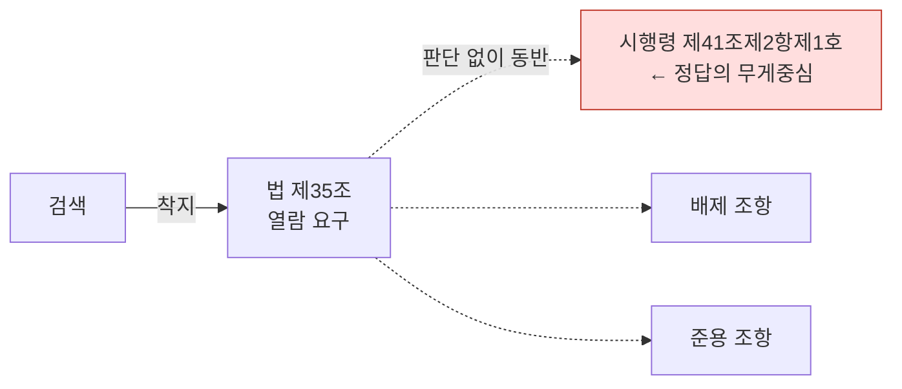

이 배선이 없던 시절의 실패 실물:

```
사건 26-0271  "정보주체가 쉽게 활용할 수 있는 방법"의 뜻이 무엇인가

  회수됨   개인정보 보호법 제35조 (열람 요구)                  ○
  안 옴    개인정보 보호법 시행령 제41조제2항제1호              ✗  ← 답이 여기 있다
           법 제35조제5항이 시행령에 위임한 조문인데 따라가지 않았다

  배선 후  회수 4/4 · 근거 4/4 · 방향 정답 (실측)
```

네 관계(위임·수임·배제·준용)는 각각 사용자가 켜고 끌 수 있다.

### 준용은 단방향이다 — 역방향 색인이 없으면 못 간다

원문을 직접 열어 마킹하다 같은 구조를 세 사건에서 발견했다.

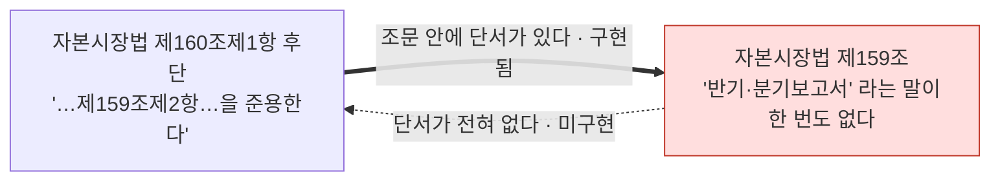

- **사건 14-0342** — 답은 제159조와 제160조 **둘 다**다. 검색이 "임원 개인별 보수"로
  제159조에 먼저 닿으면 제160조로 갈 방법이 없다.
- **사건 16-0072** — 자본시장법 제51조제1항 후단이 "이 경우 제42조를 적용하지
  아니한다"고 한다. 그런데 제42조에는 '투자권유대행'이 한 글자도 없다.
- **사건 11-0345** — 최악이다. 백지 지시다.

```
정보공개법 제9조제1항제1호 — 조문 전문
  "다른 법률 또는 법률에서 위임한 명령(대통령령·조례 등)에 따라
   비밀이나 비공개 사항으로 규정된 정보"
        ↑ 어떤 법률도 이름으로 부르지 않는다

정답인 국세기본법 제81조의13 — '개인정보'라는 낱말이 한 번도 없다
        그 조는 "장부 및 증거서류"만 말한다

  → 어휘 겹침이 0. 키워드 검색도 의미 검색도 못 잡는다.
```

**현재 상태**: 배제·수임은 역방향이 구현돼 있고, **준용 역방향은 없다.**

---

## 4. 회수 — 네 통로를 동시에 돌린다

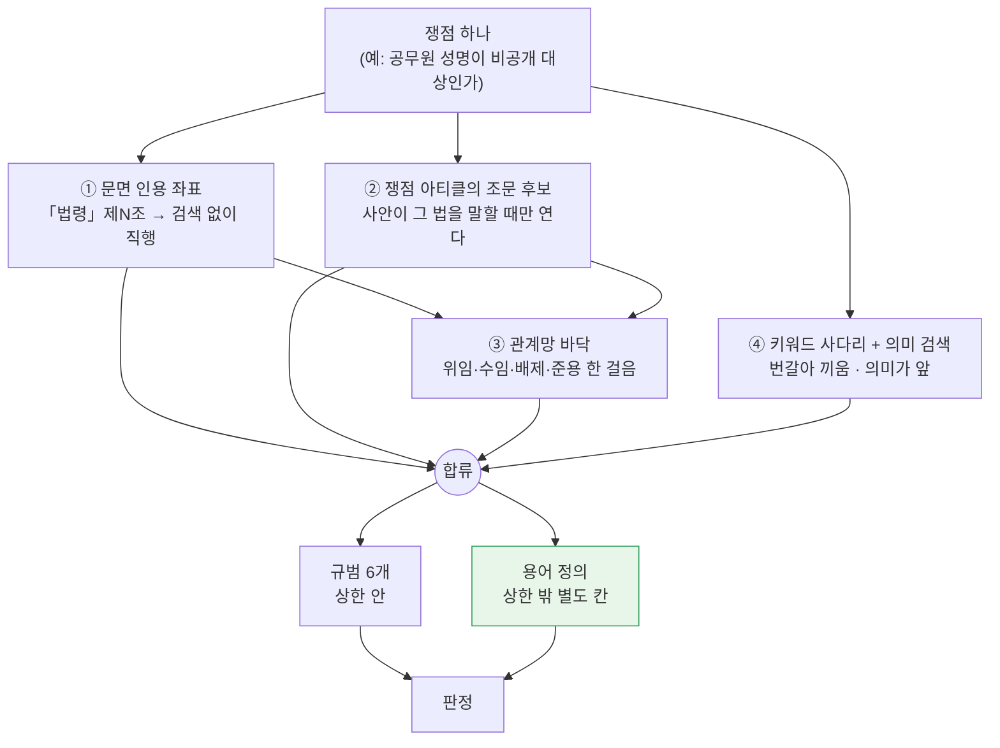

### ① 문면 인용이 있으면 검색을 안 한다

색인값이 조문 제목이라 `「개인정보 보호법」 제17조제1항` 같은 문자열은 검색으로 안
물린다. 그래서 좌표로 **직행**한다.

### ② 쟁점 아티클이 조문 후보를 들고 온다 — 단, 조건부

아티클의 조문 후보는 그 아티클을 컴파일할 때 본 **사례의 좌표**다. 사안이 다르면
무관한 조문이 딸려온다.

```
실패 실물 (사건 06-0131 구어판)
  아티클의 조문 후보에 "「자본시장법」 제47조" 가 있었다
      ↓ 질의에 실림
  "제47조" 라는 조 제목이 엉뚱한 법의 제47조에 정확 일치로 물렸다
      ↓
  정작 필요한 정보공개법은 0건

  → 그래서 "사안이 그 법을 말할 때만" 조건을 걸었다
```

### ③ 관계망 바닥 — §3의 위임·수임·배제·준용

### ④ 키워드와 의미 검색을 **둘 다**

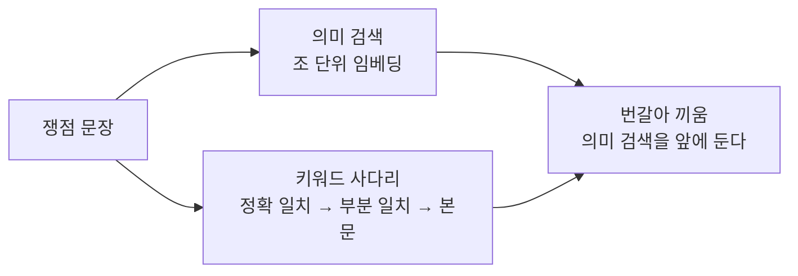

**의미 검색을 앞에 둔 이유** — 옛 사다리는 정확 일치가 하나라도 걸리면 의미 검색을
**아예 안 돌렸다.**

```
주소 없는 질문 41건의 조문 회수율     15%
실패한 33건 대부분의 원인
  "제47조" · "공공기관" · "적용대상" 같은 우연한 조 제목 일치가
  정확 일치 단에 걸려 의미 검색이 한 번도 안 돌았다
의미 검색만 따로 돌리면 정답 조가 1~4위였다

바꾼 뒤
  15%  ███░░░░░░░░░░░░░░░░░
  61%  ████████████░░░░░░░░
```

**의미 검색은 조 단위로 접는다.** 호나 항에 착지해도 그 조로 올린다 — 답이
제9조제1항제5호라도, 판정이 읽으려면 ①항 머리글이 필요하다.

### 통로 밖 — 용어 정의는 별도 칸

용어 정의는 **판단 대상이 아니라 낱말의 뜻**이라 규범 상한(쟁점당 6개) 밖에 싣는다.
상한 안에 넣으면 둘 다 안 됐다.

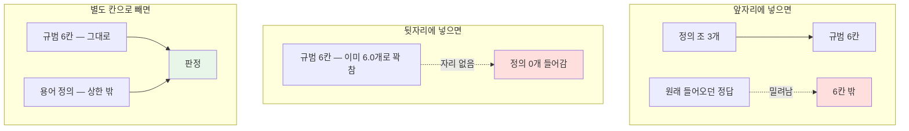

```
앞자리   회수 77% → 73%   (정답을 밀어냄)
뒷자리   효과 0           (쟁점당 6.0개로 꽉 차 하나도 안 들어감)
별도 칸  사건 24-0239 가 0/3 → 3/3 으로 살았다
```

---

## 5. 검토 파이프라인 — 다섯 단계

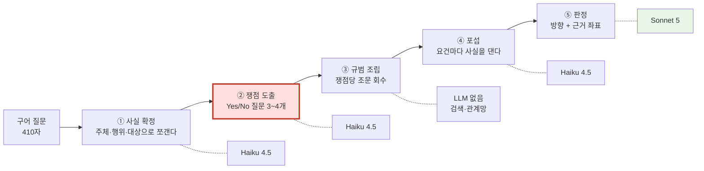

**②가 붉은 이유** — 18%p가 여기서 샌다(→ §7-2). 회수기는 95%인데 쟁점이 틀린 질의를
주면 회수기가 정확히 그 틀린 것을 가져온다.

### 모델 배치의 근거

| 단계 | 모델 | 왜 |
|---|---|---|
| 사실·쟁점·포섭 | Haiku 4.5 | 구조를 뽑는 일. 값이 싸고 빠르다 |
| **판정** | **Sonnet 5** | 같은 입력 5회에 하이쿠는 긍정2·조건부3으로 흔들렸고 소넷5는 5/5 일치 |

### 판정 입력은 자르지 않는다

```
포섭용 요건표      한 조각 260자 / 줄기 400자   ← 요건 대조에는 충분
판정용 마디 전문   자르지 않는다                ← 조 아래 항·호·목 전부

  왜 — 제9조제1항제6호 라목이 답인데 요건표 조각에는 라목이 안 들어간다
```

### 예산과 안정성

```
쟁점  8,000 토큰   ·   포섭  12,000   ·   판정  12,000
클라이언트 타임아웃  120초   (30초에서 올림 — 긴 prefill 을 죽은 연결로 오판했다)
다섯 판 연속 LLM 실패  0건
사건당 평균  60초
```

---

## 6. 골든셋 — 시험지와 자(尺)를 다시 만들었다

### 6-1. 옛 자가 고장나 있었다

정답 조문을 **회답 본문에서 정규식으로 긁는** 방식이었다. 원문 38건을 직접 열어
마킹하며 결함 **여덟**을 찾았다. 그리고 결함이 **양방향**이었다 — 그래서 숫자가
무의미했다.

```
        과대 평가 (실제보다 잘한 것처럼)      과소 평가 (실제보다 못한 것처럼)
        ──────────────────────────────      ──────────────────────────────
        ② 조 단위 희석 — 1/20               ① 시행령을 본법으로 붙임 — 21건
        ③ 전제를 정답으로 셈 — 38/38        ④ 지시 표현 못 읽음
        ⑤ 부칙을 본칙으로 뭉갬              ⑥ 이유를 안 읽음
                                            ⑦ 대조 어구에서 법령명 오염
                                            ⑧ 인용 안 된 근거 누락

        ↑ 이 둘이 동시에 일어나므로 최종 숫자가 높은지 낮은지조차 알 수 없었다
```

**① 시행령을 본법으로 붙였다 — 180건 중 21건**

```
회답 원문
  "「공공기관의 정보공개에 관한 법률」 제13조제1항 및 같은 법 시행령 제14조제2항에 따라…"
                                              └──── 이 두 글자를 못 봤다 ────┘
옛 자가 뽑은 정답
  (정보공개법, 제13조)   ○
  (정보공개법, 제14조)   ✗   ← 있어야 할 것은 (정보공개법 시행령, 제14조)

그런데 정보공개법 본법 제14조는 「부분 공개」다
  → 이 사건(우편 송부에 시행문을 붙여야 하나)과 아무 관계가 없다
  → 시스템이 옳게 답해도 이 항목은 영원히 틀린다
```

**② 조 단위라 20분의 1로 희석됐다**

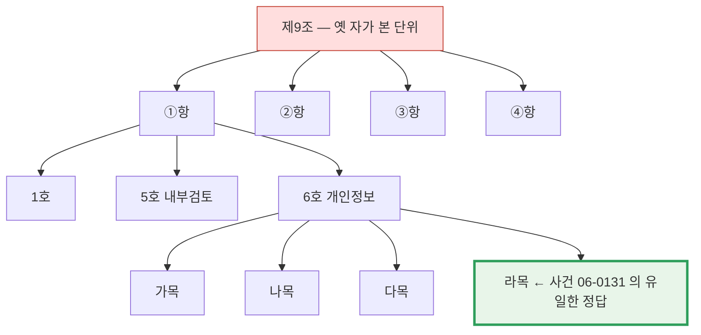

```
사건 06-0131 의 답은  «라. 직무를 수행한 공무원의 성명ㆍ직위»  하나다
제9조 아래 마디는 20개 (항 4 · 호 8 · 목 7)

옛 자는 그중 아무거나 데려와도 만점을 줬다
  제5호(내부검토)를 가져와도 1/1
  제3항을 가져와도 1/1
```

**③ 전제로 인용한 것을 정답으로 셌다 — 마킹 38건 전부**

```
사건 10-0055
  질문   "공개 대상 정보가 아닌 경우, 민원으로 처리할 수 있나요?"
                     └─────────────┬─────────────┘
                      이미 참으로 깔고 들어간 전제
  옛 자의 정답   정보공개법 제2조 (정의)   ← 전제다. 여기서는 답이 갈리지 않는다
  진짜 답        제11조제5항  "…민원으로 처리할 수 있다"
```

**④ 지시 표현을 못 봤다** — "동호"·"동항"·"라목"을 정규식이 못 읽었다

**⑤ 부칙과 본칙을 뭉갰다** — 정보공개법 제2조가 4개(→ §1)

**⑥ 회답만 읽고 이유를 안 읽었다** — 사건 07-0319의 결정 마디 4개가 **전부 이유에만**
있다. 회답은 결론 한두 문장이다.

**⑦ 대조 어구에서 법령명을 긁어 분모를 부풀렸다**

```
이유 원문
  "「민법」 또는 「상법」 외에 다른 개별법에 근거한 법인으로서…"
                          └──┬──┘
                    '아닌 것'을 말하는 어구인데 정답으로 긁혔다

옛 자의 정답 법령    공공기관운영법 · 정보공개법 · 상법
시스템이 회수한 것   공공기관운영법 · 정보공개법
                     → 2/3 (67%) 로 감점

시스템은 실재하는 법령을 다 맞혔다. 자의 오염 때문에 깎였다.
```

**⑧ 회답이 인용 안 한 결정 근거를 놓쳤다** — 사건 08-0442의 공공기관운영법 제2·4조

### 6-2. 시험지 자체가 사건을 바꿔놓았다

구어 변환이 법령 인용만 지운 게 아니라 **쟁점·전제·주체를 함께** 지웠다.

```
23건 전수 조사
  조문 표지 소실   ████████████████████ 23/23 (100%)
  법령명 소실      ████████████████████ 23/23 (100%)
  평균 길이        503자 ──────────────→ 93자   (81% 삭제)
```

**주체가 뒤바뀐 사건 22-0993**

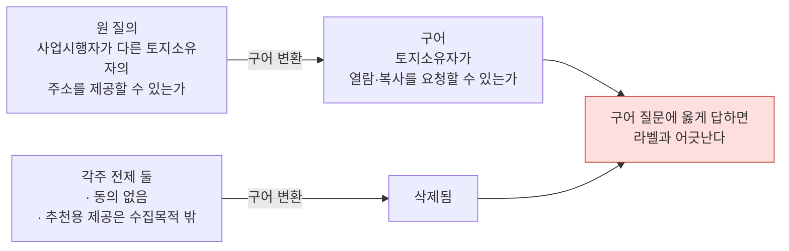

**없는 법을 만든 사건 07-0261**

```
원 질의   "설립근거법이 상법을 준용하도록 한 경우" 의 상법이 '다른 법령' 에 드는가
구어      "임원을 뽑을 때 주주총회 의결이 필요한데, '다른 법령' 에 회사법까지 포함되나요?"
                     └──────────┬──────────┘              └──┬──┘
                   다투던 조건절을 참으로 단정        한국에 「회사법」은 없다(상법이다)
```

**답의 반대말을 심은 사건 19-0473**

```
결정 논거   감사원법의 '요구' 규정은 일반 협조 '요청' 규정과 다른 특별규정이다
                        └─┬─┘                        └─┬─┘
구어 질문   "…요청할 수 있나요"  ←──────────────────────┘
            이 사건의 결론을 가르는 낱말을 반대로 썼다
```

**결론의 근거를 부정한 사건 18-0783**

```
결론의 유일한 근거   지방세외수입금법 제5조제3항은 요청 상대를 '과세자료제출기관' 으로만
                    쓰고 세무관서의 장을 명시하지 않았다  ← 그래서 '부정'
구어 질문           "…세무관서 장한테 받을 수 있나요"
                    ↑ 결론의 근거를 질문이 사실로 깔아버렸다
```

### 6-3. 골든 180건이 못 쓰게 된 나머지 이유

```
180건  전체 해석례
  │
  ├─ 중복 15쌍 제거 ─────────────────────────────────┐
165건  실질                                          │
  │                                                  │
  ├─ 창고 결손 — 인용 법령이 다 있는 것 35% 뿐  ─────┤
  ├─ 시점 충돌 — 마킹 38건 중 82% 가 어긋남    ─────┤  거를 이유
  ├─ 답이 조문 밖 — 판례·선례 필요 58%          ─────┤
  ├─ 두 갈래 물음                                ─────┤
  └─ 구어 파손 74%                               ─────┘
  ↓
 23건  골든 v2 — 원문을 열어 항·호까지 짚은 것
```

**중복 15쌍** — 같은 해석례가 두 안건번호로 등록돼 있다. 질의요지·회답·이유가
글자까지 같다.

```
25-0908 = 25-0970 = 25-0971      24-0962 = 25-0001      24-0804 = 24-0978
24-0527 = 24-0667                24-0239 = 24-0240      23-0013 = 23-0146
22-0333 = 22-0422                20-0446 = 20-0563      18-0261 = 18-0583
18-0265 = 18-0525                18-0370 = 18-0481      15-0641 = 15-0652
15-0648 = 15-0720                14-0438 = 14-0621
```

18-0370은 "3판 내내 틀린 3건"에 올라 있었는데 18-0481과 같은 사건이었다 — **같은
실패를 두 번 센 것이다.**

**창고 결손** — 회답이 인용한 법령이 창고에 전부 있는 사례는 **18/51 (35%)**.
사례당 평균 2.9개를 인용하는데 1.4개가 없다.

```
가장 자주 빠지는 법령
  7회  공공기관의 정보공개에 관한 법률 시행령   ← 정보공개 사건이 가장 많은데 시행령이 없다
  4회  고등교육법 · 정보통신망법
  3회  초·중등교육법 · 정부투자기관관리기본법 · 대한민국헌법
  2회  민원 처리에 관한 법률 · 증권거래법 · 감사원법 · 국가공무원법 · 식품위생법
```

**시점 충돌 82%** — 창고는 현행법, 사례는 과거다.

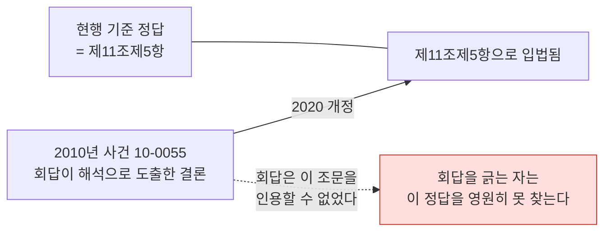

```
사건 14-0342   2014년 회답  "반기·분기 모두 기재"
               2016 개정으로 분기보고서는 제외됨
               → 현행 조문을 옳게 읽으면 회답과 어긋난다
```

**답이 조문에 없는 사례 58%** — 이게 가장 무겁다.

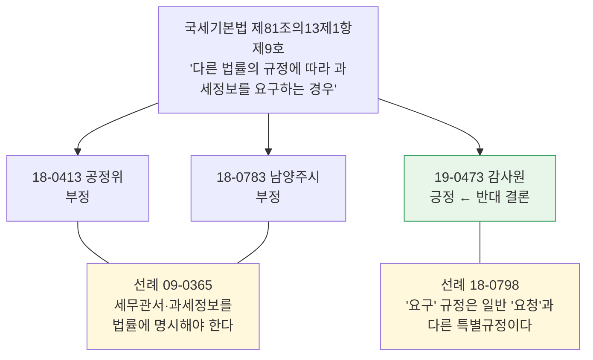

**갈림은 조문 문언이 아니라 법제처 선례가 만든 기준에 있다. 그 기준은 어느 조문에도
적혀 있지 않다.** 지금 시스템은 조문만 주고 이 판단을 요구하고 있다.

### 6-4. 골든 v2 — 23건

```
180건 → (중복 15쌍 제거) → 165건 → (기계 신호로 감점·순위) → 23건

감점 기준 (LLM 안 부름)
  창고결손      -30 /건
  조번호 부재   -12 /건
  구법 표현     -15
  판례 필요     -10
  두 갈래 물음  -10
  연식          -1.5 /년
  조문까지 특정  +6 /건 (최대 +18)
```

각 건을 **원문을 열어 항·호까지** 짚고 구어 질문을 새로 썼다.

| 항목 | 골든 v2 | 옛 골든 |
|---|---|---|
| 정답 출처 | 원문을 열어 짚음 | 회답 정규식 |
| 해상도 | **항·호·목 (마디번호)** | 조(條) |
| 결정 vs 전제 | 가름 | 구분 없음 |
| 부칙 | 구별 | 뭉갬 |
| 구어 | 사실관계로 풀어쓴 **410자** | 81% 삭제된 93자 |
| 중복 | 제거 | 15쌍 포함 |

```
결정 마디 66개 · 사례당 2.9개 · 항·호까지 내려간 것 23/23
방향 분포   부정 15  ███████████████
            긍정 7   ███████
            조건부 1 █
```

### 6-5. 태깅 화면 — 사람과 에이전트가 같은 파일에서 만난다

```
┌─────────────┬──────────────────────────┬─────────────────────┐
│ 후보 목록    │ 사례 원문과 태그          │ 법령 열람            │
│             │                          │                     │
│ ● 06-0131   │ [질의요지]               │ 법령명 ▾            │
│ ● 13-0365   │ [회답]                   │ 제1조 제2조 제9조… │
│ ○ 15-0445   │ [이유] ← 결정 마디는     │  (부칙은 흐리게)    │
│ ● 24-0239   │        대개 여기 있다     │                     │
│             │                          │ 제9조 펼침          │
│ ● 사람       │ 방향  긍정 부정 조건부    │  ①항                │
│ ● 에이전트   │                          │   1호               │
│ ○ 미태그     │ 담은 마디                │   6호               │
│             │  «라. 직무를 수행한…» ×  │    라목 ← 눌러 담음 │
│ 23/60 태그됨 │                          │                     │
└─────────────┴──────────────────────────┴─────────────────────┘
```

가운데에서 **이유를 읽고** 오른쪽에서 **마디를 눌러 담는다**. 담은 것이 결정 마디이고,
전제는 담지 않는다 — **정규식 자가 그 둘을 못 가르는 것이 이 화면이 생긴 이유다.**

---

## 7. 골든 v2 실물 두 건 — 한 사건이 시스템을 통과하는 길

### 사건 06-0131 — 항·호 정밀도의 증거 (성공 사례)

**원 질의요지**

> 교육장이 작성한 공문서에 관하여 공개청구된 경우 당해 공문서의 성립과정에 참여한
> 공무원의 성명이 기재되어 있어 개인의 사생활을 침해할 우려가 있다는 이유로 당해
> 공문서가 「공공기관의 정보공개에 관한 법률」 제9조제1항제6호의 비공개대상정보에
> 해당한다고 볼 수 있는지 여부

**옛 구어 (86자 — 질의요지의 57%)**

> 교육장이 작성한 공문서를 공개해달라고 요청했는데, 그 문서에 공무원들의 이름이 적혀
> 있어서 개인 사생활이 침해될 수 있다는 이유로 공개를 거절해도 되나요?

**새 구어 (324자)**

> 교육지원청에서 교육장 이름으로 나간 공문서를 공개해 달라는 청구가 들어왔습니다.
> 그 문서에는 기안한 담당 직원부터 중간에 검토한 사람, 결재한 사람까지 성립 과정에
> 관여한 공무원들의 직위와 이름이 그대로 남아 있습니다. 내부에서는 이름이 드러나면
> 그 사람들의 사생활이 침해될 우려가 있으니 개인에 관한 정보라는 이유로 공개하지
> 않아도 되는 것 아니냐는 의견이 있고, 그렇게까지 볼 일은 아니라는 반론도 있어
> 정리가 되지 않습니다. 공문서 작성 과정에 참여한 공무원의 성명이 적혀 있다는
> 이유만으로 그 공문서를 사생활 침해 우려가 있는 비공개 대상으로 볼 수 있는지
> 알고 싶습니다.

법령명과 조번호는 없는데 **사실관계와 다투는 지점은 온전하다.** 그래서 검색 실력을
재는 시험지 역할이 유지된다.

**정답 마디 — 하나**

```
마디 [50]   정보공개법 제9조제1항제6호 라목
            «라. 직무를 수행한 공무원의 성명ㆍ직위»

왜 이것이 답을 가르나
  제6호 본문은 개인정보를 비공개 사유로 둔다. 그런데 이 한 목이 "직무를 수행한
  공무원의 성명·직위" 를 그 사유에서 명시적으로 빼 놓았다.
  라목이 없으면 기안·검토·결재 공무원의 성명은 사생활 침해 우려로 비공개가 되고
  답이 정반대로 뒤집힌다.

방향: 부정 (공개를 거절할 수 없다)

전제로 분류해 담지 않은 것
  제9조제1항 본문   공개 원칙과 예외 구조
  제6호 본문       성명 등 개인정보로서 사생활 침해 우려
                   ← 질문이 이미 참으로 깔고 들어간다
```

**실제 통과 기록 (run6)**

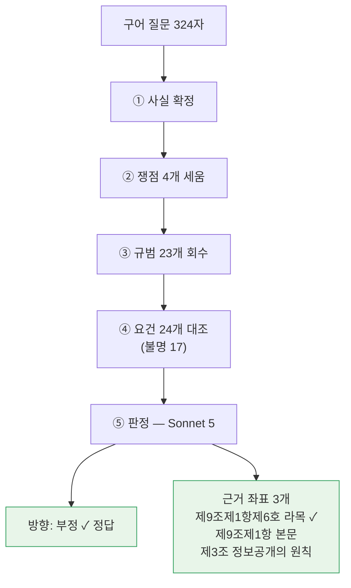

```
회수  1/1   정답 마디 [50] 라목이 회수 구역에 들어왔다
근거  1/1   판정이 «제9조제1항제6호 라목: 직무를 수행한 공무원의 성명·직위» 를 짚었다
방향  부정  ✓ 정답
53.4초
```

**20개 마디 중 하나를 정확히 짚었다.** 옛 자로는 이 정밀도가 보이지 않았다.

### 사건 13-0365 — 정답이 부칙에 있는 사건

**옛 구어 (113자)**

> 정부에서 물건을 사거나 공사를 맡길 때, 입찰 공고는 2013년 6월 19일 전에 했는데
> 계약을 맺은 건 그 이후라면, 이의신청 후 불만이 생겼을 때 분쟁조정위원회에 다시
> 심사해달라고 청구할 수 있나요?

무엇이 사라졌나:

```
법령명            「국가를 당사자로 하는 계약에 관한 법률」 → "정부에서 물건을 사거나"
결정적 구분        국내 경쟁입찰 → 명시 안 됨   ← 수의계약이면 답이 뒤집힌다
쟁점 신호          부칙·적용례·경과조치 어느 낱말도 없음
```

**새 구어 (409자)**

> 정부 발주 사업 입찰에 참가했다가 떨어진 업체입니다. 2013년 6월 19일자로 국가계약법이
> 바뀌면서 낙찰 과정에 불이익을 받은 사람이 이의신청을 하고, 그 조치에 다시 불복해서
> 국가계약분쟁조정위원회에 재심을 청구할 수 있는 범위가 넓어졌다고 들었습니다.
> 그런데 저희가 참가한 건 **국내 경쟁입찰**이고, 입찰 공고는 그 시행일 전에 났는데
> 계약 체결은 시행일이 지난 뒤에 이뤄졌습니다. **개정법 부칙의 적용례**를 보면
> '개정규정 시행 후 최초로 입찰 공고되거나 체결된 계약부터 적용한다'고만 적혀 있어서,
> 공고를 기준으로 보면 저희는 해당이 안 되고 체결을 기준으로 보면 해당이 됩니다.
> 문언 그대로 둘 중 하나만 시행일 뒤면 되는 것으로 읽어서, 저희처럼 공고는 전이지만
> 체결이 후인 경우에도 바뀐 규정에 따라 재심을 청구할 수 있나요?

**정답 마디 — 넷 중 셋이 부칙**

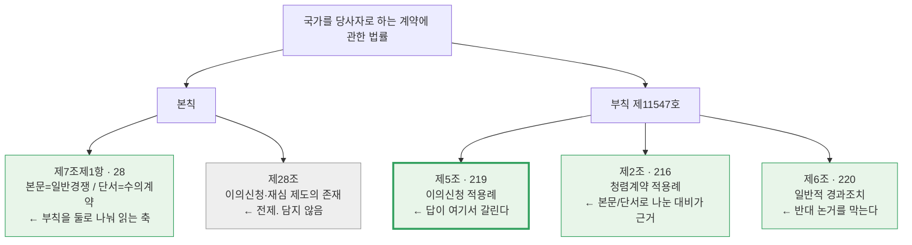

```
마디 [219]  부칙 제5조 (이의신청 등에 관한 적용례)
            «제28조제1항ㆍ제4항 및 제29조제1항의 개정규정은 같은 개정규정 시행 후
              최초로 입찰 공고되거나 체결된 계약부터 적용한다»
            ↳ 재심 청구 가능 여부가 오직 이 적용례의 시점 기준(공고냐 체결이냐)에서 갈린다

마디 [216]  부칙 제2조 (청렴계약에 관한 적용례)
            «제5조의2의 개정규정은 같은 개정규정 시행 후 최초로 입찰 공고 또는
              통지되는 입찰부터… 다만 수의계약은 최초 체결 계약부터»
            ↳ 같은 부칙이 본문=경쟁입찰(공고 기준) · 단서=수의계약(체결 기준) 으로
              명시적으로 나눈 대비. 문언이 뭉뚱그려진 제5조도 같은 취지로 나눠 읽는다

마디 [220]  부칙 제6조 (일반적 경과조치)
            «이 법 시행 전에 입찰 공고되거나 체결된 계약에 대하여는 종전의 규정에 따른다»
            ↳ "권리구제 사각지대가 생기니 넓게 읽어야 한다" 는 반대 논거를 막는다

마디  [28]  본칙 제7조제1항
            «각 중앙관서의 장 또는 계약담당공무원은 계약을 체결하려면 일반경쟁에
              부쳐야 한다. 다만…»
            ↳ 본문(경쟁입찰)과 단서(수의계약)의 구분이 부칙 적용례를 둘로 나눠 읽는 축

방향: 부정 (재심을 청구할 수 없다)

전제로 분류한 것
  본칙 제28조 — 이의신청·재심 제도의 존재를 말할 뿐 시점 판단을 하지 않는다
```

**옛 자가 정답이라 부른 것은 본칙 제28조 하나였다.**

```
시스템이 본칙 제28조만 회수하면    옛 자로는 만점 (1/1)    새 자로는 0점 (0/4)
```

**실제 통과 기록 (run6)**

```
회수  3/4   부칙 셋 다 회수 ○ · 본칙 제7조제1항만 ✗
근거  3/4   판정이 부칙 제5조·제6조·제2조 단서를 모두 짚었다
방향  부정  ✓ 정답
54.4초

판정이 실제로 쓴 좌표
  "국가를 당사자로 하는 계약에 관한 법률 부칙 <제11547호> 제5조(이의신청 등에 관한 적용례)"
  "…부칙 <제11547호> 제6조(일반적 경과조치)"
  "…부칙 <제11547호> 제2조(청렴계약에 관한 적용례) 단서"
                                                   ↑ 단서까지 짚었다
```

---

## 8. 벤치마크 — 병목이 회수기가 아님을 밝혔다

### 8-1. 두 잣대로 나눠 잰다

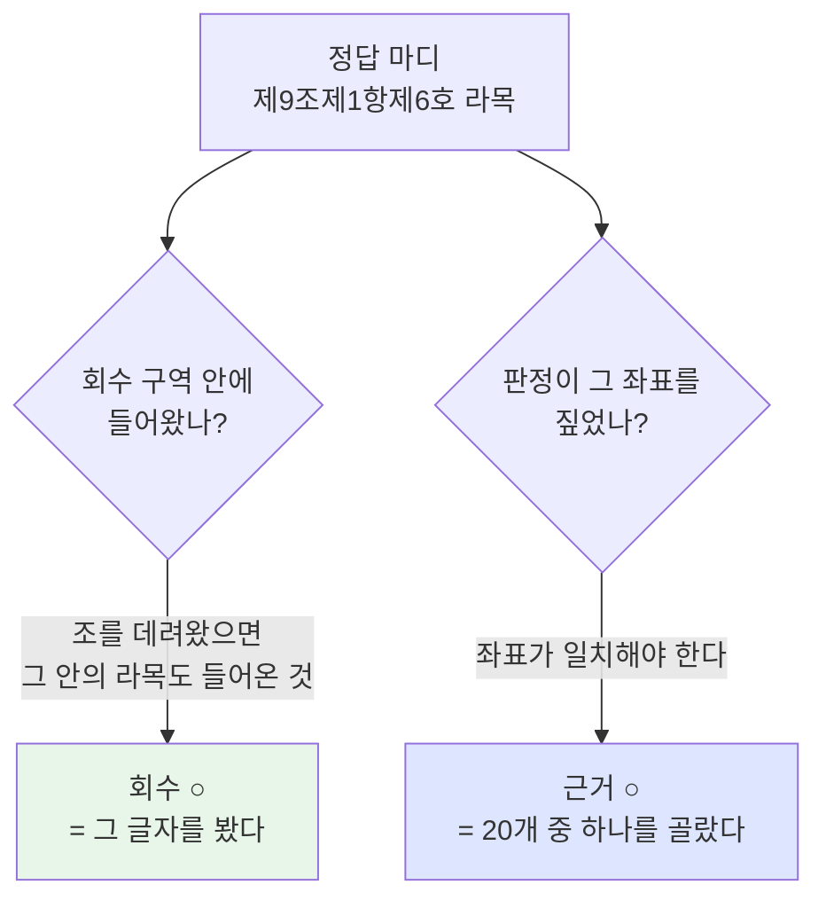

| 잣대 | 무엇을 묻나 | 왜 그 기준인가 |
|---|---|---|
| **회수** | 정답 마디가 회수 구역 **안에** 들어왔나 | 조 단위로 데려와도 라목 텍스트는 실제로 들어온다. "그 글자를 봤나"를 묻는 것이므로 포함이 맞다 |
| **근거** | 판정이 **그 항·호를 짚었나** | 06-0131의 답은 20개 마디 중 하나 — 여기서만 진짜 정밀도가 드러난다 |

### 8-2. 결정적 측정 — 쟁점을 고정하면 95%

쟁점 도출을 건너뛰고 **회수기만** 재는 시험을 만들었다. 정답 마디가 속한 조의
제목·본문 앞머리를 질의로 넣는다. LLM을 안 부르므로 요동이 0이다.

```
회수 단독  (쟁점 고정 · LLM 없음)   ███████████████████░  95%   63/66
파이프라인 (쟁점을 LLM이 만듦)      ███████████████░░░░░  77%   51/66
                                                  └───┬───┘
                                          18%p — 전부 쟁점 도출에서 샌다
```


### 8-3. 직접 증명 — 같은 회수기, 질의만 바꿈

사건 24-0239는 파이프라인에서 **0/3**으로 통째 실패했다. 같은 회수기에 질의만 바꿔
세 번 넣었다.

| 넣은 질의 | 결과 | 데려온 조 |
|---|---|---|
| "공시대상기업집단에 속하는 회사의 부당한 이익제공 금지" | **성공 ○** | **제47조**(특수관계인 부당이익제공 금지) · 제54조 · 제17조 · 제45조 |
| "공시 대상 기업집단의 이익제공" | 실패 ✗ | 시행령 제38조(공시대상기업집단 지정) · 제4조 · 제35조 |
| "공시대상기업집단 기업집단현황 공시 의무" ← **시스템이 실제로 간 길** | 실패 ✗ | 제35조(현황 공개) · 제28조(기업집단현황 공시) · 시행령 제35조 |

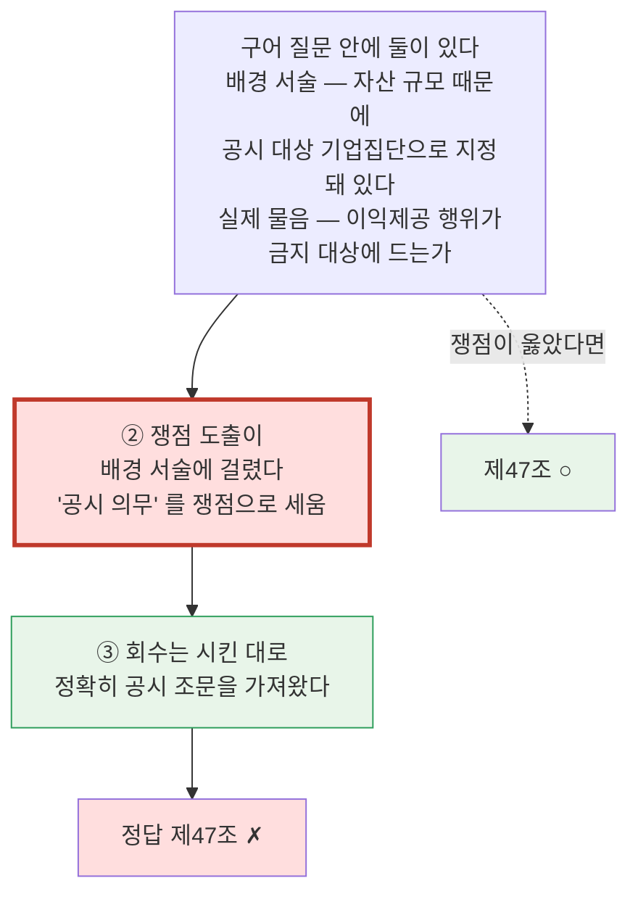

`공시대상기업집단`은 **법률용어 한 낱말**이다. 쟁점 도출이 그것을 "공시"로 쪼개
읽었다.

> **회수는 시킨 대로 정확히 공시 조문을 가져왔다. 주문이 틀렸다.**

### 8-4. 전체 지표 (골든 v2 23건 · 결정 마디 66개)

| 실행 | 회수 | 근거 | 방향 | 무엇 |
|---|---|---|---|---|
| run1 | 51/66 (77%) | 44/66 (67%) | 18/23 (78%) | 기준선 |
| run5 | 50/66 (76%) | 42/66 (64%) | 18/23 (78%) | 정의 칸 분리 + 쟁점 규율 추가 |
| run6 | 51/66 (77%) | 45/66 (68%) | 17/23 (74%) | run5 재현 |

```
회수  ███████████████░░░░░ 77%
근거  █████████████░░░░░░░ 68%   ← 회수한 것의 86% 는 실제로 인용된다
방향  ███████████████░░░░░ 74~78%
```

같은 코드 두 판의 폭 = **1개**. 겨냥한 사건은 양판 모두 개선됐다:

```
17-0387   2/3 → 3/3
15-0774   3/4 → 4/4
24-0239   0/3 → 3/3 · 2/3    ← 정의 칸 분리 효과
```

그런데 총량은 상쇄됐다. **노이즈 폭 안이므로 개선을 주장하지 않는다**(→ §9).

### 8-5. 남은 회수 실패 3개 — 조문의 성질 때문

```
18-0124   개인정보보호법 제18조제2항제2호
          «2. 다른 법률에 특별한 규정이 있는 경우»
          ← 본문이 12자. 다른 법을 가리키는 것 말고 내용이 없다

15-0445   정보공개법 제2조제3호다목
          «다. 「공공기관의 운영에 관한 법률」 제2조에 따른 공공기관»
          ← 타법 지시뿐이다

15-0774   신용정보법 제15조제2항 (동의 규정)
```

앞의 둘은 **그 마디만으로는 질의를 만들 수 없다.** 회수기의 한계가 아니다.

---

## 9. 이 시스템을 재는 법 — 노이즈를 먼저 잰다

파이프라인이 **최상류에서** 흔들린다. 쟁점 도출이 LLM이라 같은 입력에도 다르게 나온다.

```
같은 사실에서 쟁점 수가 같은 비율      21/51 (41%)

  쟁점 수 차이 분포 (같은 코드 두 판)
    -2  ████ 4건
    -1  █████████████ 13건
     0  █████████████████████ 21건
    +1  ██████████ 10건
    +2  ███ 3건

같은 코드 두 판의 사건 단위 판정 일치   39/51 (76%)  →  24% 가 뒤집힌다
항·호 66마디 셋의 회수 폭              1~2개
```

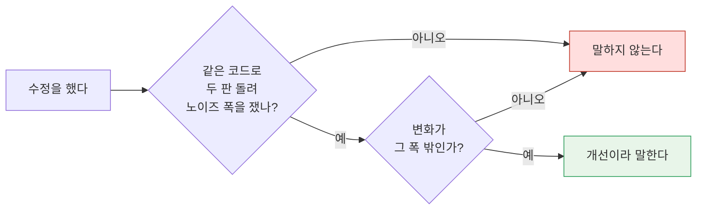

**이 규칙 없이 한 판만 보고 내린 진단 셋이 전부 틀렸다.** 사건 하나로 원인을 짚지
않는다.

### 되돌린 수정 다섯 — 실패 기록

| 수정 | 결과 | 왜 실패했나 |
|---|---|---|
| 요건 대조 입력 확대 (요건 240→321개) | 되돌림 | 재료를 4배 넣었는데 판정이 안 따라옴. 근거는 오히려 나빠짐 (과잉 1→4) |
| 이유 본문까지 읽어 정답 추출 | 되돌림 | 재현 31→71% 인데 **정밀도 85→32%**. 이유는 전제·배경도 잔뜩 인용한다 |
| 이웃 조·정의 조를 앞자리에 | 되돌림 | 상한 6 밖으로 정답을 밀어냄 (77→73%) |
| 이웃 조·정의 조를 뒷자리에 | 되돌림 | 쟁점당 6.0개로 꽉 차 하나도 안 들어감 (효과 0) |
| 질의에 쪼개진 용어의 원문 표기를 덧붙임 | 되돌림 | **배경 용어를 증폭해 판별 낱말을 묻음** |

마지막 것의 실패가 가장 많이 재사용될 것 같다.

```
의도   쟁점이 '공시대상기업집단' 을 쪼개 읽으니, 원문 표기를 질의에 보태 주자
결과   그 용어가 든 '공시' 계열 조문이 상위로 올라와 정답을 더 밀어냈다
       온전한 질의에서도 정답이 1순위에서 밀렸다

교훈   무엇이 배경이고 무엇이 판별인지는 질의 밖에서 알 수 없다
       → 질의 후처리로는 못 고친다. 쟁점이 처음부터 옳게 써야 한다.
```

---

## 10. 다음 — 우선순위

```mermaid
flowchart TB
  P1["1 · 쟁점 도출을 재는 자<br/>회수는 95%. 18%p 를 잃는 곳이<br/>쟁점인데 그걸 재는 자가 없다"]
  P2["2 · 해석례를 회수 대상에<br/>답이 조문 밖인 사례 58%<br/>180건이 이미 창고에 있다"]
  P3["3 · 준용 역방향 색인<br/>배제·수임은 있고 준용만 없다"]
  P4["4 · 법령 수집<br/>42개 문서로는 골든 76% 결손<br/>1위 = 정보공개법 시행령"]
  P1 --> P2 --> P3 --> P4
  X["회수기는 그만 만진다<br/>95% 인 것을 여섯 번 고치려 했다"]
  style P1 fill:#ffdede,stroke:#c0392b,stroke-width:3px
  style X fill:#eeeeee,stroke:#999
```

**1. 쟁점 도출을 재는 자.** 회수 벤치와 같은 방식으로 "사실을 고정하고, 쟁점이 정답
조문에 닿는 질의를 만들었나"를 결정론으로 재야 한다. 지금은 이 단계가 유일하게
측정되지 않은 곳이다.

**2. 해석례를 회수 대상에 넣기.** 마킹 38건 중 58%가 답이 조문 밖(판례·선례)에 있다.
법제처 유권해석 180건이 이미 불변층에 있는데 회수 대상이 아니다. 이게 되면 판정이
기댈 기준이 생긴다 — 지금은 조문만 주고 "같은 조문, 반대 결론"을 요구하고 있다.

**3. 준용 역방향 색인** (→ §3).

**4. 법령 수집.** 골든을 키우려면 재료가 먼저다.

---

## 부록 A — 무엇이 어디까지 왔나

| 항목 | 상태 |
|---|---|
| 법령 구조화 (항·호·목 트리) | ✅ 42문서 66,942마디 |
| 관계망 (위임·수임·배제·준용) | ✅ 27,318간선 · **준용 역방향만 미구현** |
| 네 통로 회수 | ✅ **단독 95%** |
| 용어 정의 별도 칸 | ✅ |
| 5단계 검토 | ✅ 평균 60초 |
| 항·호 단위 채점 | ✅ 정답 23건을 사람이 짚음 |
| **쟁점 도출 측정** | ❌ **없음 — 여기서 18%p 손실** |
| 해석례 회수 | ❌ 창고에 있으나 회수 안 함 |
| 창고 완비 | ❌ 골든 180건 기준 76% 결손 |

## 부록 B — 실행

```bash
# 골든 v2 (23건, 항·호 정본, 새 구어)
python scripts/review_golden.py --golden2 --out data/review/X.json

# 회수 단독 벤치 (LLM 없음, 약 2분)
python scripts/retr_bench.py
python scripts/retr_bench.py --case 19-0152 -v

# 후보 선별 (LLM 없음)
python scripts/golden_pick.py --top 30

# 법령을 항·호·목까지 펴 보기 (마디번호가 붙는다)
python scripts/lawlook.py --law "개인정보 보호법" --jo 제18조 --depth 4
python scripts/lawlook.py --case 24-0239

# 태깅 화면 — 사람이 직접 항·호를 짚는다
scripts/serve.sh   →   http://localhost:5566/golden/
```
